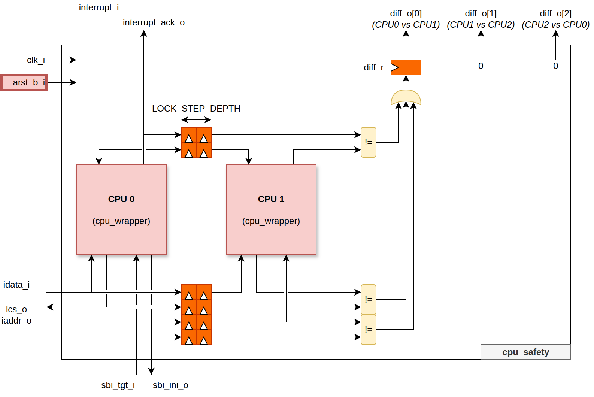
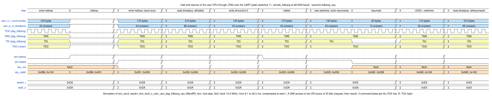

<!--
  README MODEL (common to every Asylum IP, keep the same headings)
  ----------------------------------------------------------------
  Regenerate from the sources, never from the previous README text alone:
    hdl/*.vhd (entities, generics, ports), <IP>.core (VLNV, targets, depends),
    mk/targets.txt, sim/, esw/, boards/, doc/.
  Sections, in this order (variant of a SoC: Memory Map instead of Registers):
    badges / title + one-line pitch / Overview / Features / Block Diagram /
    Getting Started / Hardware Interfaces / Configuration / Memory Map /
    Resources / Theory of Operation / Programmer's Guide /
    Design Verification / Dependencies and Related IPs / License
  Rules:
    - English, short and factual: every statement backed by the sources.
    - No VLNV line: the version badge shows it.
    - Badges: first line version, license; second line CI, lint, sim, syn.
    - Block diagram: doc/picosoc.drawio (owner's diagram, pages overview,
      cpu_safety-lock_step, cpu_safety-TMR), exported to doc/picosoc-<page>.png
      (make -C doc); the root README of asylum-project links doc/picosoc-overview.png.
    - A SoC README may name its CPUs.
    - Memory Map: link to the generated <X>_csr.md of each peripheral, never copy
      the register tables.
    - Tables: Configuration = Name|Type|Default|Description,
      Hardware Interfaces = Name|Direction|Type|Description, grouped by interface.
-->
[](https://github.com/deuskane/asylum-soc-picosoc/tags)
[](LICENSE)

[](https://github.com/deuskane/asylum-soc-picosoc/actions/workflows/ci.yml)
[](https://github.com/deuskane/asylum-soc-picosoc/actions/workflows/ci.yml)
[](https://github.com/deuskane/asylum-soc-picosoc/actions/workflows/ci.yml)
[](https://github.com/deuskane/asylum-soc-picosoc/actions/workflows/ci.yml)

# PicoSoC

**A small SoC in VHDL around OpenBlaze8 or WardRV CPUs: switches, LEDs, UART, SPI, I2C, PWM, GIC, timer, CRC, spinlock, mailbox and RAMs, with multi-core, lock-step / TMR safety, a supervisor and JTAG debug, programmed in C.**

Part of the [Asylum project](https://github.com/deuskane/asylum-project), a collection of small IP cores, written to be read and learned from.

## Table of Contents

1. [Overview](#overview)
2. [Features](#features)
3. [Block Diagram](#block-diagram)
4. [Getting Started](#getting-started)
5. [Hardware Interfaces](#hardware-interfaces)
6. [Configuration](#configuration)
7. [Memory Map](#memory-map)
8. [Resources](#resources)
9. [Theory of Operation](#theory-of-operation)
10. [Programmer's Guide](#programmers-guide)
11. [Design Verification](#design-verification)
12. [Dependencies and Related IPs](#dependencies-and-related-ips)
13. [License](#license)

## Overview

PicoSoC is the reference system of the Asylum project: it connects the Asylum IPs around a CPU and runs C firmware on them. The CPU is chosen at build time with `CPU_MODEL`: `OpenBlaze8` (8-bit, a PicoBlaze-3 clone) or `WardRV_fsm` (RV32I). Every peripheral sits on the SBI bus (the simple bus of Asylum: 8-bit address, 8-bit data).

The SoC has two parts:

- the **user SoC** (`PicoSoC_user`): 1 to `USER_NB_CPU` CPU clusters (CPU, program ROM, local interconnect, GIC and RAM) sharing the peripherals through a global interconnect;
- the **supervisor SoC** (`PicoSoC_supervisor`, optional): one CPU that watches the differences between the redundant user CPUs (lock-step or TMR) and resets the user SoC on an error.

The top level `PicoSoC_top` adds the board side: reset resynchronization, clock divider, input polarities, the pads (`PicoSoC_pads`: SPI, I2C, and the UART pads shared by the user UART, the UART of the logic analyzer, the JTAG pins of the JTAG chain and JTAG over the UART, selected by `debug_mux_sel_i`), with `DEBUG_ENABLE` a logic analyzer (HWLA) on the bus of the user CPU and a JTAG TAP of fault injection and status. The JTAG chain also goes through the user and supervisor SoCs, where the WardRV CPUs can have their RISC-V debug unit (in `cpu_wrapper`). The firmware in [esw/](esw/) is compiled by FuseSoC generators into the ROMs at build time; the targets run it on GHDL testbenches or on a NanoXplore NG-MEDIUM board.

## Features

- CPU per build: `OpenBlaze8` or `WardRV_fsm` (`cpu_wrapper`), same SoC and same C drivers
- Multi-core user SoC: `USER_NB_CPU` clusters, each with its own ROM, GIC and local RAM; `mhartid` = cluster index (WardRV); spinlock, mailbox and shared RAM for the inter-CPU communication
- CPU safety (`cpu_safety`): `none`, `lock-step` (CPU1 runs `USER_LOCK_STEP_DEPTH` cycles after CPU0 and is compared with it) or `tmr` (3 CPUs, majority vote); sticky difference flags
- Fault injection: one instruction bit of each redundant CPU flipped from a pin (`inject_error_i`)
- Supervisor SoC: resets the user SoC on a difference and counts the errors on `led_diff_o`; with TMR, a first error is only masked
- Peripherals: switches and 2 LED banks (`sbi_GPIO_irq`), UART with CTS/RTS, SPI master with pads, I2C master and slave with open-drain pads, PWM output, GIC, timer, CRC16 (Modbus polynomial), spinlock, mailbox, RAMs
- Interrupts: user button (`it_user_i`, resynchronized in the GIC), UART, timer, mailbox "data available", switch edges
- Firmware in C (and one assembler example): switch / LED identity, full peripheral test with UART output, Modbus RTU server, multi-core hello with spinlock, supervisor
- Debug (`DEBUG_ENABLE`): HWLA logic analyzer on the bus of the user CPU, triggered by a difference of the redundant CPUs, captures sent on `debug_uart_tx_o` (UART, `HWLA_BAUD_RATE`, 115200 baud by default); JTAG TAP of fault injection (ORed with `inject_error_i`) and status (LEDs, switches, resets)
- UART pads shared by 4 functions (`jtag_pad_mux` of [asylum-debug-jtag](https://github.com/deuskane/asylum-debug-jtag)), selected by `debug_mux_sel_i`: user UART, UART of the HWLA, JTAG chain on the JTAG pinout of an FTDI MPSSE cable (FT232H / FT2232H: one cable is the UART and the JTAG probe), JTAG over the UART (`jtag_bitbang`: OpenOCD `remote_bitbang` through any USB-UART cable, `JTAG_BAUD_RATE`)
- JTAG chain: RISC-V debug units (`WardRV_debug` in `cpu_wrapper`, Debug Specification 1.0, for OpenOCD + GDB) of the user CPUs (one TAP per cluster, `USER_CPU_DEBUG_ENABLE`) and of the supervisor CPU (`SUPERVISOR_CPU_DEBUG_ENABLE`), then the injection / status TAP; the JTAG pins reach every redundant copy of the CPU, whose TDO is compared or voted; an OpenBlaze8 (or a CPU without debug unit) is a wire in the chain (TDO = TDI)
- Self-checking UVVM testbenches driven by the firmware, with an SPI flash model, and NG-MEDIUM board targets

## Block Diagram


Supervisor SoC (top) and user SoC (bottom) with their address maps. The dashed box is the CPU cluster, replicated `USER_NB_CPU` times; ICN2 and the peripherals are shared. The `led0_o` GPIO of the supervisor is the reset of the user SoC, the three difference flags of the user CPUs are the supervisor GIC inputs. Source: [doc/picosoc.drawio](doc/picosoc.drawio), pages `overview`, `cpu_safety-lock_step` and `cpu_safety-TMR` (see [CPU safety](#cpu-safety)).

`PicoSoC_top` (not drawn on this page) takes its clock and resets from `PicoSoC_clkrst` (resynchronization of `arst_i`, division of `clk_i` by `FSYS/FSYS_INT`), inverts `it_user_i` / `inject_error_i` when they are active low (`active_high` of `PicoSoC_pkg`), puts IO buffers on the SPI and I2C signals (`PicoSoC_pads`) and, with `DEBUG_ENABLE`, instantiates the HWLA and its UART (`PicoSoC_hwla`, see [Debug: HWLA](#debug-hwla)).


Page `jtag` of the same file: the UART pads and their multiplexer (`PicoSoC_pads`), and the JTAG chain of `PicoSoC_top` (see [UART pads and JTAG](#uart-pads-and-jtag)).

## Getting Started

The cores of the Asylum IPs are published in the FuseSoC library [asylum-cores](https://github.com/deuskane/asylum-cores) (with UVVM and the flash models used by the testbenches). The firmware is compiled at the setup of each target by the generators of [asylum-utils-generators](https://github.com/deuskane/asylum-utils-generators): `pbcc_gen` (SDCC with the PicoBlaze back-end and picoasm) for OpenBlaze8, `rvcc_gen` (`riscv64-unknown-elf-gcc`) for WardRV. GHDL, FuseSoC, UVVM, Yosys and both toolchains are in the [asylum-env](https://github.com/deuskane/asylum-ci) image used by the CI.

### Simulation

```bash
pip install fusesoc
fusesoc library add https://github.com/deuskane/asylum-cores
fusesoc run --target sim_soc1_wardrv_fsm_c_user_uart asylum:soc:PicoSoC   # GHDL + RISC-V toolchain
```

From a clone of [asylum-project](https://github.com/deuskane/asylum-project), in `ip/asylum-soc-picosoc`: `make help`, `make sim_soc3_openblaze8_fault_c_user`, `make nonreg_sim` (see [How to Run](#how-to-run)).

### Firmware

A target names its firmware with its `generate` entries (see [PicoSoC.core](PicoSoC.core)): for example `gen_rv32i_user_c_uart_921600` compiles [esw/user.c](esw/user.c) with `-DHAVE_UART -DCLOCK_FREQ=12500000 -DBAUD_RATE=921600` into the entity `ROM_user`, and `gen_rv32i_supervisor_c_tmr` compiles [esw/supervisor.c](esw/supervisor.c) with `-DSAFETY_TMR` into `ROM_supervisor`. To run another program, add a generator entry with its file and flags and a target that uses it. `CLOCK_FREQ` and `BAUD_RATE` of the firmware must match `FSYS_INT` and `USER_BAUD_RATE` of the target. The [integration firmwares](#integration-firmwares) `esw/test_<ip>.c` are short examples of each peripheral driven from C.

### Board

The `emu_ng_medium_*` targets build the SoC for the NanoXplore NG-MEDIUM kit (DK625V0) with NXmap and program it (`program: True`); pads in [boards/NanoXplore-DK625V0/pads.py](boards/NanoXplore-DK625V0/pads.py): 25 MHz clock, 4 user switches (S1 to S4, `USER_NB_SWITCH = 4`) and 2 switches for `debug_mux_sel_i` (S5, S6), push buttons on `arst_i`, `it_user_i` and `inject_error_i` (active low), 8 + 8 + 3 LEDs, UART, SPI flash (`USER_SPI_NB_IO = 2`), I2C (`i2c_scl_io`, `i2c_sda_io`, weak pull-ups of the pads) and `pwm_o` on spare pads of Bank0, `debug_uart_tx_o` on `IOB5_D05P`, the 4 UART pads on Bank5 (weak pull-ups on TDI and TMS, pull-down on CTS*: see [UART pads and JTAG](#uart-pads-and-jtag)). The `emu_ng_medium_*` targets set `DEBUG_ENABLE = false` (no HWLA, `debug_uart_tx_o` at `'1'`, no injection / status TAP): set it to `true` in a target to get the captures of the HWLA and the injection / status TAP. `emu_ng_medium_soc1_wardrv_fsm` has the debugger of the user CPU (`USER_CPU_DEBUG_ENABLE = true`, the only TAP of its JTAG chain, IDCODE `0x10001001`): OpenOCD + GDB through the UART pads with `debug_mux_sel_i` `10` (FTDI cable) or `11` (any USB-UART cable, 115200 baud; see [UART pads and JTAG](#uart-pads-and-jtag)); the other targets have no TAP (the JTAG mode of the UART pads drives no pad).

**Switches of the board:** S1 to S4 are the user switches (`switch_i`); S6 and S5 are `debug_mux_sel_i(1 downto 0)`, the function of the UART pads: `00` user UART, `01` UART of the HWLA, `10` JTAG, `11` JTAG over the UART. [esw/user.c](esw/user.c) prints a loop line at every iteration of its main loop: the banner, the echo and the loop lines reach the user UART with `00`. The Basys1 pad file ([boards/Digilent-Basys1/pads.ucf](boards/Digilent-Basys1/pads.ucf)) has no pin for the UART, SPI, I2C and PWM, nor for `debug_mux_sel_i`. NXmap is not in the asylum-env image: these targets are not run by the CI.

```bash
make emu_ng_medium_soc4_wardrv_fsm_fault      # TOOL=nxmap (mk/defs.mk)
```

[tools/modbus_server.py](tools/modbus_server.py) and [tools/modbus_server_debug.py](tools/modbus_server_debug.py) talk to the Modbus firmware on the board through the serial port.

To use PicoSoC in another design, instantiate `PicoSoC_top` (library `asylum`, component in `asylum.PicoSoC_pkg`) and generate the two ROMs as the targets do (`ROM_user_pkg` is used by `PicoSoC_pkg`):

```vhdl
library asylum;
use     asylum.PicoSoC_pkg.all;

  ins_soc : PicoSoC_top
    generic map
    (FSYS                 => 25_000_000
    ,FSYS_INT             => 12_500_000
    ,CPU_MODEL            => "WardRV_fsm"
    ,USER_BAUD_RATE       => 9600
    ,USER_SAFETY          => "tmr"
    ,USER_FAULT_INJECTION => true
    ,SUPERVISOR           => true
    )
    port map
    (clk_i            => clk
    ,arst_i           => arst_b
    ,switch_i         => switch
    ,led0_o           => led0
    ,led1_o           => led1
    ,led_diff_o       => led_diff
    ,it_user_i        => button_b
    ,debug_mux_sel_i  => mux_sel          -- UART pads : 00 UART, 01 HWLA, 10 JTAG, 11 JTAG over the UART
    ,uart_rx_i        => uart_rx          -- RX   / TCK
    ,uart_tx_io       => uart_tx          -- TX   / TDI (inout)
    ,uart_cts_b_io    => uart_cts_b       -- CTS* / TDO (inout)
    ,uart_rts_b_io    => uart_rts_b       -- RTS* / TMS (inout)
    ,spi_sclk_io      => spi_sclk
    ,spi_cs_b_io      => spi_cs_b
    ,spi_io_io        => spi_io           -- (7 downto 0)
    ,i2c_scl_io       => i2c_scl          -- open drain : pull-up on the board
    ,i2c_sda_io       => i2c_sda
    ,pwm_o            => pwm
    ,inject_error_i   => inject_error_b
    ,debug_uart_tx_o  => debug_tx         -- HWLA captures, UART 115200 8N1
    );
```

## Hardware Interfaces

Top-level entity: **`PicoSoC_top`** ([hdl/PicoSoC_top.vhd](hdl/PicoSoC_top.vhd)), component in `asylum.PicoSoC_pkg`. It is the DUT of the testbenches and the toplevel of the `lint_*`, `syn_*` and `emu_*` targets.

### Clock and Reset

| Name | Direction | Type | Description |
|------|-----------|------|-------------|
| `clk_i` | in | std_logic | Board clock (`FSYS`), divided by `FSYS/FSYS_INT` for the SoC |
| `arst_i` | in | std_logic | Asynchronous reset, active level `RESET_POLARITY`, resynchronized inside |

### Switches, LEDs and Interrupt

| Name | Direction | Type | Description |
|------|-----------|------|-------------|
| `switch_i` | in | std_logic_vector(USER_NB_SWITCH-1 downto 0) | Switches (user GPIO `SWITCH`, resynchronized in the GPIO) |
| `led0_o` | out | std_logic_vector(USER_NB_LED0-1 downto 0) | User GPIO `LED0` |
| `led1_o` | out | std_logic_vector(USER_NB_LED1-1 downto 0) | User GPIO `LED1` |
| `led_diff_o` | out | std_logic_vector(2 downto 0) | Supervisor GPIO `LED_DIFF` (error counter of [esw/supervisor.c](esw/supervisor.c)); without supervisor, the difference flags |
| `it_user_i` | in | std_logic | User interrupt (user GIC source 0, resynchronized in the GIC), active level `USER_IT_POLARITY` |

### UART and JTAG

The 4 UART pads, shared by the user UART, the UART of the HWLA, the JTAG chain and JTAG over the UART (`debug_mux_sel_i`, see [UART pads and JTAG](#uart-pads-and-jtag)), in the order of the pins AD0 to AD3 of an FTDI MPSSE cable:

| Name | Direction | Type | Description |
|------|-----------|------|-------------|
| `debug_mux_sel_i` | in | std_logic_vector(1 downto 0) | Function of the UART pads: `00` user UART, `01` UART of the HWLA, `10` JTAG, `11` JTAG over the UART (asynchronous, synchronized inside) |
| `uart_rx_i` | in | std_logic | UART receive / JTAG TCK / receive of JTAG over the UART |
| `uart_tx_io` | inout | std_logic | UART transmit (output) / JTAG TDI (input) / transmit of JTAG over the UART (output) |
| `uart_cts_b_io` | inout | std_logic | UART Clear To Send, active low (input) / JTAG TDO (output while the TAPs shift, `'Z'` otherwise) |
| `uart_rts_b_io` | inout | std_logic | UART Request To Send, active low (output) / JTAG TMS (input) |

### SPI

| Name | Direction | Type | Description |
|------|-----------|------|-------------|
| `spi_sclk_io` | inout | std_logic | SPI clock (`obuf` with output enable) |
| `spi_cs_b_io` | inout | std_logic | Chip select, active low (`obuf`) |
| `spi_io_io` | inout | std_logic_vector(USER_SPI_NB_IO-1 downto 0) | Data lanes (`iobuf`): 0 = MOSI, 1 = MISO, 2 = WP#, 3 = HOLD# in single mode; the SPI inputs without pad read 0 |

### I2C

| Name | Direction | Type | Description |
|------|-----------|------|-------------|
| `i2c_scl_io` | inout | std_logic | I2C clock, open drain (`iobuf`): driven to 0 when the output enable of the I2C is set, `'Z'` otherwise; pull-up on the board |
| `i2c_sda_io` | inout | std_logic | I2C data, open drain, as `i2c_scl_io` |

### PWM

| Name | Direction | Type | Description |
|------|-----------|------|-------------|
| `pwm_o` | out | std_logic | PWM output, low while the PWM is disabled |

### Safety

| Name | Direction | Type | Description |
|------|-----------|------|-------------|
| `inject_error_i` | in | std_logic_vector(2 downto 0) | Bit `i` flips one instruction bit of CPU `i` of every cluster (`USER_FAULT_INJECTION`), active level `USER_FAULT_POLARITY` |

### Debug

| Name | Direction | Type | Description |
|------|-----------|------|-------------|
| `debug_uart_tx_o` | out | std_logic | Captures of the HWLA (`DEBUG_ENABLE = true`): UART `HWLA_BAUD_RATE` baud (115200 by default), 8 data bits, no parity, 1 stop bit (see [Debug: HWLA](#debug-hwla)); `'1'` (idle) otherwise |

## Configuration

Generics of `PicoSoC_top`:

| Name | Type | Default | Description |
|------|------|---------|-------------|
| `FSYS` | positive | `50_000_000` | Frequency of `clk_i` (Hz) |
| `FSYS_INT` | positive | `50_000_000` | Frequency of the SoC (Hz): clock divider ratio `FSYS/FSYS_INT`, UART clock |
| `RESET_POLARITY` | string | `"low"` | Active level of `arst_i`: `"high"` / `"low"` |
| `DEBUG_ENABLE` | boolean | `True` | HWLA on the bus of the user CPU, captures on `debug_uart_tx_o` (see [Debug: HWLA](#debug-hwla)); JTAG TAP of fault injection and status, last TAP of the JTAG chain |
| `USER_CPU_DEBUG_ENABLE` | boolean | `False` | RISC-V debug unit (`WardRV_debug`, in `cpu_wrapper`) of the user CPU of every cluster: one TAP per cluster, first TAPs of the JTAG chain; `CPU_MODEL = "WardRV_fsm"` only |
| `SUPERVISOR_CPU_DEBUG_ENABLE` | boolean | `False` | RISC-V debug unit of the supervisor CPU, TAP after the user CPU ones; `CPU_MODEL = "WardRV_fsm"` and `SUPERVISOR` only |
| `HWLA_BAUD_RATE` | integer | `115200` | Baud rate of the UART of the HWLA captures (`debug_uart_tx_o`, `DEBUG_ENABLE`): a bit every `FSYS_INT/HWLA_BAUD_RATE` SoC clock cycles |
| `JTAG_BAUD_RATE` | integer | `115200` | Baud rate of JTAG over the UART pads (`debug_mux_sel_i` `11`, `jtag_bitbang`): a bit every `FSYS_INT/JTAG_BAUD_RATE` SoC clock cycles |
| `CPU_MODEL` | string | `"OpenBlaze8"` | `"OpenBlaze8"` or `"WardRV_fsm"`, for the user and supervisor CPUs; the ROMs of the target must be built for this CPU |
| `USER_NB_CPU` | natural | `1` | Number of CPU clusters of the user SoC |
| `USER_ICN_TARGET_SEL` | string | `"or"` | Response selection of the user interconnects: `"or"` / `"mux"` |
| `USER_ICN_MASTER_SEL` | string | `"fix"` | Arbitration of ICN2 between the clusters: `"fix"` / `"roundrobin"` |
| `USER_RAM1_DEPTH` | natural | `128` | Local RAM1 of each cluster (bytes, up to 128) |
| `USER_RAM2_DEPTH` | natural | `64` | Shared RAM2 (bytes, up to 64) |
| `USER_NB_SWITCH` | positive | `8` | Width of `switch_i` (4 on the NG-MEDIUM board) |
| `USER_NB_LED0` | positive | `8` | Width of `led0_o` (1 to 8) |
| `USER_NB_LED1` | positive | `8` | Width of `led1_o` (1 to 8) |
| `USER_BAUD_RATE` | integer | `115200` | UART baud rate (reset value of the baud counter) |
| `USER_UART_DEPTH_TX` / `_RX` | natural | `0` | UART FIFO depths |
| `USER_SPI_DEPTH_CMD` / `_TX` / `_RX` | natural | `0` | SPI FIFO depths |
| `USER_SPI_NB_IO` | natural | `8` | SPI data pads (up to 8) |
| `USER_SAFETY` | string | `"lock-step"` | `"none"` / `"lock-step"` / `"tmr"` |
| `USER_LOCK_STEP_DEPTH` | natural | `2` | Delay of CPU1 behind CPU0 in lock-step (cycles) |
| `USER_FAULT_INJECTION` | boolean | `True` | Connect `inject_error_i` |
| `USER_FAULT_POLARITY` | string | `"low"` | Active level of `inject_error_i` |
| `USER_IT_POLARITY` | string | `"low"` | Active level of `it_user_i` |
| `USER_MAILBOX_FIFO0_DEPTH_TX` / `_RX`, `USER_MAILBOX_FIFO1_DEPTH_TX` / `_RX` | natural | `4` | Mailbox FIFO depths |
| `SUPERVISOR` | boolean | `True` | Instantiate the supervisor SoC |
| `SUPERVISOR_ICN_TARGET_SEL` / `_MASTER_SEL` | string | `"or"` / `"fix"` | Supervisor interconnect |
| `SUPERVISOR_RAM_DEPTH` | natural | `128` | Supervisor RAM (bytes, up to 128) |

The configurations used by the targets are named after their safety: `soc1` = no supervisor, no safety; `soc2` = lock-step without supervisor; `soc3` = supervisor and lock-step; `soc4` = supervisor and TMR; `soc5` = TMR without supervisor (WardRV_fsm, `led_diff_o` shows the difference flags); `_fault` = with fault injection; `socKxN` = N user CPU clusters (each with the safety of `socK`).

## Memory Map

PicoSoC has no register of its own: the software sees the registers of its peripherals at the base addresses of [hdl/PicoSoC_pkg.vhd](hdl/PicoSoC_pkg.vhd) (`PICOSOC_USER_*_BA`, `PICOSOC_SUPERVISOR_*_BA`), mirrored in [esw/include/addrmap_user.h](esw/include/addrmap_user.h) and [esw/include/addrmap_supervisor.h](esw/include/addrmap_supervisor.h). Address encoding `"binary"`: a target answers to its base address and its own address bits.

### User SoC

| Address | Target | Instance | Interconnect | Registers |
|---------|--------|----------|--------------|-----------|
| `0x00`-`0x01` | GIC (one per cluster) | `sbi_GIC` | ICN1 | [GIC_csr.md](https://github.com/deuskane/asylum-system-gic/blob/main/hdl/csr/GIC_csr.md) |
| `0x02`-`0x03` | Spinlock | `sbi_spinlock` | ICN2 | [spinlock_csr.md](https://github.com/deuskane/asylum-system-spinlock/blob/main/hdl/csr/spinlock_csr.md) |
| `0x04`-`0x07` | SWITCH | `sbi_GPIO_irq` (inputs) | ICN2 | [GPIO_irq_csr.md](https://github.com/deuskane/asylum-component-gpio/blob/main/hdl/csr/GPIO_irq_csr.md) |
| `0x08`-`0x0B` | LED0 | `sbi_GPIO_irq` (outputs) | ICN2 | [GPIO_irq_csr.md](https://github.com/deuskane/asylum-component-gpio/blob/main/hdl/csr/GPIO_irq_csr.md) |
| `0x0C`-`0x0F` | LED1 | `sbi_GPIO_irq` (outputs) | ICN2 | [GPIO_irq_csr.md](https://github.com/deuskane/asylum-component-gpio/blob/main/hdl/csr/GPIO_irq_csr.md) |
| `0x10`-`0x13` | CRC | `sbi_crc` (CRC16, polynomial `0xA001`, LSB first) | ICN2 | [crc_csr.md](https://github.com/deuskane/asylum-component-crc/blob/main/hdl/csr/crc_csr.md) |
| `0x14`-`0x17` | Mailbox | `sbi_mailbox` | ICN2 | [mailbox_csr.md](https://github.com/deuskane/asylum-system-mailbox/blob/main/hdl/csr/mailbox_csr.md) |
| `0x18`-`0x1B` | SPI | `sbi_spi` (software prescaler, WP# / HOLD# handled) | ICN2 | [SPI_csr.md](https://github.com/deuskane/asylum-communication-spi/blob/main/hdl/csr/SPI_csr.md) |
| `0x20`-`0x27` | UART | `sbi_uart` | ICN2 | [UART_csr.md](https://github.com/deuskane/asylum-communication-uart/blob/main/hdl/csr/UART_csr.md) |
| `0x28`-`0x2F` | Timer | `sbi_timer` | ICN2 | [timer_csr.md](https://github.com/deuskane/asylum-component-timer/blob/main/hdl/csr/timer_csr.md) |
| `0x30`-`0x33` | I2C | `sbi_I2C` (master and slave, FIFOs of depth 0, prescaler reset value `CLOCK_FREQ/400000-1`: SCL at 100 kHz) | ICN2 | [I2C_csr.md](https://github.com/deuskane/asylum-communication-i2c/blob/main/hdl/csr/I2C_csr.md) |
| `0x34`-`0x37` | PWM | `sbi_PWM` (default generics: prescaler reset value `0xC2`) | ICN2 | [PWM_csr.md](https://github.com/deuskane/asylum-component-pwm/blob/main/hdl/csr/PWM_csr.md) |
| `0x38`-`0x3F` | (unmapped) | default slave of ICN2: a write is ignored, a read returns 0 | ICN2 | - |
| `0x40`-`0x7F` | RAM2 (shared) | `sbi_ram`, `USER_RAM2_DEPTH` bytes | ICN2 | - |
| `0x80`-`0xFF` | RAM1 (one per cluster) | `sbi_ram`, `USER_RAM1_DEPTH` bytes | ICN1 | - |

Interrupt sources of the user GIC (the same vector on the GIC of every cluster):

| GIC source | Source | HDL constant | C mask |
|------------|--------|--------------|--------|
| 0 | `it_user_i` (resynchronized: `ITS_SYNC_ENABLE` bit 0) | `PICOSOC_USER_GIC_IT_USER` | `GIC_IT_USER_MSK` (`0x01`) |
| 1 | UART `it_o` | `PICOSOC_USER_GIC_UART` | `GIC_UART_MSK` (`0x02`) |
| 2 | Timer `it_o` | `PICOSOC_USER_GIC_TIMER` | `GIC_TIMER_MSK` (`0x04`) |
| 3 | Mailbox fifo0 not empty (level) | `PICOSOC_USER_GIC_MAILBOX0` | `GIC_MAILBOX0_MSK` (`0x08`) |
| 4 | Mailbox fifo1 not empty (level) | `PICOSOC_USER_GIC_MAILBOX1` | `GIC_MAILBOX1_MSK` (`0x10`) |
| 5 | SWITCH GPIO `it_o` (edge on a switch) | `PICOSOC_USER_GIC_SWITCH` | `GIC_SWITCH_MSK` (`0x20`) |

### Supervisor SoC

| Address | Target | Instance | Registers |
|---------|--------|----------|-----------|
| `0x10`-`0x13` | `RST` (GPIO `USER_ARST`): reset of the user SoC, active low | `sbi_GPIO_irq` | [GPIO_irq_csr.md](https://github.com/deuskane/asylum-component-gpio/blob/main/hdl/csr/GPIO_irq_csr.md) |
| `0x20`-`0x23` | `LED` (GPIO `LED_DIFF`): `led_diff_o` | `sbi_GPIO_irq` | [GPIO_irq_csr.md](https://github.com/deuskane/asylum-component-gpio/blob/main/hdl/csr/GPIO_irq_csr.md) |
| `0x40`-`0x41` | GIC, sources = difference flags (0 CPU0 vs CPU1, 1 CPU1 vs CPU2, 2 CPU2 vs CPU0) | `sbi_GIC` | [GIC_csr.md](https://github.com/deuskane/asylum-system-gic/blob/main/hdl/csr/GIC_csr.md) |
| `0x80`-`0xFF` | RAM | `sbi_ram`, `SUPERVISOR_RAM_DEPTH` bytes | - |

[tools/addrmap_user.hjson](tools/addrmap_user.hjson) (read by the Modbus tools) repeats the user base addresses: keep it aligned with `PicoSoC_pkg` and `addrmap_user.h`.

## Resources

Figures of the `syn_*` targets (`make nonreg_syn`, see [Targets](#targets)): `PicoSoC_top` with the generics of each configuration, synthesized by Yosys and its GHDL plugin; the reports are in the build directory of each target. The user ROM holds [esw/user_identity.c](esw/user_identity.c) (the firmware of `lint_ghdl`), the supervisor ROM [esw/dummy.c](esw/dummy.c): a bigger program needs a bigger ROM. `soc1`: no supervisor, no safety, default FIFOs (0); `soc4_ng_medium`: supervisor and TMR (3 user CPUs) with the generics of the NG-MEDIUM board (4 switches, FIFOs of 4, 2 SPI pads). The `syn_*` targets set `DEBUG_ENABLE = false` (no HWLA, no injection / status TAP), but `syn_wardrv_soc4_ng_medium_debug`: `DEBUG_ENABLE` and both CPU debuggers.

| Configuration | LUT¹ | LUTRAM¹ | FF¹ | CARRY4¹ | MUXF7/F8¹ | BRAM¹ | DSP¹ | TBUF¹ | Area² (µm²) | kGE³ |
|---|---|---|---|---|---|---|---|---|---|---|
| `syn_soc1` (OpenBlaze8) | 1309 | 108 | 788 | 60 | 184 | 0.5 | 0 | 13 | 191837.74 | 51.108 |
| `syn_soc4_ng_medium` (OpenBlaze8) | 1995 | 304 | 998 | 128 | 70 | 1 | 0 | 7 | 491550.19 | 130.954 |
| `syn_wardrv_soc1` (WardRV_fsm) | 2099 | 104 | 1069 | 54 | 167 | 1 | 0 | 13 | 164023.56 | 43.698 |
| `syn_wardrv_soc4_ng_medium` (WardRV_fsm) | 5399 | 304 | 2129 | 104 | 712 | 2 | 0 | 7 | 379970.67 | 101.228 |
| `syn_wardrv_soc4_ng_medium_debug` (WardRV_fsm, `DEBUG_ENABLE`, both CPU debuggers) | 9504 | 420 | 4431 | 157 | 1159 | 2 | 0 | 7 | 725634.69 | 193.317 |

With the HWLA ([Debug: HWLA](#debug-hwla)) and the injection / status TAP: the same configurations with `DEBUG_ENABLE = true` (`fusesoc --cores-root . run --target syn_soc1 asylum:soc:PicoSoC --DEBUG_ENABLE=true`):

| Configuration, `DEBUG_ENABLE = true` | LUT¹ | LUTRAM¹ | FF¹ | CARRY4¹ | MUXF7/F8¹ | BRAM¹ | DSP¹ | TBUF¹ | Area² (µm²) | kGE³ |
|---|---|---|---|---|---|---|---|---|---|---|
| `syn_soc1` (OpenBlaze8) | 1757 | 208 | 1250 | 85 | 85 | 0.5 | 0 | 13 | 373109.09 | 99.400 |
| `syn_soc4_ng_medium` (OpenBlaze8) | 2474 | 404 | 1476 | 153 | 69 | 1 | 0 | 7 | 675512.87 | 179.964 |
| `syn_wardrv_soc1` (WardRV_fsm) | 2641 | 220 | 1573 | 79 | 184 | 1 | 0 | 13 | 385020.52 | 102.574 |
| `syn_wardrv_soc4_ng_medium` (WardRV_fsm) | 5860 | 420 | 2649 | 129 | 758 | 2 | 0 | 7 | 599281.01 | 159.655 |

The HWLA and its UART (`PicoSoC_hwla`) cost about 180 to 260 LUTs, 100 (OpenBlaze8) or 116 (WardRV_fsm) LUTRAM for its RAM of 64 x 73 or 87 bits, 280 to 330 flip-flops and 17 CARRY4 on Artix-7, and 170000 to 210000 µm² in sky130, where its RAM becomes flip-flops. The injection / status TAP adds about 80 to 90 flip-flops (its IDCODE, IR and TDR shift registers, the INJECT register and its synchronizers) and up to about 130 LUTs (the LUT count of the `DEBUG_ENABLE` configurations moves with the technology mapping); the CPU debug units (`syn_wardrv_soc4_ng_medium_debug` against `syn_wardrv_soc4_ng_medium` with `DEBUG_ENABLE`) about 3600 LUTs and 1800 flip-flops: a debug unit (TAP, DTM, Debug Module) in each of the 4 WardRV_fsm (3 user copies in TMR and the supervisor) and their debug logic. JTAG over the UART (`jtag_bitbang`, its UART receiver and transmitter, their two 16-bit baud rate counters and the RX synchronizer, only with a TAP in the chain) costs about 94 flip-flops, 8 CARRY4, 80 to 160 LUTs and 3600 to 7000 µm² (about 1 to 2 kGE). The first table is measured on 4.3.0 (refactoring of `cpu_safety`, `PicoSoC_clkrst`, `PicoSoC_jtag_over_uart`): against 4.2.0, the same flip-flops, LUTRAM, CARRY4, BRAM and TBUF in every configuration, the LUT, MUXF and area figures move with the technology mapping only (LUT within 2 %); with `debug_mux_sel_i` the NG-MEDIUM configurations have 4 switches instead of 6: 8 (10 with the status TAP) flip-flops less (the input stages of the 2 switches of the GPIO, their bits of the status TDR); the `DEBUG_ENABLE` table is the 4.2.0 measurement. The configurations without TAP (the first four `syn_*` rows) have no `jtag_bitbang`: the same flip-flops, LUTRAM, CARRY4, BRAM and TBUF as 4.1.0, the LUT count moves with the technology mapping. The two synchronizers of `debug_mux_sel_i` (pad multiplexer) add 4 flip-flops to every configuration; the other small differences between versions come from the technology mapping, which changes with the order and the names of the cells of the netlist.

¹ Xilinx Artix-7 (LUT6), Yosys 0.33 `synth_xilinx -flatten -noiopad -noclkbuf`, before place and route: every cell of the netlist is counted, Vivado may differ. An `INV` counts as a `LUT1`. The user ROM goes to BRAM (a `RAMB18E1` counts 0.5), the RAMs and FIFOs mostly to LUTRAM. TBUF: tristate pad buffers (the OBUFT / IOBUF of the I/O blocks, not logic, never in LUT), one per pad whose output enable is not constant: the SPI data lanes (8 in `soc1`, 2 with the NG-MEDIUM generics; SCLK and CS\* are plain outputs), I2C SCL and SDA, and the 3 inout UART pads (TX / TDI, CTS\* / TDO, RTS\* / TMS). The logic that drives the pads (data and output enables, TDO of the JTAG chain) is counted. These figures need `asylum:utils:yosys_synth` >= 1.1.0: older versions lost the logic behind the `inout` pads of component instances (a GHDL synthesis issue) and rejected the tristate buffers.

² SkyWater sky130 `sky130_fd_sc_hd`, typical corner (tt, 25 °C, 1.80 V), Yosys 0.33 `synth` + `dfflibmap` + `abc -liberty`: standard-cell area only, no timing constraint, no buffering, clock tree or placement (the tristate pad buffers are I/O cells: no area); the ROMs, RAMs and FIFOs become flip-flops and logic (no ROM or SRAM macro), which explains most of the area.

³ Area in thousands of NAND2 gate equivalents (`sky130_fd_sc_hd__nand2_1` = 3.7536 µm²).

The NG-MEDIUM board targets (`emu_ng_medium_*`) need NXmap, which is not in the asylum-env image: no figure for this FPGA (about 32000 4-input LUTs and 32000 flip-flops: the 9.6k LUT6 and 4.4k flip-flops of the largest configuration, with the CPU debuggers, are expected to fit, not checked with NXmap).

## Theory of Operation

### Hierarchy

| File | Unit | Role |
|------|------|------|
| [hdl/PicoSoC_top.vhd](hdl/PicoSoC_top.vhd) | `PicoSoC_top` | Top level, wiring only: clock and resets (`PicoSoC_clkrst`), polarities of the inputs (`active_high`), user and supervisor SoCs, pads (`PicoSoC_pads`), JTAG chain (user SoC, supervisor SoC, injection / status TAP `PicoSoC_tap`), HWLA (`PicoSoC_hwla`, `DEBUG_ENABLE`), JTAG over the UART (`PicoSoC_jtag_over_uart`, when the chain has a TAP) |
| [hdl/PicoSoC_clkrst.vhd](hdl/PicoSoC_clkrst.vhd) | `PicoSoC_clkrst` | Clock and resets of the top: polarity of `arst_i` and its resynchronizers, clock divider, reset of the supervisor domain (debug units, board modules), of the supervisor SoC (and `ndmreset` of its debugger), of the user SoC (from the supervisor or `ndmreset` of its debugger, resynchronized) |
| [hdl/PicoSoC_pads.vhd](hdl/PicoSoC_pads.vhd) | `PicoSoC_pads` | Pads: UART pads shared by the user UART, the HWLA UART, the JTAG chain and JTAG over the UART (`jtag_pad_mux`, `debug_mux_sel_i` synchronizers and select; the JTAG chain driven by the pads or by `jtag_bitbang`), SPI pads (`obuf`, `iobuf`), I2C open-drain pads |
| [hdl/PicoSoC_hwla.vhd](hdl/PicoSoC_hwla.vhd) | `PicoSoC_hwla` | HWLA of the top: `hwla` on the probes (unconstrained `probe_i`: the width comes from the actual) and the trigger, its captures on a UART 8N1 at `HWLA_BAUD_RATE` (`uart_tx_axis`, `uart_baud_rate_gen`) |
| [hdl/PicoSoC_jtag_over_uart.vhd](hdl/PicoSoC_jtag_over_uart.vhd) | `PicoSoC_jtag_over_uart` | JTAG over the UART pads (`debug_mux_sel_i` `11`): RX synchronizer, `uart_rx_axis`, `jtag_bitbang`, `uart_tx_axis` and their `uart_baud_rate_gen` (`JTAG_BAUD_RATE`); its JTAG pins drive the chain, the TDO of the chain comes back |
| [hdl/PicoSoC_tap.vhd](hdl/PicoSoC_tap.vhd) | `PicoSoC_tap` | Injection / status TAP of the top (`DEBUG_ENABLE`): `jtag_tap`, the instruction decoder, the INJECT (`jtag_tdr_inout`, read diff) and STATUS (`jtag_tdr_in`, unconstrained `status_i`) registers, the synchronizers of the injection; one stage of the JTAG chain (the top chains the stages) |
| [hdl/PicoSoC_user.vhd](hdl/PicoSoC_user.vhd) | `PicoSoC_user` | User SoC: CPU clusters (`cpu_safety`, `ROM_user`, ICN1, GIC, RAM1), ICN2 and the shared peripherals |
| [hdl/PicoSoC_supervisor.vhd](hdl/PicoSoC_supervisor.vhd) | `PicoSoC_supervisor` | Supervisor SoC: CPU, `ROM_supervisor`, ICN, 2 GPIO, GIC, RAM |
| [hdl/cpu_safety.vhd](hdl/cpu_safety.vhd) | `cpu_safety` | 1, 2 or 3 copies of the CPU (one generate; records of the inputs and of the outputs of a copy), lock-step delay line and compare, TMR vote, fault injection, JTAG pins of the copies (TCK resynchronized) |
| [hdl/cpu_wrapper.vhd](hdl/cpu_wrapper.vhd) | `cpu_wrapper` | `sbi_OpenBlaze8` or `sbi_WardRV_fsm` from `CPU_MODEL`; with `DEBUG_ENABLE` (WardRV_fsm) its debug unit `WardRV_debug`, else TDO = TDI |
| [hdl/PicoSoC_pkg.vhd](hdl/PicoSoC_pkg.vhd) | `PicoSoC_pkg` | Address maps, GIC source indexes, JTAG IDCODEs and instructions, debug records, `active_high` (polarity of an input), components |
| (generated) | `ROM_user`, `ROM_supervisor` | Program ROMs built from [esw/](esw/) by `pbcc_gen` / `rvcc_gen` |

### Clock and boot

In `PicoSoC_clkrst`, `arst_i` (after its polarity) goes through two `sync2dffrn` resynchronizers: the first one, on `clk_i`, resets the clock divider; the second one, on the divided clock, resets the supervisor SoC. The reset of the user SoC is this one without supervisor, or the `RST` GPIO of the supervisor: [esw/supervisor.c](esw/supervisor.c) sets up its GIC, then writes 1 to it. A third `sync2dffrn` on the divided clock resynchronizes it: 2 more cycles of reset with a running clock, so that the registers without reset of the user SoC (input stages of the GPIOs) are loaded before the reset release.

Every CPU starts at address 0 of its ROM: the firmware sets up the GPIO directions, the UART baud rate, the GIC masks and the CPU interrupt, then runs its main loop.

### Interconnect

Each cluster has a local interconnect ICN1 (one master): GIC at `0x00`, RAM1 at `0x80`, every other address forwarded to ICN2. ICN2 has `USER_NB_CPU` masters (arbitration `USER_ICN_MASTER_SEL`) and the shared targets; its internal default slave answers to an unmapped address. Code is not on the bus: each CPU fetches from its own ROM.

### Interrupts

The user GIC of each cluster collects the 6 sources of the [table above](#user-soc) and drives the interrupt of its CPU. `it_user_i` comes from a pad: the GIC resynchronizes it (`ITS_SYNC_ENABLE`). The mailbox sources are levels: a channel with data sets its `isr` bit again after a clear, so the firmware pops the channel before clearing the bit. The interrupt routine reads `isr`, serves the sources and clears them (write 1). The edges of the switches are recorded in the `isr` register of the SWITCH GPIO, whose `it_o` is source 5 ([esw/test_gpio.c](esw/test_gpio.c)); the interrupt outputs of LED0 and LED1 are not connected, the I2C and the PWM have no interrupt (the firmware polls the I2C status). The supervisor GIC receives the 3 difference flags.

### Multi-core

With `USER_NB_CPU > 1`, the clusters run the same ROM content and share ICN2. WardRV gives each one its index in `mhartid` (`cpu_hartid()` of `cpu.h`): [esw/user_hello.c](esw/user_hello.c) uses it, the spinlock for mutual exclusion (lock 0 for the shared data, lock 1 to elect the CPU that sets up the SoC) and RAM2 for the shared loop counter. Neither the spinlock nor the ICN arbitration is fair: the firmware backs off a random time after releasing the lock.

Safety and multi-core combine: the redundancy is inside each cluster (its `cpu_safety` holds the 2 or 3 copies of the cluster CPU, compared or voted together), the clusters are different harts. Every copy of a cluster gets the same `HARTID`, so the copies read the same `mhartid` and stay equal; the difference flags of all clusters are ORed for the supervisor.

### CPU safety



Lock-step: CPU0 drives the SoC. Its inputs (reset, instruction, bus response, interrupt, JTAG pins of the debug unit) go through `USER_LOCK_STEP_DEPTH` registers to CPU1; the outputs of CPU1 (`ics`, `iaddr`, interrupt acknowledge, bus request, TDO and `ndmreset` of the debug unit) are compared with the delayed outputs of CPU0. The bus requests are compared with the `"/="` of `sbi_pkg`: the address only when `cs = '1'`, the data only when `we = '1'`. A difference sets `diff_o(0)` until the reset.

In [hdl/cpu_safety.vhd](hdl/cpu_safety.vhd), the inputs and the outputs of a copy are records (`cpu_in_t`, `cpu_out_t` with its `"/="` and its `vote`); the lock-step delay line is an array of these records, one generate instantiates the enabled copies, and the difference `i` compares the copy `i` with the copy `i+1 mod 3` (lock-step: CPU0 of the last stage of the delay line with CPU1).


TMR: 3 CPUs get the same inputs; `ics`, `iaddr`, the bus request, the interrupt acknowledge, TDO and `ndmreset` are majority-voted bit by bit. `diff_o` bits 0, 1, 2 latch the differences CPU0 / CPU1, CPU1 / CPU2 and CPU2 / CPU0.

Fault injection: `inject_error_i(i)` XORs one instruction bit of CPU `i` (bit 17 / 16 / 15 for OpenBlaze8, bit 0 / 1 / 2 for WardRV). The difference flags of all clusters are ORed into `PicoSoC_user.diff_o`.

### Supervisor

[esw/supervisor.c](esw/supervisor.c) enables the 3 sources of its GIC, then releases the user SoC. On an interrupt:

- lock-step (default build): it holds the user SoC in reset (`RST = 0`), clears its GIC, increments `LED` (`led_diff_o`) and releases the reset;
- TMR (`-DSAFETY_TMR`): on the first error (all sources still enabled) it only masks the sources that fired: the voter already hides the faulty CPU. On a second error (an unmasked pair differs) it resets the user SoC as above, unmasks every source and increments `LED`.

The user SoC restarts from its reset: the firmware runs its setup again.

### Debug: HWLA

With `DEBUG_ENABLE = true`, `PicoSoC_top` instantiates `PicoSoC_hwla` ([hdl/PicoSoC_hwla.vhd](hdl/PicoSoC_hwla.vhd)): `hwla`, the logic analyzer of [asylum-debug-hwla](https://github.com/deuskane/asylum-debug-hwla), and its UART, on the bus of the user CPU of cluster 0 (the CPU that drives the SoC, after the lock-step / TMR logic). With `DEBUG_ENABLE = false` nothing is added and `debug_uart_tx_o` stays at `'1'`.

- Probes: the data bus and the instruction bus of the CPU (`cpu_*` fields of `PicoSoC_user_debug_t`), 57 probes with OpenBlaze8, 71 with WardRV_fsm:

  | Probes | Signal |
  |--------|--------|
  | 0, 1, 2, 3 | Data bus `cs`, `re`, `we`, `ready` |
  | 11:4 | Data bus address |
  | 19:12 | Data bus write data |
  | 27:20 | Data bus read data |
  | 28 | Instruction fetch strobe `ics` (enable of the ROM: the instruction of the next cycle is the ROM word at the address) |
  | 38:29 | Instruction address (address of the ROM word) |
  | 56:39 (OpenBlaze8), 70:39 (WardRV_fsm) | Instruction (output of the ROM) |

- Trigger: a difference between the redundant CPUs, the OR of the three difference flags (`diff_o` of `PicoSoC_user`): with `USER_SAFETY = "none"` there is no trigger.
- Capture: 64 stored samples, 32 before the trigger sample, a 16-bit timestamp (cycles of the SoC clock), changes only: a sample is stored when a probe changes (and for the first sample, the trigger sample and the timestamp 0), so a capture covers about 70 (OpenBlaze8) to 130 (WardRV_fsm) clock cycles of the main loop of [esw/user.c](esw/user.c) (tens of instructions). `arm_i` is tied to 1: a new capture starts after each extraction; without supervisor the difference flags stay set, so the captures follow one another.
- Clock and reset: the SoC clock for both domains of the HWLA, and the reset of the supervisor SoC: a capture goes on while the supervisor resets the user SoC.
- Output: the bytes of the capture (`TDATA_WIDTH = 8`) go to `uart_tx_axis` and `uart_baud_rate_gen` of [asylum-communication-uart](https://github.com/deuskane/asylum-communication-uart), without CSR: `HWLA_BAUD_RATE` baud, 115200 by default (a bit every `FSYS_INT/HWLA_BAUD_RATE` cycles, 108 cycles at 12.5 MHz: 115741 baud, + 0.5 %), 8 data bits, no parity, 1 stop bit, CTS ignored. A sample is 10 bytes (OpenBlaze8: 57 probes and the timestamp) or 11 bytes (WardRV_fsm), from the LSB; a capture is 640 or 704 bytes, 56 or 61 ms at 115200 baud.

To read a capture on the host, save the bytes of `debug_uart_tx_o` and rebuild a VCD file with [tools/hwla2vcd.py](https://github.com/deuskane/asylum-debug-hwla/blob/main/tools/hwla2vcd.py) of asylum-debug-hwla (`-n` 71 for WardRV_fsm, 57 for OpenBlaze8; `--period` is the period of the SoC clock in ns, 80 at `FSYS_INT = 12.5 MHz`):

```bash
python3 tools/hwla2vcd.py --port /dev/ttyUSB1 --baudrate 115200 --captures 1 \
        -n 71 -d 64 -p 32 -t 16 -w 8 --period 80 --bus probes -o capture.vcd
gtkwave capture.vcd
```

`--bus probes` dumps the probes as one bus (split it in GTKWave with the table above); `--names` names them one by one instead. The `trigger` wire of the VCD file is high during the clock cycle of the trigger sample. Cost of the HWLA: see [Resources](#resources).

A capture of the scenario `hwla` (WardRV_fsm, lock-step, SoC clock 1.152 MHz), decoded by `hwla2vcd.py` from the bytes received on `debug_uart_tx_o`, around the trigger: an error is injected in CPU1 just after the firmware writes the new switches `0x96` to LED0 (`daddr` `0A`); the CPU fetches an instruction when `ics` is high, the ROM gives it the next cycle (`idata`); the difference of the two copies of the CPU triggers the capture (`trigger`, one cycle) while the main loop reads the switches again (`daddr` `06`):


### UART pads and JTAG

The 4 UART pads go through `jtag_pad_mux` (in `PicoSoC_pads`) of [asylum-debug-jtag](https://github.com/deuskane/asylum-debug-jtag): `debug_mux_sel_i` (synchronized on the SoC clock by two `sync2dffrn`) gives them to one function:

| `debug_mux_sel_i` | Function | Pads |
|-------------------|----------|------|
| `00` | user UART (`sbi_UART`) | RX, TX, CTS*, RTS* |
| `01` | UART of the HWLA (TX only): the captures, also on `debug_uart_tx_o`; `'1'` (idle) without `DEBUG_ENABLE` | TX |
| `10` | JTAG chain on the JTAG pins (no TRST*) | TCK, TDI, TDO, TMS |
| `11` | JTAG over the UART: the UART of `jtag_bitbang` (OpenOCD `remote_bitbang`), which drives the JTAG chain (see [JTAG over the UART](#jtag-over-the-uart)) | RX, TX |

The pinout is the one of an FTDI MPSSE cable (FT232H, channel A of an FT2232H): the same cable is the UART (virtual COM port, modes `00` and `11`) and the JTAG probe (OpenOCD `ftdi`, mode `10`) without rewiring.

| Pad | FTDI pin | UART mode (`00`) | JTAG mode (`10`) | JTAG over the UART (`11`) | NG-MEDIUM pad |
|-----|----------|------------------|------------------|---------------------------|---------------|
| `uart_rx_i` | AD0 (TXD / TCK) | RX, input | TCK, input | RX, input | `IOB5_D03N` |
| `uart_tx_io` | AD1 (RXD / TDI) | TX, output | TDI, input | TX, output | `IOB5_D03P`, weak pull-up |
| `uart_cts_b_io` | AD2 (RTS# / TDO) | CTS*, input | TDO, output in Shift-IR / Shift-DR, `'Z'` otherwise | not used, `'Z'` | `IOB5_D01N`, weak pull-down |
| `uart_rts_b_io` | AD3 (CTS# / TMS) | RTS*, output | TMS, input | not used, `'Z'` | `IOB5_D01P`, weak pull-up |

The functions that do not own the pads see `PAD_IN_DEFAULT`: RX idle (`'1'`), CTS* active (`'0'`: the user UART keeps sending into nothing and its firmware never waits, so the program goes on while the pads are given to JTAG), TDI `'1'`, TMS `'1'` (the TAPs stay in Test-Logic-Reset); TCK reads the RX default (`'1'`, no clock edge). The pad mapping is in the `PAD_*` constants and in one assignment block of `PicoSoC_pads`, which also gives the JTAG chain its pins: those of the pads in mode `10`, those of `jtag_bitbang` in mode `11`.

Switch the mode of the FPGA before starting the terminal or OpenOCD on the cable: in the wrong mode, two outputs drive the same wire (TX of the SoC and TDI of the probe, RTS* of the SoC and TMS of the probe). Series resistors (about 330 Ω) on these wires limit the current of such a contention. The multiplexer has no clock: change `debug_mux_sel_i` while the functions are idle; a change of mode while a probe is active (a scan cut in the middle, a byte half received) is not supported: stop the terminal or OpenOCD, change `debug_mux_sel_i`, start again.

**JTAG chain.** TDI → user SoC (the TAP of the CPU of each cluster, cluster 0 first) → supervisor SoC (the TAP of its CPU) → injection / status TAP → TDO. The TAPs share TCK and TMS (they are always in the same state); TDO comes from the last stage, its enable is the OR of the enables of the stages. A CPU without debug unit (OpenBlaze8, or `*_CPU_DEBUG_ENABLE = false`) and an absent TAP are wires (TDO = TDI, TDO never driven), so the chain has 0 to `USER_NB_CPU` + 2 TAPs. Since a wire stage passes the TDO of the stages before it with the OR of their enables, the last real TAP drives the TDO pad whatever wires follow it (checked by the scenario `jtag_last`, with the TAP of the user CPU only, as on the NG-MEDIUM board). Without any TAP (`DEBUG_ENABLE` and both CPU debuggers off), nothing drives TDO: in mode `10` the pad stays `'Z'` and the probe reads the pull level of the board (the weak pull-down of the NG-MEDIUM pad: zeros); in mode `11`, `jtag_bitbang` answers `'1'` to every `'R'`, as a pull-up. Every TAP has a 5-bit IR; they are reset by the reset of the supervisor (power-on) and by 5 TCK with TMS = 1.

| Position from TDI | TAP | Present with | IDCODE | Instructions |
|-------------------|-----|--------------|--------|--------------|
| 1st to `USER_NB_CPU`-th | `WardRV_debug` of the user CPU of cluster `i` | `USER_CPU_DEBUG_ENABLE` | `0x10001001` + `i` x `0x10000` | IDCODE `00001`, DTMCS `10000`, DMI `10001`, BYPASS |
| next | `WardRV_debug` of the supervisor CPU | `SUPERVISOR_CPU_DEBUG_ENABLE` | `0x10002001` | same |
| last | `jtag_tap`, injection / status | `DEBUG_ENABLE` | `0x10003001` | IDCODE `00001`, INJECT `00010`, STATUS `00011`, BYPASS (every other opcode) |

The IDCODEs (`PICOSOC_JTAG_IDCODE_*` of `PicoSoC_pkg`) are version 1, manufacturer 0, part number `0x0001` + `0x10` x `i` for the user CPU of cluster `i`, 2 for the supervisor CPU, 3 for the injection / status TAP.

**Injection / status TAP** (`DEBUG_ENABLE`, `PicoSoC_tap` in [hdl/PicoSoC_tap.vhd](hdl/PicoSoC_tap.vhd)): a `jtag_tap` with its instruction decoder and two test data registers, in the TCK domain:

| Instruction | TDR | Bits (from the LSB, first shifted out) |
|-------------|-----|----------------------------------------|
| INJECT `00010` | `jtag_tdr_inout`, 3 bits | written: error injection, bit `i` in CPU `i` (as `inject_error_i`, active high); read: `diff` of the user SoC (0 CPU0 vs CPU1, 1 CPU1 vs CPU2, 2 CPU2 vs CPU0, sticky until the reset of the user SoC) |
| STATUS `00011` | `jtag_tdr_in`, `USER_NB_LED0 + USER_NB_LED1 + 3 + USER_NB_SWITCH + 2` bits (29 with the defaults) | `led0_o`, `led1_o`, `led_diff_o`, `switch_i`, then the resets: user SoC, supervisor SoC (`1`: running) |

The injection written by an Update-DR (falling edge of TCK) goes through a `sync2dffrn` per bit to the SoC clock, then is ORed with `inject_error_i` after its polarity (`USER_FAULT_POLARITY`): both inject while either is active. It stays until the next scan of INJECT, a Test-Logic-Reset or the power-on reset. The read values are quasi-static (LEDs, switches, sticky difference flags, resets): they are loaded in Capture-DR without synchronizer, a bit that changes during the capture may be read old or new.

**CPU debug units** (`USER_CPU_DEBUG_ENABLE`, `SUPERVISOR_CPU_DEBUG_ENABLE`, `CPU_MODEL = "WardRV_fsm"`): each `cpu_wrapper` with `DEBUG_ENABLE` instantiates `WardRV_debug` of [asylum-processor-WardRV](https://github.com/deuskane/asylum-processor-WardRV) (TAP, DTM, Debug Module with a program buffer of 2 words and 2 data registers, no system bus access, no TRST*) next to its `sbi_WardRV_fsm`: the halt requests and the debug memory stay inside `cpu_wrapper`, which only has the JTAG pins, the power-on reset of the debug unit and `ndmreset`. With lock-step or TMR, every copy of the CPU has its debug unit: `cpu_safety` resynchronizes TCK on the SoC clock (`sync2dffrn`), then gives the JTAG pins to every copy like their other inputs (to CPU1 through the lock-step delay line), and checks their TDO and `ndmreset` like their other outputs (compared with CPU0, which drives them, in lock-step; voted in TMR). So a halted, stepped or resumed CPU stays in lock-step: no difference flag. The debug units are reset by the reset of the supervisor (power-on), not by a reset of the user SoC; `ndmreset` of a debug unit resets the SoC of its CPU (the supervisor SoC holds the user SoC in reset).

**JTAG timing.** TCK is resynchronized on the SoC clock in front of the user CPU debug units: this is not a protocol change (IEEE 1149.1 behaviour unchanged, the probes change TMS and TDI on the falling edge of TCK and sample TDO on the rising edge), but a limit on TCK:

| Parameter | Value |
|-----------|-------|
| TCK frequency | below about `FSYS_INT` / 8 (1.5 MHz at 12.5 MHz); TCK high and low each more than 3 SoC clock cycles |
| TMS, TDI hold after the rising edge of TCK | about 3 SoC clock cycles (the edge is seen up to 3 cycles later) |
| TDO valid after the falling edge of TCK | about 3 SoC clock cycles |

A probe faster than this limit can miss TCK pulses (the scans then fail). The testbench uses TCK = 1 µs. JTAG over the UART (mode `11`) is always far below this limit: a TCK edge per command byte, at least 10 bit times.

On the host, OpenOCD with the FTDI cable (TAPs declared from TDI; take the riscv target lines of [wardrv.cfg](https://github.com/deuskane/asylum-processor-WardRV/blob/main/sim/openocd/wardrv.cfg), TCK below `FSYS_INT` / 8, see JTAG timing):

```tcl
adapter driver ftdi
ftdi vid_pid 0x0403 0x6014           ;# FT232H (FT2232H : 0x0403 0x6010, channel A)
ftdi layout_init 0x0008 0x000b       ;# TCK AD0, TDI AD1, TDO AD2, TMS AD3 (high)
adapter speed 500
transport select jtag
reset_config none
jtag newtap user       cpu    -irlen 5 -expected-id 0x10001001
jtag newtap supervisor cpu    -irlen 5 -expected-id 0x10002001
jtag newtap picosoc    inject -irlen 5 -expected-id 0x10003001
target create user.cpu riscv -chain-position user.cpu
target create supervisor.cpu riscv -chain-position supervisor.cpu
init
irscan picosoc.inject 0x02 ; drscan picosoc.inject 3 0x1   ;# inject an error in CPU0
```

Remove the `newtap` and `target` lines of the absent TAPs; with `USER_NB_CPU` > 1, one `newtap` / `target` pair per cluster (IDCODE `0x10001001` + `i` x `0x10000`), cluster 0 first.

Halt and resume of the user CPU through the JTAG pads, from the simulation of the scenario `jtag_cpu_user` (WardRV_fsm, lock-step): the DMI write of `haltreq` sets the halt request of the Debug Module, the CPU enters debug mode (`halted`) and leaves the user ROM (`cpu_ics` low: it runs the park loop of the Debug Module, at the addresses `0x201` to `0x206`), LED0 no longer follows the switches; `resumereq` brings it back to the program:


#### JTAG over the UART

With the switches `11`, the UART pads carry a UART (`PicoSoC_jtag_over_uart`: `uart_rx_axis`, `uart_tx_axis` and their `uart_baud_rate_gen` of [asylum-communication-uart](https://github.com/deuskane/asylum-communication-uart), RX resynchronized, 8 data bits, no parity, 1 stop bit, `JTAG_BAUD_RATE`, 115200 by default) to `jtag_bitbang` of [asylum-debug-jtag](https://github.com/deuskane/asylum-debug-jtag): a JTAG master driven by the byte stream of the OpenOCD `remote_bitbang` adapter. Its JTAG pins drive the same JTAG chain as the pads of mode `10` (the selection is in `PicoSoC_pads`), the TDO of the chain comes back to it. Any USB-UART cable is the probe: no JTAG adapter, no extra pin; the FTDI MPSSE cable of mode `10` works too, as a plain serial port (AD0 TXD to `uart_rx_i`, AD1 RXD from `uart_tx_io`).

| Byte | `jtag_bitbang` in PicoSoC |
|------|---------------------------|
| `'0'` to `'7'` | TCK, TMS, TDI = bits 2, 1, 0 of the byte |
| `'R'` | answer `'0'` / `'1'` on `uart_tx_io`: TDO of the chain, `'1'` when no TAP drives it |
| `'r'`, `'s'`, `'t'`, `'u'` | TRST, SRST: no effect. SRST (`srst_o` of `jtag_bitbang`) is not connected: a CPU is reset by `ndmreset` of its debug unit (Debug Module); TRST reaches the TAPs, which have no TRST* (ignored) |
| `'B'`, `'b'`, any other byte | LED of OpenOCD (not connected: no free LED), ignored |

- Clock and reset: `jtag_bitbang` and its UART run on the SoC clock with the reset of the supervisor (power-on): a reset of the user SoC (by the supervisor or `ndmreset`) keeps the link. They exist only when the JTAG chain has at least one TAP (`DEBUG_ENABLE`, `USER_CPU_DEBUG_ENABLE` or `SUPERVISOR_CPU_DEBUG_ENABLE`); without TAP, the code `11` drives the TX pad idle (`'1'`) and ignores RX.
- TCK: in mode `11`, TCK is the register `tck_r` of `jtag_bitbang`, clocked by the SoC clock, with a TCK edge per command byte. The CPU debug units resynchronize it on the SoC clock (`cpu_safety`) as the TCK of the pads: nothing changes for them. The injection / status TAP (`PicoSoC_tap`) uses TCK as its clock: on an FPGA, the TCK net of the chain is driven by the pad (mode `10`) or by `tck_r` (mode `11`) through the selection of `PicoSoC_pads`. Give it a clock net and declare both sources, for example Vivado `create_clock` on `uart_rx_i` (TCK of the probe) and `create_generated_clock -divide_by 2` on `tck_r/Q`, the two TCK clocks exclusive (`set_clock_groups -logically_exclusive`) and asynchronous to the SoC clock, or false paths between the SoC clock and the TCK domain: OpenOCD changes TMS and TDI a byte before the rising edge of TCK and reads TDO a byte after its falling edge.
- Speed: a scanned bit read by OpenOCD costs 3 bytes (TCK low with TMS and TDI, `'R'`, TCK high), a TMS move 2 bytes. At 115200 baud (11520 bytes/s), TCK is about 3.8 kHz during the scans: the IDCODE of a TAP (about 110 bytes) takes about 10 ms, a DMI access of a CPU debug unit (two DR scans of 41 bits and the BYPASS bits of the other TAPs, about 310 bytes) about 27 ms. The speed scales with `JTAG_BAUD_RATE` (the testbench uses 921600 baud); `adapter speed` of OpenOCD has no effect.

On the host, `socat` links the TCP port of the adapter to the serial port, and OpenOCD declares the chain as with the FTDI cable:

```bash
socat TCP-LISTEN:4444,reuseaddr /dev/ttyUSB0,raw,echo=0,b115200 &
openocd -c "adapter driver remote_bitbang; remote_bitbang host 127.0.0.1; remote_bitbang port 4444" \
        -c "transport select jtag; reset_config none" \
        -c "jtag newtap user cpu -irlen 5 -expected-id 0x10001001" \
        -c "target create user.cpu riscv -chain-position user.cpu" \
        -c "init; halt; reg pc; resume"
```

The same halt and resume through JTAG over the UART, from the simulation of the scenario `bitbang_cpu` (921600 baud): each step is a DMI access, two DR scans of 43 bits (the target and the BYPASS bits of the 2 other TAPs), 3 command bytes per bit:



The first bytes of such a scan, one column per byte (TCK low then high around each `'R'`, the answer comes back on `uart_tx_io` while the next commands arrive):


## Programmer's Guide

### Firmware structure

| File | Description |
|------|-------------|
| [esw/user_identity.c](esw/user_identity.c), [esw/user_identity.psm](esw/user_identity.psm) | Copies the switches into LED0 (C, and assembler for OpenBlaze8); `-DINVERT_SWITCH` inverts them |
| [esw/user.c](esw/user.c) | Peripheral test: LED0 = switches, LED1 counts the `it_user_i` interrupts, UART echo in the interrupt routine; one UART line per loop with the loop counter, the switches, an SPI byte (loopback or flash, `HAVE_SPI` / `HAVE_SPI_MEMORY`), a spinlock test and a mailbox test that also checks the mailbox sources of the GIC (prints `KO` and stops on a mismatch; on hart 0 only: with several clusters, the others share the mailbox and its GIC sources and skip it) |
| [esw/user_modbus_rtu.c](esw/user_modbus_rtu.c) | Modbus RTU server on the UART (slave id `0x5A`, functions `0x03` read and `0x06` write of a SoC address, CRC16 by the CRC IP) |
| [esw/user_hello.c](esw/user_hello.c) | Multi-core test (WardRV): each CPU prints `CPU <hartid> - Loop <counter>` under the spinlock, shows the shared counter on LED0 and the CPUs seen on LED1 |
| [esw/user_xmodem.c](esw/user_xmodem.c) | XModem receiver (generators defined, no target uses it) |
| [esw/supervisor.c](esw/supervisor.c) | Supervisor (see [Supervisor](#supervisor)) |
| [esw/dummy.c](esw/dummy.c) | Empty program (supervisor ROM when the SoC has no supervisor) |
| [esw/test_&lt;ip&gt;.c](esw/) | Integration firmwares, see below |

### Integration firmwares

One small firmware per peripheral of the user SoC, the reference example of its use from C: registers through the driver of [esw/include/](esw/include/) at the base address of `addrmap_user.h`, the path to the pins (seen by the testbench) and the interrupt through the user GIC. Each step is one `test_check(step, condition)` of [esw/include/test.h](esw/include/test.h); the firmware prints `PASS` on the UART, or `FAIL <step>` and stops. Each one has its scenario `test_<ip>` in `tb_PicoSoC` (see [Scenarios](#scenarios-tests_list)).

| Firmware | What it checks |
|----------|----------------|
| [esw/test_gpio.c](esw/test_gpio.c) | GPIO: reset directions and values, LED0 / LED1 registers read back and seen on the pins, switches set by the testbench read back, their rising / falling edges recorded in the `isr` of SWITCH and taken by interrupt (SWITCH -> GIC source 5 -> CPU), direction register (an input reads its pin) |
| [esw/test_uart.c](esw/test_uart.c) | UART: reset values (disabled, baud rate of the generics), setup read back, TX (every line), RX polled on the "RX FIFO not empty" source, RX by interrupt (UART source -> GIC source 1 -> CPU) |
| [esw/test_spi.c](esw/test_spi.c) | SPI with the flash model of the testbench: reset values, prescaler and configuration read back, flash status register (write enable latch set / cleared), read of 4 bytes, page program of 2 bytes polled on the write-in-progress bit, read back |
| [esw/test_timer.c](esw/test_timer.c) | Timer: reset values, 32-bit initial value read back, periodic interrupt (autostart, GIC source 2) counted on LED0, period of 2000 SoC cycles measured by the testbench, no interrupt after the timer is stopped |
| [esw/test_crc.c](esw/test_crc.c) | CRC: reset value, seed read back, CRC16 of `123456789` (`0x4B37`), of a Modbus request (`C5 CD`) and of the request with its CRC (0) |
| [esw/test_spinlock.c](esw/test_spinlock.c) | Spinlock from one CPU: test-and-set on read, 2 independent locks, release by a write of 0, a write never takes a lock (several CPUs: [esw/user_hello.c](esw/user_hello.c)) |
| [esw/test_gic.c](esw/test_gic.c) | GIC: reset values, mask read back, `it_user_i` pulse recorded while masked (no interrupt), taken when unmasked, taken at once when unmasked before |
| [esw/test_ram.c](esw/test_ram.c) | RAM2 (64 bytes) and the lower half of RAM1 (WardRV keeps its stack in the upper half): address in the data then its complement (aliasing, every data bit), the unmapped addresses `0x38`-`0x3F` answered by the default slave of ICN2 (write ignored, read 0) |
| [esw/test_i2c.c](esw/test_i2c.c) | I2C with the UVVM I2C BFM of the testbench: reset values (disabled, prescaler for 100 kHz), prescaler and configuration read back; master: write of 2 bytes to the BFM slave and read back, every byte acknowledged, NACK on an address without slave; slave (polling of the status, no interrupt): 2 bytes written by the BFM master read and checked, then sent back to it |
| [esw/test_pwm.c](esw/test_pwm.c) | PWM: reset values, prescaler / period / duty read back; steps on LED0, acknowledged by the testbench on the switches: `pwm_o` low while disabled, period and high phase measured by the testbench for 2 duties, low again once disabled |
| [esw/test_mailbox.c](esw/test_mailbox.c) | Mailbox between 2 clusters: the CPU that takes lock 1 is the requester; reset status, FIFO order and full / empty flags, then 4 requests in fifo0 answered in fifo1, each one through the "data available" source of the GIC of the other cluster |

The interconnects and the clock divider have no firmware of their own: every integration firmware reaches its peripheral through ICN1 and ICN2 at its base address (a decoding error fails it), `test_ram` checks the RAM ranges and the default slave, `test_mailbox` runs with 2 masters on ICN2, and the timer period and the UART bit time measured by the testbench are counted in cycles of the divided clock (`FSYS_INT`).

The firmwares are portable C (the drivers support both CPUs), with one restriction: `test_ram` is built for WardRV only, as pbcc (SDCC 3.0.1, OpenBlaze8) miscompiles the variable port address of `PORT_WR(base, i, ...)` in a loop (it uses the high byte of `base + i`). Two other pbcc limits shape the code of the integration firmwares: a function that ends with an infinite loop breaks the register saves of the next function (the stop loops of `test.h` are in macros), a register saved inside a branch is restored on every path (the interrupt routine of `test_mailbox.c` calls one function per source), and a register is saved at its first use, also inside a polling loop of `main`, where it would be saved at each iteration (`test_i2c.c` has no local variable and tests a status bit before its first loop).

### Drivers

The drivers in [esw/include/](esw/include/) are macros on `PORT_WR(base, offset, data)` / `PORT_RD(base, offset)` (8-bit accesses, [cpu/picoblaze.h](esw/include/cpu/picoblaze.h) or [cpu/riscv.h](esw/include/cpu/riscv.h) from `cpu.h`) and on the register offsets of the regtool headers of each peripheral (`<X>_csr.h`, on the include path of the generators): `gpio.h`, `uart.h` (`putchar`, `puthex`, `getchar`, empty without `HAVE_UART`), `spi.h` (flash commands), `i2c.h` (master commands, slave data), `pwm.h`, `gic.h`, `timer.h`, `crc.h`, `spinlock.h`, `mailbox.h`, `modbus_rtu.h`. `cpu.h` also gives `ISR_FCT` (the interrupt routine `isr`), `interrupt_setup`, `interrupt_enable` / `interrupt_disable`, `cpu_nop` and `cpu_hartid` (`mhartid` on WardRV, 0 on OpenBlaze8). The base addresses are those of `addrmap_user.h` / `addrmap_supervisor.h`.

### Example: switches to LEDs, interrupt counter

```c
#include <stdint.h>
#include "addrmap_user.h"

// Interruption routine : count the it_user_i interruptions on LED1
ISR_FCT
{
  if (gic_isr(GIC) & GIC_IT_USER_MSK)
    {
      gpio_wr(LED1, gpio_rd(LED1)+1);
      gic_clr(GIC, GIC_IT_USER_MSK);     // acknowledge (rw1c)
    }
}

void main()
{
  gpio_setup(SWITCH, INPUT);
  gpio_setup(LED0  , OUTPUT);
  gpio_setup(LED1  , OUTPUT);
  gpio_wr   (LED1  , 0);

  gic_clr      (GIC, GIC_IT_USER_MSK);   // old events : the ISR also records the masked sources
  gic_it_enable(GIC, GIC_IT_USER_MSK);
  interrupt_setup(isr);
  interrupt_enable();

  while (1)
    gpio_wr(LED0, gpio_rd(SWITCH));      // LED0 = switches
}
```

Clear the old events of a GIC source before unmasking it: the `isr` register also records the masked sources.

## Design Verification

### Testbenches

| File | DUT | Description |
|------|-----|-------------|
| [sim/picosoc/tb_PicoSoC.vhd](sim/picosoc/tb_PicoSoC.vhd) | `PicoSoC_top` | Self-checking UVVM testbench driven by the firmware of the target: drives the switches, `debug_mux_sel_i`, `it_user_i` and `inject_error_i`, checks LED0, LED1, `led_diff_o`, `pwm_o`, the UART lines (UART VIP) and the captures of the HWLA on `debug_uart_tx_o` (UART VIP, with a copy of the user ROM `ROM_user` as the reference of the instruction bus); the I2C bus has pull-ups and the UVVM I2C BFM (slave or master of the SoC). The UART pads have pull-ups (a pad driven by nobody reads `'H'`) and a model of the FTDI cable: RX and CTS* driven by the testbench in the UART modes, TCK, TDI and TMS by the JTAG BFM `jtag_bfm_pkg` of [asylum-verification-uvvm](https://github.com/deuskane/asylum-verification-uvvm) in the JTAG mode (`debug_mux_sel_i` `10`, TCK 1 µs), TDO read on `uart_cts_b_io`; the monitor `jtag_ir_capture_monitor` of the BFM checks the Capture-IR value of the whole chain (`00001` per TAP) at each IR scan. [tb_PicoSoC_jtag_pkg](sim/picosoc/tb_PicoSoC_jtag_pkg.vhd) gives the BFM configuration of a TAP of the chain (`jtag_config(cfg, tap)`: the chain fields `head_ir`, `tail_ir`, `head_dr`, `tail_dr`, the other TAPs in BYPASS) and holds the DTM / DMI accesses of a debugger (as `WardRV_vips` of WardRV). In the mode `11` (JTAG over the UART), the cable is a UART: [tb_PicoSoC_bitbang_pkg](sim/picosoc/tb_PicoSoC_bitbang_pkg.vhd) sends the bytes of the OpenOCD `remote_bitbang` adapter on `uart_rx_i` with the UART VIP (`JTAG_BAUD_RATE`), as the bitbang driver of OpenOCD 0.12 (TMS moves, IR / DR scans of a TAP of the chain with the same BFM configuration, DMI accesses), and the process `p_bitbang` receives the answers to `'R'` on `uart_tx_io`. Generics: the DUT configuration (CPU, clusters, safety, polarities), `TESTS_LIST`, `FIRMWARE` (program of the user ROM: `identity`, `user`, `user_uart`, `user_uart_spi`, `user_uart_spi_mem`, `hello` or an integration firmware `test_<ip>`; it selects the scenarios that apply), `TB_WATCHDOG` (timeout of each wait, in `clk_i` cycles) and `SPI_MODEL` (`m25p40` / `s25fl512s` flash model preloaded with [sim/mem/memory.mem](sim/mem/memory.mem)). Scenarios in `tb_PicoSoC_<name>_pkg`, names, applicability and dispatch in [tb_PicoSoC_tests_pkg](sim/picosoc/tb_PicoSoC_tests_pkg.vhd), helpers in [tb_PicoSoC_bfm_pkg](sim/picosoc/tb_PicoSoC_bfm_pkg.vhd). With an integration firmware, a UART console logs every line and stops on `FAIL <step>`, whatever the scenario waits for |
| [sim/modbus_rtu/tb_PicoSoC_modbus_rtu.vhd](sim/modbus_rtu/tb_PicoSoC_modbus_rtu.vhd) | `PicoSoC_top` | UVVM testbench of [esw/user_modbus_rtu.c](esw/user_modbus_rtu.c): the UART VIP is the Modbus RTU master (CRC16 computed by the bench) and reads / writes the SoC addresses. Scenarios in `tb_PicoSoC_modbus_rtu_<name>_pkg`, dispatch in [tb_PicoSoC_modbus_rtu_tests_pkg](sim/modbus_rtu/tb_PicoSoC_modbus_rtu_tests_pkg.vhd), Modbus frames in [tb_PicoSoC_modbus_rtu_bfm_pkg](sim/modbus_rtu/tb_PicoSoC_modbus_rtu_bfm_pkg.vhd) |

Waveform setups: [sim/wave/waves.gtkw](sim/wave/waves.gtkw), [sim/wave/cpus.gtkw](sim/wave/cpus.gtkw).

### Scenarios (`TESTS_LIST`)

The scenarios are chosen at run time with the generic `TESTS_LIST`: names separated by `,` without space, a name may be repeated. The sequencer first checks every name (an unknown name, or a scenario that does not apply to the firmware and the configuration, is a `TB_ERROR` before any scenario runs), then for each scenario puts the inputs to their inactive level, drives a reset pulse, logs `TEST <i>/<N> : <name>` and runs it: each scenario starts from reset, so the firmware runs its setup again. The empty list only compiles and elaborates the testbench. Checks are counted as the `=> OK` lines of the log; for an integration scenario, `(+ n)` is the number of `test_check` steps of its firmware, summed up by its `PASS` line.

`tb_PicoSoC`:

| Name | Checks | Applies to | Description |
|------|--------|------------|-------------|
| `switch` | 11 | every firmware but `hello` | Switches set one by one from bit 7 to bit 0, then `0x5A` and `0xA5`: LED0 follows; `led_diff_o = 0` (no difference between the redundant CPUs) |
| `it_user` | 10 | `user*` | The loop also prints its line and runs the spinlock / mailbox code: two short `it_user_i` pulses give exactly one interrupt each (LED1 + 1), a long pulse at least one, LED1 stable without interrupt; LED0 still follows the switches afterwards |
| `uart` | 10 | `user_uart*` | Banner `Welcome Back, Commander`; CTS* held from the CR of the banner (the line is quiet), a byte sent on `uart_rx_i` is echoed by the interrupt routine (UART source of the GIC) in the first `Loop` line; 6 `Loop` lines checked character by character (counter from 0, switches: `00` for the first two lines, then `0xA5`; SPI byte of the loopback or of the flash, spinlock, mailbox); one `it_user_i` pulse during the lines |
| `fault_lock_step` | 13 | `user*`, supervisor, lock-step, fault injection | Errors in CPU0, CPU1, CPU0: after each one the user SoC is reset (LED0 = 0, then the switches again) and `led_diff_o` counts the errors; one reset per error |
| `fault_tmr` | 24 | `user*`, supervisor (`-DSAFETY_TMR`), TMR, fault injection | Errors in CPU0 (voted out: no reset, LED0 still follows the switches), CPU1 (second error: reset, `led_diff_o` = 1), CPU2 (voted out), CPU2 again (its sources already masked), CPU1 (reset, 2), CPU1 (voted out); a voted-out error stays active while it is checked (LED0 stable, then LED0 follows new switches): the two correct copies drive the buses |
| `fault_diff` | 4 | `user*`, no supervisor, lock-step or TMR, fault injection | Without supervisor `led_diff_o` shows the difference flags: an error in CPU0 sets them (lock-step `001`, TMR `101`) and they stay set |
| `hwla` | 11 | `user*`, no supervisor, lock-step or TMR, fault injection, `DEBUG_ENABLE` | Switches `0x5A` then `0x96` (LED0 follows), `debug_uart_tx_o` idle until the error; error in CPU1 just after LED0 changes; the capture is received on `debug_uart_tx_o` with the UART VIP at 115200 baud and checked: the write of the new switches to LED0 is in the samples before the trigger, followed by the read of the switches of the next loop iteration (the read of the iteration that writes LED0 is a whole loop line earlier, out of the capture), the trigger sample is the sample 32 (its timestamp is the one of the write of LED0 plus the clock cycles between the change of LED0 and the difference flag on `led_diff_o`), the next capture does not continue it (64 samples), the timestamps increase and the probes change from a sample to the next (but the trigger sample), the instruction of each sample follows the fetch strobe `ics` of the previous sample: the word of the user ROM at its address when `ics` is set, else unchanged (a copy of `ROM_user` in the testbench) |
| `pad_mux` | 26 (22 without `DEBUG_ENABLE` or fault injection) | `user_uart*` | Each code of `debug_mux_sel_i` (switches with the MSBs `00`: they no longer select the pads): `00` banner and echo (CTS* held from the CR of the banner, the echo in the first loop line), RTS* driven, CTS* not driven by the SoC; `11` TX pad driven by the UART of `jtag_bitbang` (idle), RTS* and CTS* not driven, the firmware does not wait; `01` the loop lines of the firmware do not reach the TX pad, idle (`'1'`), CTS* and RTS* not driven, the firmware does not wait (LED0 follows the switches); `10` TDI, TMS and TDO pads not driven by the SoC out of a scan, the firmware does not wait; back to `00`: a quiet line (CTS* held two characters), the end of the current line, then a complete `Loop` line; with `DEBUG_ENABLE` and fault injection, `01` again: an error in CPU0 triggers the HWLA, its capture is on the TX pad, bit by bit equal to `debug_uart_tx_o` during 3 bytes |
| `jtag_chain` | 6 + 2 x TAPs (8 to 12) | `user*`, at least one TAP | JTAG mode, LED0 = switches (also with several clusters: `user.c` runs its mailbox test on hart 0 only); TDO not driven out of a scan; after Test-Logic-Reset one DR scan reads the IDCODE of every TAP in the chain order; every TAP in BYPASS: a DR scan is delayed by one bit per TAP; IDCODE of each TAP alone, the others in BYPASS; Capture-IR of the whole chain by the monitor |
| `jtag_inject` | 9 (no supervisor), 11 (supervisor) | `user*`, `DEBUG_ENABLE`, fault injection, no supervisor or lock-step | An error injected in CPU1 through INJECT (written `010`; the scan reads diff = `000` before); no supervisor: `led_diff_o` = flags of CPU1 (`001` lock-step, `011` TMR), read back through INJECT, sticky (read again); supervisor: the user SoC is reset and `led_diff_o` counts, diff `001` read during the injection, after it the firmware runs again, no more reset, diff `000` |
| `jtag_status` | 8 (no supervisor), 10 (supervisor) | `user*`, `DEBUG_ENABLE` | STATUS read after reset, after new switches (`0x05`) and an `it_user_i` pulse (LED1 = 1), and with fault injection after an error in CPU0, held until the difference flag (the UART writes of the loop line stall the fetches of the CPU) (`led_diff_o`); compared with the pins, resets `11` |
| `jtag_cpu_user` | 27 (lock-step, with the injection TAP), 25 (TMR, without) | `user*`, `USER_CPU_DEBUG_ENABLE` | Debugger of the user CPU through the chain: dtmcs `0x00005071`, `dmactive`, `dmstatus` running, `havereset` acknowledged; `haltreq`: `allhalted`; halted, LED0 does not follow the switches; `resumereq`: `allresumeack`, `allrunning`, LED0 follows again; `led_diff_o` stays 0 (lock-step: no reset counted by the supervisor; TMR: no difference flag): the copies of the CPU halt and resume together; `ndmreset`: the user SoC in reset (LED0 = 0, STATUS resets `10` with the injection TAP), then the firmware runs again |
| `jtag_cpu_supervisor` | 26 | `user*`, `SUPERVISOR_CPU_DEBUG_ENABLE` | Debugger of the supervisor CPU: as above; halted, an error (`inject_error_i`) is not handled (`led_diff_o` = 0); resumed, the user SoC is reset and the error counted; `ndmreset`: the supervisor SoC in reset holds the user SoC in reset (STATUS resets `00`), then both run again |
| `bitbang_chain` | 3 + TAPs (4 to 6) | `user*`, at least one TAP | JTAG over the UART (`debug_mux_sel_i` `11`, `remote_bitbang` bytes on `uart_rx_i`, answers on `uart_tx_io`): after Test-Logic-Reset one DR scan reads the IDCODE of every TAP in the chain order; every TAP in BYPASS: one bit per TAP; IDCODE of each TAP alone, the others in BYPASS |
| `bitbang_inject` | 7 | `user*`, `DEBUG_ENABLE`, fault injection, supervisor, lock-step | JTAG over the UART: INJECT written `010` (diff read `000` before), the supervisor resets the user SoC; diff read while the injection lasts: `001`; injection stopped (`000`): the firmware runs again, diff `000` |
| `bitbang_cpu` | 7 | `user*`, `USER_CPU_DEBUG_ENABLE` | JTAG over the UART, debugger of the user CPU: dtmcs `0x00005071`; `dmactive`, `haltreq`: `allhalted`; halted, LED0 does not follow the switches; `resumereq`: `allresumeack`, `allrunning`, LED0 follows again |
| `jtag_last` | 10 | `user*`, `USER_CPU_DEBUG_ENABLE` | The chain ends with stages without TAP (the configuration of the board: no supervisor, no `DEBUG_ENABLE`): JTAG pads, TDO not driven out of a scan, the IDCODEs of the chain with every TDO bit driven by the SoC (no `'H'` of the pull-up), `dmactive` and `dmstatus` (`allrunning`) through the DMI; JTAG over the UART: the IDCODEs and `dmstatus` |
| `hello` | 4 x `USER_NB_CPU` + 4 | `hello` | The first 4 x `USER_NB_CPU` UART lines are `CPU <id> - Loop <counter>` with a valid id and the counter 0, 1, 2, ... (mutual exclusion, shared counter in RAM2); every CPU takes the lock (LED1) and the counter progresses (LED0); `led_diff_o` stays 0 during the whole scenario: with lock-step or TMR, the copies of every cluster read the same `mhartid` (no difference flag, no error counted by the supervisor) |
| `test_gpio` | 5 (+ 16 in the firmware) | `test_gpio` | LED0 = `0xA5` and LED1 = `0x5A` on the pins, switches `0x3C` (rising edges) copied into LED0, then `0x00` (falling edges); `PASS`; LED1 pins unchanged while the firmware reads LED1 as an input |
| `test_uart` | 3 (+ 11) | `test_uart` | On each prompt `>`, a byte sent on `uart_rx_i`: `0x5A` read by polling, `0xA5` read by the interrupt routine; `PASS`; LED0 = `0xA5`, LED1 = one interrupt |
| `test_spi` | 1 (+ 16) | `test_spi` (`SPI_MODEL = m25p40`) | `PASS`: the firmware checks the answers of the flash model |
| `test_timer` | 9 (+ 10) | `test_timer` | LED0 counts the timer interrupts: 3 periods of 2000 SoC cycles (± 10); `PASS`; LED0 stays at 4 for 2 more periods (timer stopped) |
| `test_crc` | 1 (+ 10) | `test_crc` | `PASS`: the firmware checks the CRC values |
| `test_spinlock` | 1 (+ 9) | `test_spinlock` | `PASS`: the firmware checks the lock values |
| `test_gic` | 5 (+ 9) | `test_gic` | One `it_user_i` pulse on each request of the firmware (LED0 = 1, 2, 3); `PASS`; LED1 = 2 interrupts (pulses 2 and 3) |
| `test_ram` | 1 (+ 6) | `test_ram` | `PASS`: the firmware checks the RAM bytes and the unmapped addresses |
| `test_i2c` | 25 (+ 14) | `test_i2c` | BFM slave at `0x50`: write of `A5 5A` by the SoC, read back (ACK, then NACK of the last byte); write of the SoC to `0x51` (no slave): address byte sampled, SCL period 95 to 100 kHz; once LED0 = 1, BFM master: write of `3C C3` to the slave of the SoC at `0x3A`, read back; end of the read acknowledged on the switches; `PASS`; SCL and SDA released |
| `test_pwm` | 21 (+ 9) | `test_pwm` | Steps of the firmware on LED0, acknowledged on the switches: `pwm_o` low since the reset while disabled; period of 10 ticks of 4 SoC cycles and high phase of 3, then 7 ticks; `pwm_o` low once disabled, until `PASS` |
| `test_mailbox` | 7 (+ 6) | `test_mailbox`, `USER_NB_CPU = 2` | LED1 counts the 4 answers of the other cluster; `PASS`; LED0 = last answer `0xBB` |

`tb_PicoSoC_modbus_rtu`:

| Name | Checks | Applies to | Description |
|------|--------|------------|-------------|
| `basic` | 58 | every configuration | LED0 written and read back (data and output enable), switches read (`0x5A`, `0x3C`), a frame to another slave id is ignored (no answer, LED0 unchanged), broadcast write |
| `fault_lock_step` | 23 | supervisor, lock-step, fault injection | Errors in CPU0 then CPU1: LED0 written by Modbus, then back to 0 after the reset of the user SoC; `led_diff_o` counts the resets |
| `fault_tmr` | 64 | supervisor, TMR, fault injection | Errors CPU0 (voted out, LED0 kept and still writable), CPU1 (reset), CPU2 (voted out), CPU0 (reset), CPU1 (voted out), CPU2 (reset); `led_diff_o` counts the resets |
| `sequence` | 128 | every configuration | Each switch alone, bits 0 to 7: read through Modbus, then written into LED0 |

### Targets

A target is a firmware build: its generators compile the user and supervisor programs into the ROMs, so the program is fixed when the target is built. Each target runs the scenarios that apply to its program and configuration. The reference configurations, `sim_soc4_openblaze8_fault_c_user` (supervisor, TMR, fault injection), its Modbus counterpart and the JTAG one `sim_soc3_wardrv_fsm_fault_c_user_uart_jtag` (supervisor, lock-step, the 3 TAPs), have a build-only base target and one target per scenario (one CI job per scenario, a failure isolated).

| Target | Toplevel | Description |
|--------|----------|-------------|
| `sim_soc4_openblaze8_fault_c_user` | `tb_PicoSoC` | Reference configuration of `tb_PicoSoC`: build and elaboration only (`TESTS_LIST` empty) |
| `sim_soc4_openblaze8_fault_c_user_<name>` | `tb_PicoSoC` | One target per scenario: `_switch`, `_it_user`, `_fault_tmr` |
| `sim_soc4_openblaze8_fault_c_user_modbus_rtu` | `tb_PicoSoC_modbus_rtu` | Reference configuration of the Modbus testbench: build only |
| `sim_soc4_openblaze8_fault_c_user_modbus_rtu_<name>` | `tb_PicoSoC_modbus_rtu` | One target per scenario: `_basic`, `_fault_tmr`, `_sequence` |
| `sim_soc1_openblaze8_asm_identity`, `sim_soc1_<cpu>_c_identity` | `tb_PicoSoC` | `user_identity` (assembler, C): `switch`; `sim_soc1_openblaze8_c_identity` with `FSYS_INT = FSYS` (clock divider ratio 1) |
| `sim_soc1_openblaze8_c_user`, `sim_soc2_<cpu>_c_user`, `sim_soc3_<cpu>_c_user` | `tb_PicoSoC` | `user.c` without UART: `switch`, `it_user` |
| `sim_soc2_openblaze8_fault_c_user` | `tb_PicoSoC` | `switch`, `it_user`, `fault_diff` |
| `sim_soc2_openblaze8_fault_c_user_uart_jtag` | `tb_PicoSoC` | `pad_mux`, `jtag_chain`, `jtag_inject`, `jtag_status`, `bitbang_chain`: no supervisor, lock-step, fault injection, `DEBUG_ENABLE` (chain: the injection / status TAP only), JTAG over the UART at the default 115200 baud |
| `sim_soc3_wardrv_fsm_fault_c_user_uart_jtag` | `tb_PicoSoC` | Reference configuration of the JTAG scenarios: supervisor, lock-step, fault injection, `DEBUG_ENABLE`, both CPU debuggers (chain of 3 TAPs), `it_user_i` and `inject_error_i` active low, JTAG over the UART at 921600 baud; build only |
| `sim_soc3_wardrv_fsm_fault_c_user_uart_jtag_<name>` | `tb_PicoSoC` | One target per scenario: `_pad_mux`, `_jtag_chain`, `_jtag_inject`, `_jtag_status`, `_jtag_cpu_user`, `_jtag_cpu_supervisor`, `_bitbang_chain`, `_bitbang_inject`, `_bitbang_cpu` |
| `sim_soc1_wardrv_fsm_c_user_jtag_last` | `tb_PicoSoC` | `jtag_last`, `jtag_chain`, `bitbang_chain`: the JTAG configuration of `emu_ng_medium_soc1_wardrv_fsm` (user CPU debugger only, no supervisor, no safety, no `DEBUG_ENABLE`: the last stages of the chain are wires), board polarities, JTAG over the UART at 921600 baud |
| `sim_soc5_wardrv_fsm_c_user_uart_jtag` | `tb_PicoSoC` | `pad_mux`, `jtag_chain`, `jtag_cpu_user`: no supervisor, TMR, user CPU debugger only, no `DEBUG_ENABLE` (`01` idle, chain of 1 TAP) |
| `sim_soc1x2_wardrv_fsm_c_user_jtag` | `tb_PicoSoC` | `jtag_chain`: 2 user CPU clusters, each with its debug unit, and the injection / status TAP (chain of 3 TAPs) |
| `sim_soc2_<cpu>_fault_c_user_hwla` | `tb_PicoSoC` | `hwla`, with `DEBUG_ENABLE = true` and a SoC clock of 1.152 MHz (`FSYS_INT`): 10 clock cycles per bit at 115200 baud, a capture of 56 ms (OpenBlaze8) or 62 ms (WardRV_fsm) of simulated time in about a minute |
| `sim_soc3_<cpu>_fault_c_user` | `tb_PicoSoC` | `switch`, `it_user`, `fault_lock_step` |
| `sim_soc4_wardrv_fsm_fault_c_user` | `tb_PicoSoC` | `switch`, `it_user`, `fault_tmr`, with `it_user_i` and `inject_error_i` active low (as on the board) |
| `sim_soc1_<cpu>_c_user_uart`, `_uart_spi`, `_uart_spi_mem`, `sim_soc2_<cpu>_c_user_uart`, `sim_soc4_<cpu>_c_user_uart` | `tb_PicoSoC` | `user.c` with UART at 921600 baud (+ SPI loopback, + SPI flash model `m25p40`): `switch`, `it_user`, `uart`; `sim_soc1_wardrv_fsm_c_user_uart` with `arst_i` active high |
| `sim_soc1x2_wardrv_fsm_c_hello_uart`, `sim_soc1x4_...`, `sim_soc1x6_...` | `tb_PicoSoC` | `user_hello.c` on 2, 4, 6 clusters: `hello` |
| `sim_soc3x2_wardrv_fsm_c_hello_uart`, `sim_soc4x2_wardrv_fsm_c_hello_uart` | `tb_PicoSoC` | `user_hello.c` on 2 clusters with supervisor and lock-step / TMR in each cluster, no fault: `hello` |
| `sim_soc1_<cpu>_c_test_<ip>`, `sim_soc1x2_<cpu>_c_test_mailbox` | `tb_PicoSoC` | Integration firmware `esw/test_<ip>.c`: scenario `test_<ip>`, for `<ip>` in `gpio`, `uart`, `spi`, `timer`, `crc`, `spinlock`, `gic`, `i2c`, `pwm` (both CPUs), `ram` (WardRV only), `mailbox` (2 clusters) |
| `sim_soc{1,2,3}_<cpu>_c_user_modbus_rtu`, `sim_soc3_<cpu>_fault_c_user_modbus_rtu`, `sim_soc4_wardrv_fsm_fault_c_user_modbus_rtu` | `tb_PicoSoC_modbus_rtu` | `basic`, `sequence` (+ `fault_lock_step` / `fault_tmr`); the TMR one with the board polarities |
| `lint_ghdl` | `asylum.PicoSoC_top` | GHDL `-Wall` analysis and elaboration, default generics |
| `lint_ghdl_synth_<config>` | `asylum.PicoSoC_top` | `ghdl --synth` check (no latch) of 8 configurations: `default`, `soc1`, `soc4_ng_medium`, `4leds_reset_high`, `wardrv_soc1`, `wardrv_soc4_ng_medium`, `wardrv_soc4_ng_medium_debug`, `wardrv_soc1x4`; `default` and `4leds_reset_high` with the HWLA and the injection / status TAP (`DEBUG_ENABLE = true`), `wardrv_soc4_ng_medium_debug` with them and both CPU debuggers, the others without |
| `syn_<config>` | `asylum.PicoSoC_top` | Yosys synthesis (see [Resources](#resources)): `syn_soc1`, `syn_soc4_ng_medium`, `syn_wardrv_soc1`, `syn_wardrv_soc4_ng_medium`, `syn_wardrv_soc4_ng_medium_debug` |
| `emu_ng_medium_*` | `PicoSoC_top` | NG-MEDIUM board (NXmap, not in the CI): `user.c` and `user_modbus_rtu.c` builds of soc1 to soc4 for each CPU; `emu_ng_medium_soc1_wardrv_fsm` with the debugger of the user CPU |

`<cpu>` is `openblaze8` (generators `gen_picoblaze3_*`) or `wardrv_fsm` (`gen_rv32i_*`). Every `sim_*`, `lint_*` and `syn_*` target is a job of the [GitHub CI](https://github.com/deuskane/asylum-soc-picosoc/actions/workflows/ci.yml), run in the [asylum-env](https://github.com/deuskane/asylum-ci) image. The `sim`, `lint` and `syn` badges count the passed and failed targets of the last run on `main`.

The testbenches were validated with 33 RTL mutants of the SoC glue (address decoding, interrupt routing, lock-step compare, TMR vote, supervisor, reset and clock, multi-core), each scenario run alone: 31 are killed. The 2 survivors are a lock-step compare without the data bus and difference flags that are not sticky: the fault injection flips an instruction bit, which also changes the instruction stream and leaves the two CPUs different, so neither the data bus compare nor the stickiness can be seen with it.

The integration scenarios were validated with 45 integration mutants, each one run on the targets of its peripheral (both CPUs, 86 runs): wrong base addresses and GIC masks in `addrmap_user.h` (13), wrong bits in the drivers of `esw/include` (8), interrupt lines swapped or tied low, pins disconnected, address decoding, CRC polynomial, timer and clock divider in a copy of the RTL (20), and wrong stimuli in the testbench (4): all are killed, most of them by the `FAIL <step>` line of the firmware. The I2C and PWM scenarios were validated the same way with 40 more mutants (both CPUs, 80 runs): base addresses in `addrmap_user.h` and in the RTL, ICN2 address width, SCL / SDA pad input not connected, output enable inverted or off, SCL and SDA swapped, prescaler reset value, slave disabled, static prescaler of the PWM, `pwm_o` not driven or inverted (RTL copies), wrong bits or registers in `i2c.h` and `pwm.h`, wrong constants in the firmwares and in the testbench: 38 are killed. The 2 survivors are equivalent in these firmwares: `i2c_wait` polling `bus_busy` instead of `busy` (both fall at the STOP of a single master), and the slave waiting for `slave_addressed` instead of `slave_read` before writing the bytes of the read (with FIFOs of depth 0, the write of `data` waits until the remote master reads).

The scenario `hwla` was validated with 21 mutants in copies of the RTL, both CPUs (42 runs): trigger tied low or high, `arm_i` tied low, probe bits swapped (data address, instruction address, instruction bits 0 / 1 and 4 / 5, read / write strobes, write / read data, read data taken from the write data), baud tick of `FSYS_INT/115200` (no `- 1`), of `FSYS/115200 - 1` and of 9600 baud, parity enabled, CTS high, `debug_uart_tx_o` driven by a copy of `uart_tx_o` or by `'1'`, `PRE_TRIGGER` 31, `DEPTH` 128, `CHANGE_ONLY` false, `TIMESTAMP_WIDTH` 8: all are killed. Only the swap of the instruction bits 0 and 1 survives with WardRV_fsm, where both bits are always 1 (RV32I): it is killed with OpenBlaze8.

The UART pads and the JTAG scenarios were validated with 30 mutants in copies of the RTL, each scenario run alone on the 3 JTAG configurations (and `fault_diff` for the buttons), 420 runs: pad select decode (`10`, `01`, wrong switch bit), TDO of the chain from another TAP, a CPU TAP missing from the chain, injection without the buttons, without the TDR, ORed before the polarity or inverted, INJECT / STATUS decoded the other way round, diff not read, STATUS fields swapped, output enables stuck or wrong in one mode (RTS* / TMS stuck at 1 or 0, CTS* / TDO driven in a UART mode, TX / TDI driven in the JTAG mode, TDO always driven), CTS* default inactive, debug requests not reaching CPU1 (lock-step) or CPU2 (TMR), debug memory answers of CPU1 not delayed, `ndmreset` not connected, no synchronizer input: 27 are killed. The 3 survivors are not observable with the fault model of the SoC or the firmware: RX default `0` (the break received by the user UART out of its modes only feeds the echo, which goes to the unselected TX pad), no compare and no vote of the debug memory accesses of the copies (`inject_error_i` flips the instructions of the program ROM, the debug code comes from the Debug Module: a fault never reaches these accesses).

The debug units in `cpu_wrapper` were validated with 10 more mutants (each scenario alone on the JTAG configurations, 100 runs): a copy of the CPU without the JTAG pins (CPU1 lock-step or TMR, CPU2 TMR), the JTAG pins of CPU1 not delayed, the OpenBlaze8 wire broken (TDO = 0) and the supervisor SoC before the user SoC in the chain are killed. Equivalent with the fault model of the SoC (the copies stay identical, `inject_error_i` never reaches the debug units): TDO and `ndmreset` not compared (lock-step) or not voted (TMR). TCK not resynchronized also passes in simulation: the race it avoids (a TCK edge seen one SoC clock earlier by CPU0 than through the lock-step delay line) needs an edge at the same time as a clock edge, a metastable case of the board.

JTAG over the UART, the TMR vote of `vote` and the `ics` probe were validated with mutants in copies of the RTL (before the removal of SRST and of `bitbang_srst`), each target run alone on the JTAG configurations, the TMR fault targets and the `hwla` targets: code `11` decoded as `10` or as `00`, TDI and TMS swapped at the input of the chain, the chain fed by the pads in mode `11`, the TX pad not driven in mode `11`, the RX of the UART inverted, its baud divider without `- 1` (killed at 921600 baud, not at 115200 where the error is 1 %), the TDO of `jtag_bitbang` taken before the last stage and `jtag_bitbang` on the reset of the user SoC are killed by the `bitbang_*` scenarios (and `pad_mux`, `jtag_last`); the OR of the TDO enables dropped at a wire stage only by `jtag_last`; a copy missing from the TMR vote (`vote(cpu0, cpu1, cpu1)`) by `fault_tmr` of both CPUs (a voted-out error kept active during its checks); `ics` stuck at 1 or missing from the probes by `hwla`.

The refactoring of 4.3.0 (records of `cpu_safety`, `active_high`, `PicoSoC_clkrst`) was validated with 14 mutants in copies of the RTL, each scenario run alone on 34 (target, scenario) pairs of the lock-step, TMR, JTAG, `hwla` and polarity configurations (510 runs, the unmutated copy passes them all): a pair of copies not compared (0-1: 17 runs, 1-2: `fault_tmr` of both CPUs), a copy missing from the vote (`fault_tmr`), the lock-step delay of the inputs of CPU1 or of the compared outputs of CPU0 off by one (20 runs each), the fault polarity `low` ignored (11), `it_user_i` always active high (`it_user`, `jtag_status`, `pad_mux` with the board polarities), the reset polarity inverted (all) are killed; of the fields of the record `"/="`, `iaddr` left out is killed (`fault_tmr` of WardRV_fsm), `ics`, `it_ack`, `sbi_ini`, `jtag_tgt` or `ndmreset` left out survives: with the fault model of the SoC (an instruction bit flipped), a copy that differs differs on several outputs, as the survivors of the data bus compare above. `debug_mux_sel_i` was checked with 2 more mutants on the 44 simulation targets of the UART pads, JTAG and Modbus: its two bits swapped in `PicoSoC_pads` (killed by 10 targets: `pad_mux`, `jtag_*`, `jtag_last`) and the switch MSBs still selecting the pads (killed by 34: `uart`, `pad_mux`, `jtag_*`, Modbus, whose switch values have MSBs other than the code of `debug_mux_sel_i`).

### How to Run

From a clone of [asylum-project](https://github.com/deuskane/asylum-project) (in the asylum-env image, or with GHDL, FuseSoC and the toolchains installed):

```bash
make help                                        # variables, rules and targets
make sim_soc4_openblaze8_fault_c_user_fault_tmr  # one scenario, log in log/
make sim_soc1_wardrv_fsm_c_user_uart_spi         # every scenario of a firmware build
make nonreg_sim                                  # every sim_* target
make nonreg_lint                                 # every lint_* target
make nonreg_syn                                  # every syn_* target (Yosys, figures of Resources)
make TARGETS_FILTER=wardrv nonreg_sim
```

To run a list of scenarios, build the target once, then run the list without recompiling (same `--build-root` and `--no-export` as the Makefile, so the build is reused; any generic of the target can be overridden after the VLNV):

```bash
make sim_soc4_openblaze8_fault_c_user           # build and elaboration (TESTS_LIST empty)
fusesoc --cores-root . run --build-root build --no-export --run --target sim_soc4_openblaze8_fault_c_user asylum:soc:PicoSoC:4.3.0 --TESTS_LIST=fault_tmr,switch
```

To add a scenario: a package `tb_PicoSoC_<name>_pkg` with a procedure `run`, its name in `C_TESTS`, its applicability in `test_applies` and its case in `run_test` of [tb_PicoSoC_tests_pkg](sim/picosoc/tb_PicoSoC_tests_pkg.vhd), the file in the `files_sim` fileset, the name in the `TESTS_LIST` of the targets it applies to, then `make mk/targets.txt` and `make ci_generate`. An integration firmware `esw/test_<ip>.c` is a scenario of the same name: add it to `C_INTEGRATION` (it applies to its firmware only), give it a package when the testbench drives or checks pins (else `run_test` only calls `wait_pass`), and add its generators `gen_rv32i_user_test_<ip>` / `gen_picoblaze3_user_test_<ip>` and its targets `sim_soc1_<cpu>_c_test_<ip>` to the core.

Outside the CI, GHDL writes a waveform `dut.fst`.

## Dependencies and Related IPs

| Core | Repository | Purpose |
|------|------------|---------|
| `asylum:utils:pkg` | [asylum-utils-pkg](https://github.com/deuskane/asylum-utils-pkg) | `sbi_pkg` (SBI records, `"/="` of the lock-step compare, `vote` of the TMR vote, >= 1.11.0), `logic_pkg`, `math_pkg`; the testbenches need >= 1.10.0 (`string_pkg` lists of `TESTS_LIST`) |
| `asylum:target:techmap` | [asylum-target-techmap](https://github.com/deuskane/asylum-target-techmap) | `sync2dffrn` (resets, `debug_mux_sel_i` of the pad multiplexer, injection of the JTAG TDR, RX of JTAG over the UART), `obuf`, `iobuf` |
| `asylum:component:clock_divider` | [asylum-component-clock_divider](https://github.com/deuskane/asylum-component-clock_divider) | SoC clock (`PicoSoC_clkrst`) |
| `asylum:component:GPIO` | [asylum-component-gpio](https://github.com/deuskane/asylum-component-gpio) | `sbi_GPIO_irq`: switches, LEDs, supervisor GPIOs |
| `asylum:communication:uart` | [asylum-communication-uart](https://github.com/deuskane/asylum-communication-uart) | `sbi_uart` (>= 3.0.0); `uart_tx_axis` and `uart_baud_rate_gen` of the HWLA output (`PicoSoC_hwla`); `uart_rx_axis`, `uart_tx_axis` and `uart_baud_rate_gen` of JTAG over the UART (`PicoSoC_jtag_over_uart`) |
| `asylum:debug:HWLA` | [asylum-debug-hwla](https://github.com/deuskane/asylum-debug-hwla) | `hwla` (`DEBUG_ENABLE`); `tools/hwla2vcd.py` reads its captures |
| `asylum:debug:jtag` | [asylum-debug-jtag](https://github.com/deuskane/asylum-debug-jtag) | `jtag_pad_mux` (UART pads), `jtag_tap`, `jtag_tdr_inout`, `jtag_tdr_in` (injection / status TAP), `jtag_bitbang` (JTAG over the UART, >= 1.1.0), `jtag_pkg` |
| `asylum:communication:SPI` | [asylum-communication-spi](https://github.com/deuskane/asylum-communication-spi) | `sbi_spi`; `fmf:memory:flash_nor` (flash models of the testbench) |
| `asylum:system:GIC` | [asylum-system-gic](https://github.com/deuskane/asylum-system-gic) | `sbi_GIC` (>= 2.0.0) |
| `asylum:component:timer` | [asylum-component-timer](https://github.com/deuskane/asylum-component-timer) | `sbi_timer` |
| `asylum:component:crc` | [asylum-component-crc](https://github.com/deuskane/asylum-component-crc) | `sbi_crc` |
| `asylum:system:spinlock` | [asylum-system-spinlock](https://github.com/deuskane/asylum-system-spinlock) | `sbi_spinlock` |
| `asylum:communication:I2C` | [asylum-communication-i2c](https://github.com/deuskane/asylum-communication-i2c) | `sbi_I2C` |
| `asylum:component:PWM` | [asylum-component-pwm](https://github.com/deuskane/asylum-component-pwm) | `sbi_PWM` |
| `asylum:system:mailbox` | [asylum-system-mailbox](https://github.com/deuskane/asylum-system-mailbox) | `sbi_mailbox` (>= 1.1.0) |
| `asylum:infrastructure:icn` | [asylum-infrastructure_icn](https://github.com/deuskane/asylum-infrastructure_icn) | `sbi_icn` |
| `asylum:component:ram` | [asylum-component-ram](https://github.com/deuskane/asylum-component-ram) | `sbi_ram` |
| `asylum:component:fifo` | [asylum-component-fifo](https://github.com/deuskane/asylum-component-fifo) | FIFOs of the peripherals |
| `asylum:processor:OpenBlaze8` | [asylum-processor-OpenBlaze8](https://github.com/deuskane/asylum-processor-OpenBlaze8) | `sbi_OpenBlaze8` |
| `asylum:processor:WardRV` | [asylum-processor-WardRV](https://github.com/deuskane/asylum-processor-WardRV) | `sbi_WardRV_fsm`, `WardRV_debug` (debug units in `cpu_wrapper`, >= 1.2.0: TAP of asylum-debug-jtag) |
| `asylum:utils:generators` | [asylum-utils-generators](https://github.com/deuskane/asylum-utils-generators) | `pbcc_gen` / `rvcc_gen` (firmware to ROM), regtool of the peripherals |
| `asylum:utils:ghdl_synth`, `asylum:utils:yosys_synth` | [asylum-utils-generators](https://github.com/deuskane/asylum-utils-generators) | `lint_ghdl_synth_*` check, `syn_*` synthesis |
| `bitvis:verification:uvvm` | [UVVM](https://github.com/UVVM/UVVM) | Verification library, UART and I2C VIPs |
| `asylum:verification:uvvm` | [asylum-verification-uvvm](https://github.com/deuskane/asylum-verification-uvvm) | JTAG BFM `jtag_bfm_pkg`, its chain fields (`head_ir`, `tail_ir`, `head_dr`, `tail_dr`, >= 1.2.0) and its Capture-IR monitor |

All the IPs: [asylum-project](https://github.com/deuskane/asylum-project).

## License

Apache License 2.0, see [LICENSE](LICENSE).

Exception: the SPI flash models (`fmf:memory:flash_nor`, from the [Free Model Foundry](https://www.freemodelfoundry.com), GPL-2.0) are a dependency of the simulation targets only, they are not in this repository and not part of the SoC.
