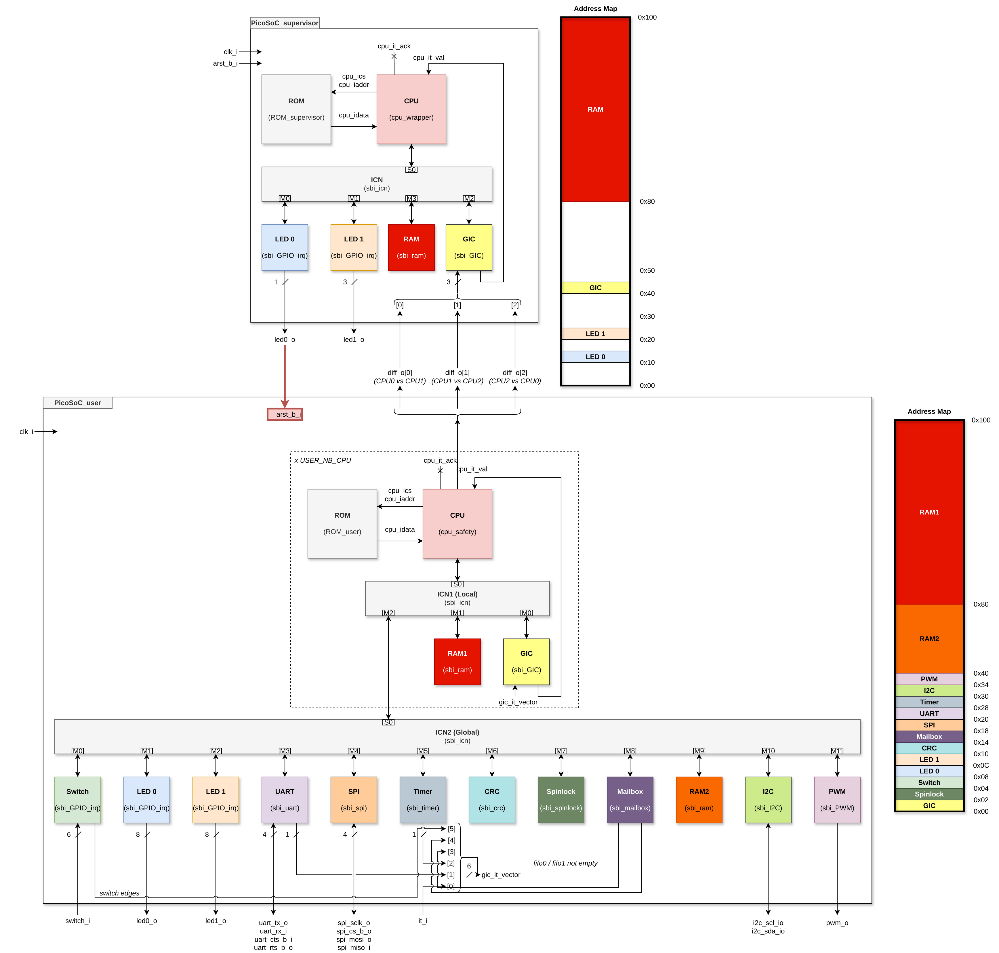

<!--
  README MODEL (common to every Asylum IP, keep the same headings)
  ----------------------------------------------------------------
  Regenerate from the sources, never from the previous README text alone:
    hdl/*.vhd (entities, generics, ports), <IP>.core (VLNV, targets, depends),
    mk/targets.txt, sim/, esw/, boards/, doc/.
  Sections, in this order (variant of a SoC: Memory Map instead of Registers):
    badges / title + one-line pitch / Overview / Features / Block Diagram /
    Getting Started / Hardware Interfaces / Configuration / Memory Map /
    Resources / Theory of Operation / Programmer's Guide /
    Design Verification / Dependencies and Related IPs / License
  Rules:
    - English, short and factual: every statement backed by the sources.
    - No VLNV line: the version badge shows it.
    - Badges: first line version, license; second line CI, lint, sim, syn.
    - Block diagram: doc/picosoc.drawio (owner's diagram, pages overview,
      cpu_safety-lock_step, cpu_safety-TMR), exported to doc/picosoc-<page>.png
      (make -C doc); the root README of asylum-project links doc/picosoc-overview.png.
    - A SoC README may name its CPUs.
    - Memory Map: link to the generated <X>_csr.md of each peripheral, never copy
      the register tables.
    - Tables: Configuration = Name|Type|Default|Description,
      Hardware Interfaces = Name|Direction|Type|Description, grouped by interface.
-->
[](https://github.com/deuskane/asylum-soc-picosoc/tags)
[](LICENSE)

[](https://github.com/deuskane/asylum-soc-picosoc/actions/workflows/ci.yml)
[](https://github.com/deuskane/asylum-soc-picosoc/actions/workflows/ci.yml)
[](https://github.com/deuskane/asylum-soc-picosoc/actions/workflows/ci.yml)
[](https://github.com/deuskane/asylum-soc-picosoc/actions/workflows/ci.yml)

# PicoSoC

**A small SoC in VHDL around OpenBlaze8 or WardRV CPUs: switches, LEDs, UART, SPI, GIC, timer, CRC, spinlock, mailbox and RAMs, with multi-core, lock-step / TMR safety and a supervisor, programmed in C.**

Part of the [Asylum project](https://github.com/deuskane/asylum-project), a collection of small IP cores, written to be read and learned from.

## Table of Contents

1. [Overview](#overview)
2. [Features](#features)
3. [Block Diagram](#block-diagram)
4. [Getting Started](#getting-started)
5. [Hardware Interfaces](#hardware-interfaces)
6. [Configuration](#configuration)
7. [Memory Map](#memory-map)
8. [Resources](#resources)
9. [Theory of Operation](#theory-of-operation)
10. [Programmer's Guide](#programmers-guide)
11. [Design Verification](#design-verification)
12. [Dependencies and Related IPs](#dependencies-and-related-ips)
13. [License](#license)

## Overview

PicoSoC is the reference system of the Asylum project: it connects the Asylum IPs around a CPU and runs C firmware on them. The CPU is chosen at build time with `CPU_MODEL`: `OpenBlaze8` (8-bit, a PicoBlaze-3 clone) or `WardRV_fsm` (RV32I). Every peripheral sits on the SBI bus (the simple bus of Asylum: 8-bit address, 8-bit data).

The SoC has two parts:

- the **user SoC** (`PicoSoC_user`): 1 to `USER_NB_CPU` CPU clusters (CPU, program ROM, local interconnect, GIC and RAM) sharing the peripherals through a global interconnect;
- the **supervisor SoC** (`PicoSoC_supervisor`, optional): one CPU that watches the differences between the redundant user CPUs (lock-step or TMR) and resets the user SoC on an error.

The top level `PicoSoC_top` adds the board side: reset resynchronization, clock divider, input polarities, SPI pads and a debug output. The firmware in [esw/](esw/) is compiled by FuseSoC generators into the ROMs at build time; the targets run it on GHDL testbenches or on a NanoXplore NG-MEDIUM board.

## Features

- CPU per build: `OpenBlaze8` or `WardRV_fsm` (`cpu_wrapper`), same SoC and same C drivers
- Multi-core user SoC: `USER_NB_CPU` clusters, each with its own ROM, GIC and local RAM; `mhartid` = cluster index (WardRV); spinlock, mailbox and shared RAM for the inter-CPU communication
- CPU safety (`cpu_safety`): `none`, `lock-step` (CPU1 runs `USER_LOCK_STEP_DEPTH` cycles after CPU0 and is compared with it) or `tmr` (3 CPUs, majority vote); sticky difference flags
- Fault injection: one instruction bit of each redundant CPU flipped from a pin (`inject_error_i`)
- Supervisor SoC: resets the user SoC on a difference and counts the errors on `led_diff_o`; with TMR, a first error is only masked
- Peripherals: switches and 2 LED banks (`sbi_GPIO_irq`), UART with CTS/RTS, SPI master with pads, GIC, timer, CRC16 (Modbus polynomial), spinlock, mailbox, RAMs
- Interrupts: user button (`it_user_i`, resynchronized in the GIC), UART, timer, mailbox "data available"
- Firmware in C (and one assembler example): switch / LED identity, full peripheral test with UART output, Modbus RTU server, multi-core hello with spinlock, supervisor
- Self-checking UVVM testbenches driven by the firmware, with an SPI flash model, and NG-MEDIUM board targets

## Block Diagram



Supervisor SoC (top) and user SoC (bottom) with their address maps. The dashed box is the CPU cluster, replicated `USER_NB_CPU` times; ICN2 and the peripherals are shared. The `led0_o` GPIO of the supervisor is the reset of the user SoC, the three difference flags of the user CPUs are the supervisor GIC inputs. Source: [doc/picosoc.drawio](doc/picosoc.drawio), pages `overview`, `cpu_safety-lock_step` and `cpu_safety-TMR` (see [CPU safety](#cpu-safety)).

`PicoSoC_top` (not drawn) resynchronizes `arst_i`, divides `clk_i` by `FSYS/FSYS_INT`, inverts `it_user_i` / `inject_error_i` when they are active low, and puts IO buffers on the SPI signals.

## Getting Started

The cores of the Asylum IPs are published in the FuseSoC library [asylum-cores](https://github.com/deuskane/asylum-cores) (with UVVM and the flash models used by the testbenches). The firmware is compiled at the setup of each target by the generators of [asylum-utils-generators](https://github.com/deuskane/asylum-utils-generators): `pbcc_gen` (SDCC with the PicoBlaze back-end and picoasm) for OpenBlaze8, `rvcc_gen` (`riscv64-unknown-elf-gcc`) for WardRV. GHDL, FuseSoC, UVVM, Yosys and both toolchains are in the [asylum-env](https://github.com/deuskane/asylum-ci) image used by the CI.

### Simulation

```bash
pip install fusesoc
fusesoc library add https://github.com/deuskane/asylum-cores
fusesoc run --target sim_soc1_wardrv_fsm_c_user_uart asylum:soc:PicoSoC   # GHDL + RISC-V toolchain
```

From a clone of [asylum-project](https://github.com/deuskane/asylum-project), in `ip/asylum-soc-picosoc`: `make help`, `make sim_soc3_openblaze8_fault_c_user`, `make nonreg_sim` (see [How to Run](#how-to-run)).

### Firmware

A target names its firmware with its `generate` entries (see [PicoSoC.core](PicoSoC.core)): for example `gen_rv32i_user_c_uart_921600` compiles [esw/user.c](esw/user.c) with `-DHAVE_UART -DCLOCK_FREQ=12500000 -DBAUD_RATE=921600` into the entity `ROM_user`, and `gen_rv32i_supervisor_c_tmr` compiles [esw/supervisor.c](esw/supervisor.c) with `-DSAFETY_TMR` into `ROM_supervisor`. To run another program, add a generator entry with its file and flags and a target that uses it. `CLOCK_FREQ` and `BAUD_RATE` of the firmware must match `FSYS_INT` and `USER_BAUD_RATE` of the target. The [integration firmwares](#integration-firmwares) `esw/test_<ip>.c` are short examples of each peripheral driven from C.

### Board

The `emu_ng_medium_*` targets build the SoC for the NanoXplore NG-MEDIUM kit (DK625V0) with NXmap and program it (`program: True`); pads in [boards/NanoXplore-DK625V0/pads.py](boards/NanoXplore-DK625V0/pads.py): 25 MHz clock, 6 switches, push buttons on `arst_i`, `it_user_i` and `inject_error_i` (active low), 8 + 8 + 3 LEDs, UART and SPI flash (`USER_SPI_NB_IO = 2`). NXmap is not in the asylum-env image: these targets are not run by the CI.

```bash
make emu_ng_medium_soc4_wardrv_fsm_fault      # TOOL=nxmap (mk/defs.mk)
```

[tools/modbus_server.py](tools/modbus_server.py) and [tools/modbus_server_debug.py](tools/modbus_server_debug.py) talk to the Modbus firmware on the board through the serial port.

To use PicoSoC in another design, instantiate `PicoSoC_top` (library `asylum`, component in `asylum.PicoSoC_pkg`) and generate the two ROMs as the targets do (`ROM_user_pkg` is used by `PicoSoC_pkg`):

```vhdl
library asylum;
use     asylum.PicoSoC_pkg.all;

  ins_soc : PicoSoC_top
    generic map
    (FSYS                 => 25_000_000
    ,FSYS_INT             => 12_500_000
    ,CPU_MODEL            => "WardRV_fsm"
    ,USER_BAUD_RATE       => 9600
    ,USER_SAFETY          => "tmr"
    ,USER_FAULT_INJECTION => true
    ,SUPERVISOR           => true
    )
    port map
    (clk_i            => clk
    ,arst_i           => arst_b
    ,switch_i         => switch
    ,led0_o           => led0
    ,led1_o           => led1
    ,led_diff_o       => led_diff
    ,it_user_i        => button_b
    ,uart_tx_o        => uart_tx
    ,uart_rx_i        => uart_rx
    ,uart_cts_b_i     => '0'
    ,uart_rts_b_o     => open
    ,spi_sclk_io      => spi_sclk
    ,spi_cs_b_io      => spi_cs_b
    ,spi_io_io        => spi_io           -- (7 downto 0)
    ,inject_error_i   => inject_error_b
    ,debug_mux_i      => (others => '0')
    ,debug_o          => open
    ,debug_uart_tx_o  => open
    );
```

## Hardware Interfaces

Top-level entity: **`PicoSoC_top`** ([hdl/PicoSoC_top.vhd](hdl/PicoSoC_top.vhd)), component in `asylum.PicoSoC_pkg`. It is the DUT of the testbenches and the toplevel of the `lint_*`, `syn_*` and `emu_*` targets.

### Clock and Reset

| Name | Direction | Type | Description |
|------|-----------|------|-------------|
| `clk_i` | in | std_logic | Board clock (`FSYS`), divided by `FSYS/FSYS_INT` for the SoC |
| `arst_i` | in | std_logic | Asynchronous reset, active level `RESET_POLARITY`, resynchronized inside |

### Switches, LEDs and Interrupt

| Name | Direction | Type | Description |
|------|-----------|------|-------------|
| `switch_i` | in | std_logic_vector(USER_NB_SWITCH-1 downto 0) | Switches (user GPIO `SWITCH`, resynchronized in the GPIO); bits 2..0 also select `debug_o` |
| `led0_o` | out | std_logic_vector(USER_NB_LED0-1 downto 0) | User GPIO `LED0` |
| `led1_o` | out | std_logic_vector(USER_NB_LED1-1 downto 0) | User GPIO `LED1` |
| `led_diff_o` | out | std_logic_vector(2 downto 0) | Supervisor GPIO `LED_DIFF` (error counter of [esw/supervisor.c](esw/supervisor.c)); without supervisor, the difference flags |
| `it_user_i` | in | std_logic | User interrupt (user GIC source 0, resynchronized in the GIC), active level `USER_IT_POLARITY` |

### UART

| Name | Direction | Type | Description |
|------|-----------|------|-------------|
| `uart_tx_o` | out | std_logic | Transmit |
| `uart_rx_i` | in | std_logic | Receive |
| `uart_cts_b_i` | in | std_logic | Clear To Send, active low |
| `uart_rts_b_o` | out | std_logic | Request To Send, active low |

### SPI

| Name | Direction | Type | Description |
|------|-----------|------|-------------|
| `spi_sclk_io` | inout | std_logic | SPI clock (`obuf` with output enable) |
| `spi_cs_b_io` | inout | std_logic | Chip select, active low (`obuf`) |
| `spi_io_io` | inout | std_logic_vector(USER_SPI_NB_IO-1 downto 0) | Data lanes (`iobuf`): 0 = MOSI, 1 = MISO, 2 = WP#, 3 = HOLD# in single mode; the SPI inputs without pad read 0 |

### Safety

| Name | Direction | Type | Description |
|------|-----------|------|-------------|
| `inject_error_i` | in | std_logic_vector(2 downto 0) | Bit `i` flips one instruction bit of CPU `i` of every cluster (`USER_FAULT_INJECTION`), active level `USER_FAULT_POLARITY` |

### Debug

| Name | Direction | Type | Description |
|------|-----------|------|-------------|
| `debug_mux_i` | in | std_logic_vector(2 downto 0) | Not used (the selection is `switch_i(2 downto 0)`); kept for the pad files |
| `debug_o` | out | std_logic_vector(7 downto 0) | `DEBUG_ENABLE = true`, by `switch_i(2 downto 0)`: 0 LED0, 1 switches, 2 user / supervisor resets, 3 CPU0 `iaddr(7:0)`, 4 CPU0 `idata(17:10)`, 5 data bus `cs`, `re`, `we`, `ready`, `addr(7:4)`, 6 data address, 7 `cs` / `ready` of SWITCH, LED0, LED1, UART. `false`: SoC clock, UART RX bit counter and state, `uart_rx`, `uart_tx` |
| `debug_uart_tx_o` | out | std_logic | Copy of `uart_tx_o` (`DEBUG_ENABLE = true`), else `'0'` |

## Configuration

Generics of `PicoSoC_top`:

| Name | Type | Default | Description |
|------|------|---------|-------------|
| `FSYS` | positive | `50_000_000` | Frequency of `clk_i` (Hz) |
| `FSYS_INT` | positive | `50_000_000` | Frequency of the SoC (Hz): clock divider ratio `FSYS/FSYS_INT`, UART clock |
| `RESET_POLARITY` | string | `"low"` | Active level of `arst_i`: `"high"` / `"low"` |
| `DEBUG_ENABLE` | boolean | `True` | Debug multiplexer on `debug_o` (see [Debug](#debug)) |
| `CPU_MODEL` | string | `"OpenBlaze8"` | `"OpenBlaze8"` or `"WardRV_fsm"`, for the user and supervisor CPUs; the ROMs of the target must be built for this CPU |
| `USER_NB_CPU` | natural | `1` | Number of CPU clusters of the user SoC |
| `USER_ICN_TARGET_SEL` | string | `"or"` | Response selection of the user interconnects: `"or"` / `"mux"` |
| `USER_ICN_MASTER_SEL` | string | `"fix"` | Arbitration of ICN2 between the clusters: `"fix"` / `"roundrobin"` |
| `USER_RAM1_DEPTH` | natural | `128` | Local RAM1 of each cluster (bytes, up to 128) |
| `USER_RAM2_DEPTH` | natural | `64` | Shared RAM2 (bytes, up to 64) |
| `USER_NB_SWITCH` | positive | `8` | Width of `switch_i` |
| `USER_NB_LED0` | positive | `8` | Width of `led0_o` (1 to 8) |
| `USER_NB_LED1` | positive | `8` | Width of `led1_o` (1 to 8) |
| `USER_BAUD_RATE` | integer | `115200` | UART baud rate (reset value of the baud counter) |
| `USER_UART_DEPTH_TX` / `_RX` | natural | `0` | UART FIFO depths |
| `USER_SPI_DEPTH_CMD` / `_TX` / `_RX` | natural | `0` | SPI FIFO depths |
| `USER_SPI_NB_IO` | natural | `8` | SPI data pads (up to 8) |
| `USER_SAFETY` | string | `"lock-step"` | `"none"` / `"lock-step"` / `"tmr"` |
| `USER_LOCK_STEP_DEPTH` | natural | `2` | Delay of CPU1 behind CPU0 in lock-step (cycles) |
| `USER_FAULT_INJECTION` | boolean | `True` | Connect `inject_error_i` |
| `USER_FAULT_POLARITY` | string | `"low"` | Active level of `inject_error_i` |
| `USER_IT_POLARITY` | string | `"low"` | Active level of `it_user_i` |
| `USER_MAILBOX_FIFO0_DEPTH_TX` / `_RX`, `USER_MAILBOX_FIFO1_DEPTH_TX` / `_RX` | natural | `4` | Mailbox FIFO depths |
| `SUPERVISOR` | boolean | `True` | Instantiate the supervisor SoC |
| `SUPERVISOR_ICN_TARGET_SEL` / `_MASTER_SEL` | string | `"or"` / `"fix"` | Supervisor interconnect |
| `SUPERVISOR_RAM_DEPTH` | natural | `128` | Supervisor RAM (bytes, up to 128) |

The configurations used by the targets are named after their safety: `soc1` = no supervisor, no safety; `soc2` = lock-step without supervisor; `soc3` = supervisor and lock-step; `soc4` = supervisor and TMR; `_fault` = with fault injection; `socKxN` = N user CPU clusters (each with the safety of `socK`).

## Memory Map

PicoSoC has no register of its own: the software sees the registers of its peripherals at the base addresses of [hdl/PicoSoC_pkg.vhd](hdl/PicoSoC_pkg.vhd) (`PICOSOC_USER_*_BA`, `PICOSOC_SUPERVISOR_*_BA`), mirrored in [esw/include/addrmap_user.h](esw/include/addrmap_user.h) and [esw/include/addrmap_supervisor.h](esw/include/addrmap_supervisor.h). Address encoding `"binary"`: a target answers to its base address and its own address bits.

### User SoC

| Address | Target | Instance | Interconnect | Registers |
|---------|--------|----------|--------------|-----------|
| `0x00`-`0x01` | GIC (one per cluster) | `sbi_GIC` | ICN1 | [GIC_csr.md](https://github.com/deuskane/asylum-system-gic/blob/main/hdl/csr/GIC_csr.md) |
| `0x02`-`0x03` | Spinlock | `sbi_spinlock` | ICN2 | [spinlock_csr.md](https://github.com/deuskane/asylum-system-spinlock/blob/main/hdl/csr/spinlock_csr.md) |
| `0x04`-`0x07` | SWITCH | `sbi_GPIO_irq` (inputs) | ICN2 | [GPIO_irq_csr.md](https://github.com/deuskane/asylum-component-gpio/blob/main/hdl/csr/GPIO_irq_csr.md) |
| `0x08`-`0x0B` | LED0 | `sbi_GPIO_irq` (outputs) | ICN2 | [GPIO_irq_csr.md](https://github.com/deuskane/asylum-component-gpio/blob/main/hdl/csr/GPIO_irq_csr.md) |
| `0x0C`-`0x0F` | LED1 | `sbi_GPIO_irq` (outputs) | ICN2 | [GPIO_irq_csr.md](https://github.com/deuskane/asylum-component-gpio/blob/main/hdl/csr/GPIO_irq_csr.md) |
| `0x10`-`0x13` | CRC | `sbi_crc` (CRC16, polynomial `0xA001`, LSB first) | ICN2 | [crc_csr.md](https://github.com/deuskane/asylum-component-crc/blob/main/hdl/csr/crc_csr.md) |
| `0x14`-`0x17` | Mailbox | `sbi_mailbox` | ICN2 | [mailbox_csr.md](https://github.com/deuskane/asylum-system-mailbox/blob/main/hdl/csr/mailbox_csr.md) |
| `0x18`-`0x1B` | SPI | `sbi_spi` (software prescaler, WP# / HOLD# handled) | ICN2 | [SPI_csr.md](https://github.com/deuskane/asylum-communication-spi/blob/main/hdl/csr/SPI_csr.md) |
| `0x20`-`0x27` | UART | `sbi_uart` | ICN2 | [UART_csr.md](https://github.com/deuskane/asylum-communication-uart/blob/main/hdl/csr/UART_csr.md) |
| `0x28`-`0x2F` | Timer | `sbi_timer` | ICN2 | [timer_csr.md](https://github.com/deuskane/asylum-component-timer/blob/main/hdl/csr/timer_csr.md) |
| `0x40`-`0x7F` | RAM2 (shared) | `sbi_ram`, `USER_RAM2_DEPTH` bytes | ICN2 | - |
| `0x80`-`0xFF` | RAM1 (one per cluster) | `sbi_ram`, `USER_RAM1_DEPTH` bytes | ICN1 | - |

Interrupt sources of the user GIC (the same vector on the GIC of every cluster):

| GIC source | Source | HDL constant | C mask |
|------------|--------|--------------|--------|
| 0 | `it_user_i` (resynchronized: `ITS_SYNC_ENABLE` bit 0) | `PICOSOC_USER_GIC_IT_USER` | `GIC_IT_USER_MSK` (`0x01`) |
| 1 | UART `it_o` | `PICOSOC_USER_GIC_UART` | `GIC_UART_MSK` (`0x02`) |
| 2 | Timer `it_o` | `PICOSOC_USER_GIC_TIMER` | `GIC_TIMER_MSK` (`0x04`) |
| 3 | Mailbox fifo0 not empty (level) | `PICOSOC_USER_GIC_MAILBOX0` | `GIC_MAILBOX0_MSK` (`0x08`) |
| 4 | Mailbox fifo1 not empty (level) | `PICOSOC_USER_GIC_MAILBOX1` | `GIC_MAILBOX1_MSK` (`0x10`) |

### Supervisor SoC

| Address | Target | Instance | Registers |
|---------|--------|----------|-----------|
| `0x10`-`0x13` | `RST` (GPIO `USER_ARST`): reset of the user SoC, active low | `sbi_GPIO_irq` | [GPIO_irq_csr.md](https://github.com/deuskane/asylum-component-gpio/blob/main/hdl/csr/GPIO_irq_csr.md) |
| `0x20`-`0x23` | `LED` (GPIO `LED_DIFF`): `led_diff_o` | `sbi_GPIO_irq` | [GPIO_irq_csr.md](https://github.com/deuskane/asylum-component-gpio/blob/main/hdl/csr/GPIO_irq_csr.md) |
| `0x40`-`0x41` | GIC, sources = difference flags (0 CPU0 vs CPU1, 1 CPU1 vs CPU2, 2 CPU2 vs CPU0) | `sbi_GIC` | [GIC_csr.md](https://github.com/deuskane/asylum-system-gic/blob/main/hdl/csr/GIC_csr.md) |
| `0x80`-`0xFF` | RAM | `sbi_ram`, `SUPERVISOR_RAM_DEPTH` bytes | - |

[tools/addrmap_user.hjson](tools/addrmap_user.hjson) (read by the Modbus tools) repeats the user base addresses: keep it aligned with `PicoSoC_pkg` and `addrmap_user.h`.

## Resources

Figures of the `syn_*` targets (`make nonreg_syn`, see [Targets](#targets)): `PicoSoC_top` with the generics of each configuration, synthesized by Yosys and its GHDL plugin; the reports are in the build directory of each target. The user ROM holds [esw/user_identity.c](esw/user_identity.c) (the firmware of `lint_ghdl`), the supervisor ROM [esw/dummy.c](esw/dummy.c): a bigger program needs a bigger ROM. `soc1`: no supervisor, no safety, default FIFOs (0); `soc4_ng_medium`: supervisor and TMR (3 user CPUs) with the generics of the NG-MEDIUM board (6 switches, FIFOs of 4, 2 SPI pads).

| Configuration | LUT¹ | LUTRAM¹ | FF¹ | CARRY4¹ | MUXF7/F8¹ | BRAM¹ | DSP¹ | Area² (µm²) | kGE³ |
|---|---|---|---|---|---|---|---|---|---|
| `syn_soc1` (OpenBlaze8) | 1496 | 108 | 620 | 48 | 125 | 0.5 | 0 | 183822.55 | 48.972 |
| `syn_soc4_ng_medium` (OpenBlaze8) | 2308 | 304 | 840 | 116 | 90 | 1 | 0 | 484422.10 | 129.055 |
| `syn_wardrv_soc1` (WardRV_fsm) | 3276 | 104 | 1020 | 53 | 501 | 1 | 0 | 164924.43 | 43.938 |
| `syn_wardrv_soc4_ng_medium` (WardRV_fsm) | 9447 | 304 | 2415 | 136 | 1692 | 2 | 0 | 405022.20 | 107.902 |

¹ Xilinx Artix-7 (LUT6), Yosys 0.33 `synth_xilinx -flatten -noiopad -noclkbuf`, before place and route: every cell of the netlist is counted, Vivado may differ. An `INV` counts as a `LUT1`. The user ROM goes to BRAM (a `RAMB18E1` counts 0.5), the RAMs and FIFOs mostly to LUTRAM. The SPI pads (`inout`) are not synthesized by the GHDL plugin of Yosys (warning "no assignment for port"): the SPI output enables and output registers that only drive them may be removed.

² SkyWater sky130 `sky130_fd_sc_hd`, typical corner (tt, 25 °C, 1.80 V), Yosys 0.33 `synth` + `dfflibmap` + `abc -liberty`: standard-cell area only, no timing constraint, no buffering, clock tree or placement; the ROMs, RAMs and FIFOs become flip-flops and logic (no ROM or SRAM macro), which explains most of the area.

³ Area in thousands of NAND2 gate equivalents (`sky130_fd_sc_hd__nand2_1` = 3.7536 µm²).

The NG-MEDIUM board targets (`emu_ng_medium_*`) need NXmap, which is not in the asylum-env image: no figure for this FPGA.

## Theory of Operation

### Hierarchy

| File | Unit | Role |
|------|------|------|
| [hdl/PicoSoC_top.vhd](hdl/PicoSoC_top.vhd) | `PicoSoC_top` | Top level: reset resynchronization, clock divider, polarities, user and supervisor SoCs, SPI pads, debug multiplexer |
| [hdl/PicoSoC_user.vhd](hdl/PicoSoC_user.vhd) | `PicoSoC_user` | User SoC: CPU clusters (`cpu_safety`, `ROM_user`, ICN1, GIC, RAM1), ICN2 and the shared peripherals |
| [hdl/PicoSoC_supervisor.vhd](hdl/PicoSoC_supervisor.vhd) | `PicoSoC_supervisor` | Supervisor SoC: CPU, `ROM_supervisor`, ICN, 2 GPIO, GIC, RAM |
| [hdl/cpu_safety.vhd](hdl/cpu_safety.vhd) | `cpu_safety` | 1, 2 or 3 CPUs, lock-step delay line and compare, TMR vote, fault injection |
| [hdl/cpu_wrapper.vhd](hdl/cpu_wrapper.vhd) | `cpu_wrapper` | `sbi_OpenBlaze8` or `sbi_WardRV_fsm` from `CPU_MODEL` |
| [hdl/PicoSoC_pkg.vhd](hdl/PicoSoC_pkg.vhd) | `PicoSoC_pkg` | Address maps, GIC source indexes, debug records, components |
| (generated) | `ROM_user`, `ROM_supervisor` | Program ROMs built from [esw/](esw/) by `pbcc_gen` / `rvcc_gen` |

### Clock and boot

`arst_i` (after its polarity) goes through two `sync2dffrn` resynchronizers: the first one, on `clk_i`, resets the clock divider; the second one, on the divided clock, resets the supervisor SoC. The reset of the user SoC is this one without supervisor, or the `RST` GPIO of the supervisor: [esw/supervisor.c](esw/supervisor.c) sets up its GIC, then writes 1 to it. A third `sync2dffrn` on the divided clock resynchronizes it: 2 more cycles of reset with a running clock, so that the registers without reset of the user SoC (input stages of the GPIOs) are loaded before the reset release.

Every CPU starts at address 0 of its ROM: the firmware sets up the GPIO directions, the UART baud rate, the GIC masks and the CPU interrupt, then runs its main loop.

### Interconnect

Each cluster has a local interconnect ICN1 (one master): GIC at `0x00`, RAM1 at `0x80`, every other address forwarded to ICN2. ICN2 has `USER_NB_CPU` masters (arbitration `USER_ICN_MASTER_SEL`) and the shared targets; its internal default slave answers to an unmapped address. Code is not on the bus: each CPU fetches from its own ROM.

### Interrupts

The user GIC of each cluster collects the 5 sources of the [table above](#user-soc) and drives the interrupt of its CPU. `it_user_i` comes from a pad: the GIC resynchronizes it (`ITS_SYNC_ENABLE`). The mailbox sources are levels: a channel with data sets its `isr` bit again after a clear, so the firmware pops the channel before clearing the bit. The interrupt routine reads `isr`, serves the sources and clears them (write 1). The interrupt outputs of the three GPIOs are not connected: the edges of the switches are read in the `isr` register of the SWITCH GPIO by polling ([esw/test_gpio.c](esw/test_gpio.c)). The supervisor GIC receives the 3 difference flags.

### Multi-core

With `USER_NB_CPU > 1`, the clusters run the same ROM content and share ICN2. WardRV gives each one its index in `mhartid`: [esw/user_hello.c](esw/user_hello.c) uses it, the spinlock for mutual exclusion (lock 0 for the shared data, lock 1 to elect the CPU that sets up the SoC) and RAM2 for the shared loop counter. Neither the spinlock nor the ICN arbitration is fair: the firmware backs off a random time after releasing the lock.

Safety and multi-core combine: the redundancy is inside each cluster (its `cpu_safety` holds the 2 or 3 copies of the cluster CPU, compared or voted together), the clusters are different harts. Every copy of a cluster gets the same `HARTID`, so the copies read the same `mhartid` and stay equal; the difference flags of all clusters are ORed for the supervisor.

### CPU safety


Lock-step: CPU0 drives the SoC. Its inputs (reset, instruction, bus response, interrupt) go through `USER_LOCK_STEP_DEPTH` registers to CPU1; the outputs of CPU1 (`ics`, `iaddr`, interrupt acknowledge, bus request) are compared with the delayed outputs of CPU0. The bus requests are compared with the `"/="` of `sbi_pkg`: the address only when `cs = '1'`, the data only when `we = '1'`. A difference sets `diff_o(0)` until the reset.


TMR: 3 CPUs get the same inputs; `ics`, `iaddr`, the bus request and the interrupt acknowledge are majority-voted bit by bit. `diff_o` bits 0, 1, 2 latch the differences CPU0 / CPU1, CPU1 / CPU2 and CPU2 / CPU0.

Fault injection: `inject_error_i(i)` XORs one instruction bit of CPU `i` (bit 17 / 16 / 15 for OpenBlaze8, bit 0 / 1 / 2 for WardRV). The difference flags of all clusters are ORed into `PicoSoC_user.diff_o`.

### Supervisor

[esw/supervisor.c](esw/supervisor.c) enables the 3 sources of its GIC, then releases the user SoC. On an interrupt:

- lock-step (default build): it holds the user SoC in reset (`RST = 0`), clears its GIC, increments `LED` (`led_diff_o`) and releases the reset;
- TMR (`-DSAFETY_TMR`): on the first error (all sources still enabled) it only masks the sources that fired: the voter already hides the faulty CPU. On a second error (an unmasked pair differs) it resets the user SoC as above, unmasks every source and increments `LED`.

The user SoC restarts from its reset: the firmware runs its setup again.

## Programmer's Guide

### Firmware structure

| File | Description |
|------|-------------|
| [esw/user_identity.c](esw/user_identity.c), [esw/user_identity.psm](esw/user_identity.psm) | Copies the switches into LED0 (C, and assembler for OpenBlaze8); `-DINVERT_SWITCH` inverts them |
| [esw/user.c](esw/user.c) | Peripheral test: LED0 = switches, LED1 counts the `it_user_i` interrupts, UART echo in the interrupt routine; while switch 5 is set, one UART line per loop with the loop counter, an SPI byte (loopback or flash, `HAVE_SPI` / `HAVE_SPI_MEMORY`), a spinlock test and a mailbox test that also checks the mailbox sources of the GIC (prints `KO` and stops on a mismatch) |
| [esw/user_modbus_rtu.c](esw/user_modbus_rtu.c) | Modbus RTU server on the UART (slave id `0x5A`, functions `0x03` read and `0x06` write of a SoC address, CRC16 by the CRC IP) |
| [esw/user_hello.c](esw/user_hello.c) | Multi-core test (WardRV): each CPU prints `CPU <hartid> - Loop <counter>` under the spinlock, shows the shared counter on LED0 and the CPUs seen on LED1 |
| [esw/user_xmodem.c](esw/user_xmodem.c) | XModem receiver (generators defined, no target uses it) |
| [esw/supervisor.c](esw/supervisor.c) | Supervisor (see [Supervisor](#supervisor)) |
| [esw/dummy.c](esw/dummy.c) | Empty program (supervisor ROM when the SoC has no supervisor) |
| [esw/test_&lt;ip&gt;.c](esw/) | Integration firmwares, see below |

### Integration firmwares

One small firmware per peripheral of the user SoC, the reference example of its use from C: registers through the driver of [esw/include/](esw/include/) at the base address of `addrmap_user.h`, the path to the pins (seen by the testbench) and the interrupt through the user GIC. Each step is one `test_check(step, condition)` of [esw/include/test.h](esw/include/test.h); the firmware prints `PASS` on the UART, or `FAIL <step>` and stops. Each one has its scenario `test_<ip>` in `tb_PicoSoC` (see [Scenarios](#scenarios-tests_list)).

| Firmware | What it checks |
|----------|----------------|
| [esw/test_gpio.c](esw/test_gpio.c) | GPIO: reset directions and values, LED0 / LED1 registers read back and seen on the pins, switches set by the testbench read back, their rising / falling edges recorded in the `isr` of SWITCH (polled), direction register (an input reads its pin) |
| [esw/test_uart.c](esw/test_uart.c) | UART: reset values (disabled, baud rate of the generics), setup read back, TX (every line), RX polled on the "RX FIFO not empty" source, RX by interrupt (UART source -> GIC source 1 -> CPU) |
| [esw/test_spi.c](esw/test_spi.c) | SPI with the flash model of the testbench: reset values, prescaler and configuration read back, flash status register (write enable latch set / cleared), read of 4 bytes, page program of 2 bytes polled on the write-in-progress bit, read back |
| [esw/test_timer.c](esw/test_timer.c) | Timer: reset values, 32-bit initial value read back, periodic interrupt (autostart, GIC source 2) counted on LED0, period of 2000 SoC cycles measured by the testbench, no interrupt after the timer is stopped |
| [esw/test_crc.c](esw/test_crc.c) | CRC: reset value, seed read back, CRC16 of `123456789` (`0x4B37`), of a Modbus request (`C5 CD`) and of the request with its CRC (0) |
| [esw/test_spinlock.c](esw/test_spinlock.c) | Spinlock from one CPU: test-and-set on read, 2 independent locks, release by a write of 0, a write never takes a lock (several CPUs: [esw/user_hello.c](esw/user_hello.c)) |
| [esw/test_gic.c](esw/test_gic.c) | GIC: reset values, mask read back, `it_user_i` pulse recorded while masked (no interrupt), taken when unmasked, taken at once when unmasked before |
| [esw/test_ram.c](esw/test_ram.c) | RAM2 (64 bytes) and the lower half of RAM1 (WardRV keeps its stack in the upper half): address in the data then its complement (aliasing, every data bit), an unmapped address answered by the default slave of ICN2 (write ignored, read 0) |
| [esw/test_mailbox.c](esw/test_mailbox.c) | Mailbox between 2 clusters: the CPU that takes lock 1 is the requester; reset status, FIFO order and full / empty flags, then 4 requests in fifo0 answered in fifo1, each one through the "data available" source of the GIC of the other cluster |

The interconnects and the clock divider have no firmware of their own: every integration firmware reaches its peripheral through ICN1 and ICN2 at its base address (a decoding error fails it), `test_ram` checks the RAM ranges and the default slave, `test_mailbox` runs with 2 masters on ICN2, and the timer period and the UART bit time measured by the testbench are counted in cycles of the divided clock (`FSYS_INT`).

The firmwares are portable C (the drivers support both CPUs), with one restriction: `test_ram` is built for WardRV only, as pbcc (SDCC 3.0.1, OpenBlaze8) miscompiles the variable port address of `PORT_WR(base, i, ...)` in a loop (it uses the high byte of `base + i`). Two other pbcc limits shape the code of the integration firmwares: a function that ends with an infinite loop breaks the register saves of the next function (the stop loops of `test.h` are in macros), and a register saved inside a branch is restored on every path (the interrupt routine of `test_mailbox.c` calls one function per source).

### Drivers

The drivers in [esw/include/](esw/include/) are macros on `PORT_WR(base, offset, data)` / `PORT_RD(base, offset)` (8-bit accesses, [cpu/picoblaze.h](esw/include/cpu/picoblaze.h) or [cpu/riscv.h](esw/include/cpu/riscv.h) from `cpu.h`) and on the register offsets of the regtool headers of each peripheral (`<X>_csr.h`, on the include path of the generators): `gpio.h`, `uart.h` (`putchar`, `puthex`, `getchar`, empty without `HAVE_UART`), `spi.h` (flash commands), `gic.h`, `timer.h`, `crc.h`, `spinlock.h`, `mailbox.h`, `modbus_rtu.h`. `cpu.h` also gives `ISR_FCT` (the interrupt routine `isr`), `interrupt_setup`, `interrupt_enable` / `interrupt_disable` and `cpu_nop`. The base addresses are those of `addrmap_user.h` / `addrmap_supervisor.h`.

### Example: switches to LEDs, interrupt counter

```c
#include <stdint.h>
#include "addrmap_user.h"

// Interruption routine : count the it_user_i interruptions on LED1
ISR_FCT
{
  if (gic_isr(GIC) & GIC_IT_USER_MSK)
    {
      gpio_wr(LED1, gpio_rd(LED1)+1);
      gic_clr(GIC, GIC_IT_USER_MSK);     // acknowledge (rw1c)
    }
}

void main()
{
  gpio_setup(SWITCH, INPUT);
  gpio_setup(LED0  , OUTPUT);
  gpio_setup(LED1  , OUTPUT);
  gpio_wr   (LED1  , 0);

  gic_clr      (GIC, GIC_IT_USER_MSK);   // old events : the ISR also records the masked sources
  gic_it_enable(GIC, GIC_IT_USER_MSK);
  interrupt_setup(isr);
  interrupt_enable();

  while (1)
    gpio_wr(LED0, gpio_rd(SWITCH));      // LED0 = switches
}
```

Clear the old events of a GIC source before unmasking it: the `isr` register also records the masked sources.

## Design Verification

### Testbenches

| File | DUT | Description |
|------|-----|-------------|
| [sim/picosoc/tb_PicoSoC.vhd](sim/picosoc/tb_PicoSoC.vhd) | `PicoSoC_top` | Self-checking UVVM testbench driven by the firmware of the target: drives the switches, `it_user_i`, `inject_error_i` and `uart_rx_i`, checks LED0, LED1, `led_diff_o` and the UART lines (UART VIP). Generics: the DUT configuration (CPU, clusters, safety, polarities), `TESTS_LIST`, `FIRMWARE` (program of the user ROM: `identity`, `user`, `user_uart`, `user_uart_spi`, `user_uart_spi_mem`, `hello` or an integration firmware `test_<ip>`; it selects the scenarios that apply), `TB_WATCHDOG` (timeout of each wait, in `clk_i` cycles) and `SPI_MODEL` (`m25p40` / `s25fl512s` flash model preloaded with [sim/mem/memory.mem](sim/mem/memory.mem)). Scenarios in `tb_PicoSoC_<name>_pkg`, names, applicability and dispatch in [tb_PicoSoC_tests_pkg](sim/picosoc/tb_PicoSoC_tests_pkg.vhd), helpers in [tb_PicoSoC_bfm_pkg](sim/picosoc/tb_PicoSoC_bfm_pkg.vhd). With an integration firmware, a UART console logs every line and stops on `FAIL <step>`, whatever the scenario waits for |
| [sim/modbus_rtu/tb_PicoSoC_modbus_rtu.vhd](sim/modbus_rtu/tb_PicoSoC_modbus_rtu.vhd) | `PicoSoC_top` | UVVM testbench of [esw/user_modbus_rtu.c](esw/user_modbus_rtu.c): the UART VIP is the Modbus RTU master (CRC16 computed by the bench) and reads / writes the SoC addresses. Scenarios in `tb_PicoSoC_modbus_rtu_<name>_pkg`, dispatch in [tb_PicoSoC_modbus_rtu_tests_pkg](sim/modbus_rtu/tb_PicoSoC_modbus_rtu_tests_pkg.vhd), Modbus frames in [tb_PicoSoC_modbus_rtu_bfm_pkg](sim/modbus_rtu/tb_PicoSoC_modbus_rtu_bfm_pkg.vhd) |

Waveform setups: [sim/wave/waves.gtkw](sim/wave/waves.gtkw), [sim/wave/cpus.gtkw](sim/wave/cpus.gtkw).

### Scenarios (`TESTS_LIST`)

The scenarios are chosen at run time with the generic `TESTS_LIST`: names separated by `,` without space, a name may be repeated. The sequencer first checks every name (an unknown name, or a scenario that does not apply to the firmware and the configuration, is a `TB_ERROR` before any scenario runs), then for each scenario puts the inputs to their inactive level, drives a reset pulse, logs `TEST <i>/<N> : <name>` and runs it: each scenario starts from reset, so the firmware runs its setup again. The empty list only compiles and elaborates the testbench. Checks are counted as the `=> OK` lines of the log; for an integration scenario, `(+ n)` is the number of `test_check` steps of its firmware, summed up by its `PASS` line.

`tb_PicoSoC`:

| Name | Checks | Applies to | Description |
|------|--------|------------|-------------|
| `switch` | 11 | every firmware but `hello` | Switches set one by one from bit 7 to bit 0, then `0x5A` and `0xA5`: LED0 follows; `led_diff_o = 0` (no difference between the redundant CPUs) |
| `it_user` | 10 | `user*` | With switch 5 set (the loop also runs the spinlock / mailbox code): two short `it_user_i` pulses give exactly one interrupt each (LED1 + 1), a long pulse at least one, LED1 stable without interrupt; LED0 still follows the switches afterwards |
| `uart` | 9 | `user_uart*` | Banner `Welcome Back, Commander`; a byte sent on `uart_rx_i` is echoed by the interrupt routine (UART source of the GIC); with switch 5 set, 6 `Loop` lines checked character by character (counter, switches, SPI byte of the loopback or of the flash, spinlock, mailbox); one `it_user_i` pulse during the lines |
| `fault_lock_step` | 13 | `user*`, supervisor, lock-step, fault injection | Errors in CPU0, CPU1, CPU0: after each one the user SoC is reset (LED0 = 0, then the switches again) and `led_diff_o` counts the errors; one reset per error |
| `fault_tmr` | 24 | `user*`, supervisor (`-DSAFETY_TMR`), TMR, fault injection | Errors in CPU0 (voted out: no reset, LED0 still follows the switches), CPU1 (second error: reset, `led_diff_o` = 1), CPU2 (voted out), CPU2 again (its sources already masked), CPU1 (reset, 2), CPU1 (voted out) |
| `fault_diff` | 4 | `user*`, no supervisor, lock-step or TMR, fault injection | Without supervisor `led_diff_o` shows the difference flags: an error in CPU0 sets them (lock-step `001`, TMR `101`) and they stay set |
| `hello` | 4 x `USER_NB_CPU` + 4 | `hello` | The first 4 x `USER_NB_CPU` UART lines are `CPU <id> - Loop <counter>` with a valid id and the counter 0, 1, 2, ... (mutual exclusion, shared counter in RAM2); every CPU takes the lock (LED1) and the counter progresses (LED0); `led_diff_o` stays 0 during the whole scenario: with lock-step or TMR, the copies of every cluster read the same `mhartid` (no difference flag, no error counted by the supervisor) |
| `test_gpio` | 5 (+ 16 in the firmware) | `test_gpio` | LED0 = `0xA5` and LED1 = `0x5A` on the pins, switches `0x3C` (rising edges) copied into LED0, then `0x00` (falling edges); `PASS`; LED1 pins unchanged while the firmware reads LED1 as an input |
| `test_uart` | 3 (+ 11) | `test_uart` | On each prompt `>`, a byte sent on `uart_rx_i`: `0x5A` read by polling, `0xA5` read by the interrupt routine; `PASS`; LED0 = `0xA5`, LED1 = one interrupt |
| `test_spi` | 1 (+ 16) | `test_spi` (`SPI_MODEL = m25p40`) | `PASS`: the firmware checks the answers of the flash model |
| `test_timer` | 9 (+ 10) | `test_timer` | LED0 counts the timer interrupts: 3 periods of 2000 SoC cycles (± 10); `PASS`; LED0 stays at 4 for 2 more periods (timer stopped) |
| `test_crc` | 1 (+ 10) | `test_crc` | `PASS`: the firmware checks the CRC values |
| `test_spinlock` | 1 (+ 9) | `test_spinlock` | `PASS`: the firmware checks the lock values |
| `test_gic` | 5 (+ 9) | `test_gic` | One `it_user_i` pulse on each request of the firmware (LED0 = 1, 2, 3); `PASS`; LED1 = 2 interrupts (pulses 2 and 3) |
| `test_ram` | 1 (+ 6) | `test_ram` | `PASS`: the firmware checks the RAM bytes and the unmapped addresses |
| `test_mailbox` | 7 (+ 6) | `test_mailbox`, `USER_NB_CPU = 2` | LED1 counts the 4 answers of the other cluster; `PASS`; LED0 = last answer `0xBB` |

`tb_PicoSoC_modbus_rtu`:

| Name | Checks | Applies to | Description |
|------|--------|------------|-------------|
| `basic` | 58 | every configuration | LED0 written and read back (data and output enable), switches read, a frame to another slave id is ignored (no answer, LED0 unchanged), broadcast write |
| `fault_lock_step` | 23 | supervisor, lock-step, fault injection | Errors in CPU0 then CPU1: LED0 written by Modbus, then back to 0 after the reset of the user SoC; `led_diff_o` counts the resets |
| `fault_tmr` | 64 | supervisor, TMR, fault injection | Errors CPU0 (voted out, LED0 kept and still writable), CPU1 (reset), CPU2 (voted out), CPU0 (reset), CPU1 (voted out), CPU2 (reset); `led_diff_o` counts the resets |
| `sequence` | 128 | every configuration | Each switch alone: read through Modbus, then written into LED0 |

### Targets

A target is a firmware build: its generators compile the user and supervisor programs into the ROMs, so the program is fixed when the target is built. Each target runs the scenarios that apply to its program and configuration. The reference configurations, `sim_soc4_openblaze8_fault_c_user` (supervisor, TMR, fault injection) and its Modbus counterpart, have a build-only base target and one target per scenario (one CI job per scenario, a failure isolated).

| Target | Toplevel | Description |
|--------|----------|-------------|
| `sim_soc4_openblaze8_fault_c_user` | `tb_PicoSoC` | Reference configuration of `tb_PicoSoC`: build and elaboration only (`TESTS_LIST` empty) |
| `sim_soc4_openblaze8_fault_c_user_<name>` | `tb_PicoSoC` | One target per scenario: `_switch`, `_it_user`, `_fault_tmr` |
| `sim_soc4_openblaze8_fault_c_user_modbus_rtu` | `tb_PicoSoC_modbus_rtu` | Reference configuration of the Modbus testbench: build only |
| `sim_soc4_openblaze8_fault_c_user_modbus_rtu_<name>` | `tb_PicoSoC_modbus_rtu` | One target per scenario: `_basic`, `_fault_tmr`, `_sequence` |
| `sim_soc1_openblaze8_asm_identity`, `sim_soc1_<cpu>_c_identity` | `tb_PicoSoC` | `user_identity` (assembler, C): `switch`; `sim_soc1_openblaze8_c_identity` with `FSYS_INT = FSYS` (clock divider ratio 1) |
| `sim_soc1_openblaze8_c_user`, `sim_soc2_<cpu>_c_user`, `sim_soc3_<cpu>_c_user` | `tb_PicoSoC` | `user.c` without UART: `switch`, `it_user` |
| `sim_soc2_openblaze8_fault_c_user` | `tb_PicoSoC` | `switch`, `it_user`, `fault_diff` |
| `sim_soc3_<cpu>_fault_c_user` | `tb_PicoSoC` | `switch`, `it_user`, `fault_lock_step` |
| `sim_soc4_wardrv_fsm_fault_c_user` | `tb_PicoSoC` | `switch`, `it_user`, `fault_tmr`, with `it_user_i` and `inject_error_i` active low (as on the board) |
| `sim_soc1_<cpu>_c_user_uart`, `_uart_spi`, `_uart_spi_mem`, `sim_soc2_<cpu>_c_user_uart`, `sim_soc4_<cpu>_c_user_uart` | `tb_PicoSoC` | `user.c` with UART at 921600 baud (+ SPI loopback, + SPI flash model `m25p40`): `switch`, `it_user`, `uart`; `sim_soc1_wardrv_fsm_c_user_uart` with `arst_i` active high |
| `sim_soc1x2_wardrv_fsm_c_hello_uart`, `sim_soc1x4_...`, `sim_soc1x6_...` | `tb_PicoSoC` | `user_hello.c` on 2, 4, 6 clusters: `hello` |
| `sim_soc3x2_wardrv_fsm_c_hello_uart`, `sim_soc4x2_wardrv_fsm_c_hello_uart` | `tb_PicoSoC` | `user_hello.c` on 2 clusters with supervisor and lock-step / TMR in each cluster, no fault: `hello` |
| `sim_soc1_<cpu>_c_test_<ip>`, `sim_soc1x2_<cpu>_c_test_mailbox` | `tb_PicoSoC` | Integration firmware `esw/test_<ip>.c`: scenario `test_<ip>`, for `<ip>` in `gpio`, `uart`, `spi`, `timer`, `crc`, `spinlock`, `gic` (both CPUs), `ram` (WardRV only), `mailbox` (2 clusters) |
| `sim_soc{1,2,3}_<cpu>_c_user_modbus_rtu`, `sim_soc3_<cpu>_fault_c_user_modbus_rtu`, `sim_soc4_wardrv_fsm_fault_c_user_modbus_rtu` | `tb_PicoSoC_modbus_rtu` | `basic`, `sequence` (+ `fault_lock_step` / `fault_tmr`); the TMR one with the board polarities |
| `lint_ghdl` | `asylum.PicoSoC_top` | GHDL `-Wall` analysis and elaboration, default generics |
| `lint_ghdl_synth_<config>` | `asylum.PicoSoC_top` | `ghdl --synth` check (no latch) of 7 configurations: `default`, `soc1`, `soc4_ng_medium`, `4leds_reset_high`, `wardrv_soc1`, `wardrv_soc4_ng_medium`, `wardrv_soc1x4` |
| `syn_<config>` | `asylum.PicoSoC_top` | Yosys synthesis (see [Resources](#resources)): `syn_soc1`, `syn_soc4_ng_medium`, `syn_wardrv_soc1`, `syn_wardrv_soc4_ng_medium` |
| `emu_ng_medium_*` | `PicoSoC_top` | NG-MEDIUM board (NXmap, not in the CI): `user.c` and `user_modbus_rtu.c` builds of soc1 to soc4 for each CPU |

`<cpu>` is `openblaze8` (generators `gen_picoblaze3_*`) or `wardrv_fsm` (`gen_rv32i_*`). Every `sim_*`, `lint_*` and `syn_*` target is a job of the [GitHub CI](https://github.com/deuskane/asylum-soc-picosoc/actions/workflows/ci.yml), run in the [asylum-env](https://github.com/deuskane/asylum-ci) image. The `sim`, `lint` and `syn` badges count the passed and failed targets of the last run on `main`.

The testbenches were validated with 33 RTL mutants of the SoC glue (address decoding, interrupt routing, lock-step compare, TMR vote, supervisor, reset and clock, multi-core), each scenario run alone: 31 are killed. The 2 survivors are a lock-step compare without the data bus and difference flags that are not sticky: the fault injection flips an instruction bit, which also changes the instruction stream and leaves the two CPUs different, so neither the data bus compare nor the stickiness can be seen with it.

The integration scenarios were validated with 45 integration mutants, each one run on the targets of its peripheral (both CPUs, 86 runs): wrong base addresses and GIC masks in `addrmap_user.h` (13), wrong bits in the drivers of `esw/include` (8), interrupt lines swapped or tied low, pins disconnected, address decoding, CRC polynomial, timer and clock divider in a copy of the RTL (20), and wrong stimuli in the testbench (4): all are killed, most of them by the `FAIL <step>` line of the firmware.

### How to Run

From a clone of [asylum-project](https://github.com/deuskane/asylum-project) (in the asylum-env image, or with GHDL, FuseSoC and the toolchains installed):

```bash
make help                                        # variables, rules and targets
make sim_soc4_openblaze8_fault_c_user_fault_tmr  # one scenario, log in log/
make sim_soc1_wardrv_fsm_c_user_uart_spi         # every scenario of a firmware build
make nonreg_sim                                  # every sim_* target
make nonreg_lint                                 # every lint_* target
make nonreg_syn                                  # every syn_* target (Yosys, figures of Resources)
make TARGETS_FILTER=wardrv nonreg_sim
```

To run a list of scenarios, build the target once, then run the list without recompiling (same `--build-root` and `--no-export` as the Makefile, so the build is reused; any generic of the target can be overridden after the VLNV):

```bash
make sim_soc4_openblaze8_fault_c_user           # build and elaboration (TESTS_LIST empty)
fusesoc --cores-root . run --build-root build --no-export --run --target sim_soc4_openblaze8_fault_c_user asylum:soc:PicoSoC:4.0.0 --TESTS_LIST=fault_tmr,switch
```

To add a scenario: a package `tb_PicoSoC_<name>_pkg` with a procedure `run`, its name in `C_TESTS`, its applicability in `test_applies` and its case in `run_test` of [tb_PicoSoC_tests_pkg](sim/picosoc/tb_PicoSoC_tests_pkg.vhd), the file in the `files_sim` fileset, the name in the `TESTS_LIST` of the targets it applies to, then `make mk/targets.txt` and `make ci_generate`. An integration firmware `esw/test_<ip>.c` is a scenario of the same name: add it to `C_INTEGRATION` (it applies to its firmware only), give it a package when the testbench drives or checks pins (else `run_test` only calls `wait_pass`), and add its generators `gen_rv32i_user_test_<ip>` / `gen_picoblaze3_user_test_<ip>` and its targets `sim_soc1_<cpu>_c_test_<ip>` to the core.

Outside the CI, GHDL writes a waveform `dut.fst`.

## Dependencies and Related IPs

| Core | Repository | Purpose |
|------|------------|---------|
| `asylum:utils:pkg` | [asylum-utils-pkg](https://github.com/deuskane/asylum-utils-pkg) | `sbi_pkg` (SBI records, `"/="` of the lock-step / TMR compare, >= 1.9.0), `logic_pkg`, `math_pkg`; the testbenches need >= 1.10.0 (`string_pkg` lists of `TESTS_LIST`) |
| `asylum:target:techmap` | [asylum-target-techmap](https://github.com/deuskane/asylum-target-techmap) | `sync2dffrn`, `obuf`, `iobuf` |
| `asylum:component:clock_divider` | [asylum-component-clock_divider](https://github.com/deuskane/asylum-component-clock_divider) | SoC clock |
| `asylum:component:GPIO` | [asylum-component-gpio](https://github.com/deuskane/asylum-component-gpio) | `sbi_GPIO_irq`: switches, LEDs, supervisor GPIOs |
| `asylum:communication:uart` | [asylum-communication-uart](https://github.com/deuskane/asylum-communication-uart) | `sbi_uart` (>= 3.0.0) |
| `asylum:communication:SPI` | [asylum-communication-spi](https://github.com/deuskane/asylum-communication-spi) | `sbi_spi`; `fmf:memory:flash_nor` (flash models of the testbench) |
| `asylum:system:GIC` | [asylum-system-gic](https://github.com/deuskane/asylum-system-gic) | `sbi_GIC` (>= 2.0.0) |
| `asylum:component:timer` | [asylum-component-timer](https://github.com/deuskane/asylum-component-timer) | `sbi_timer` |
| `asylum:component:crc` | [asylum-component-crc](https://github.com/deuskane/asylum-component-crc) | `sbi_crc` |
| `asylum:system:spinlock` | [asylum-system-spinlock](https://github.com/deuskane/asylum-system-spinlock) | `sbi_spinlock` |
| `asylum:system:mailbox` | [asylum-system-mailbox](https://github.com/deuskane/asylum-system-mailbox) | `sbi_mailbox` (>= 1.1.0) |
| `asylum:infrastructure:icn` | [asylum-infrastructure_icn](https://github.com/deuskane/asylum-infrastructure_icn) | `sbi_icn` |
| `asylum:component:ram` | [asylum-component-ram](https://github.com/deuskane/asylum-component-ram) | `sbi_ram` |
| `asylum:component:fifo` | [asylum-component-fifo](https://github.com/deuskane/asylum-component-fifo) | FIFOs of the peripherals |
| `asylum:processor:OpenBlaze8` | [asylum-processor-OpenBlaze8](https://github.com/deuskane/asylum-processor-OpenBlaze8) | `sbi_OpenBlaze8` |
| `asylum:processor:WardRV` | [asylum-processor-WardRV](https://github.com/deuskane/asylum-processor-WardRV) | `sbi_WardRV_fsm` |
| `asylum:utils:generators` | [asylum-utils-generators](https://github.com/deuskane/asylum-utils-generators) | `pbcc_gen` / `rvcc_gen` (firmware to ROM), regtool of the peripherals |
| `asylum:utils:ghdl_synth`, `asylum:utils:yosys_synth` | [asylum-utils-generators](https://github.com/deuskane/asylum-utils-generators) | `lint_ghdl_synth_*` check, `syn_*` synthesis |
| `bitvis:verification:uvvm` | [UVVM](https://github.com/UVVM/UVVM) | Verification library and UART VIP |

All the IPs: [asylum-project](https://github.com/deuskane/asylum-project).

## License

Apache License 2.0, see [LICENSE](LICENSE).

Exception: the SPI flash models (`fmf:memory:flash_nor`, from the [Free Model Foundry](https://www.freemodelfoundry.com), GPL-2.0) are a dependency of the simulation targets only, they are not in this repository and not part of the SoC.
