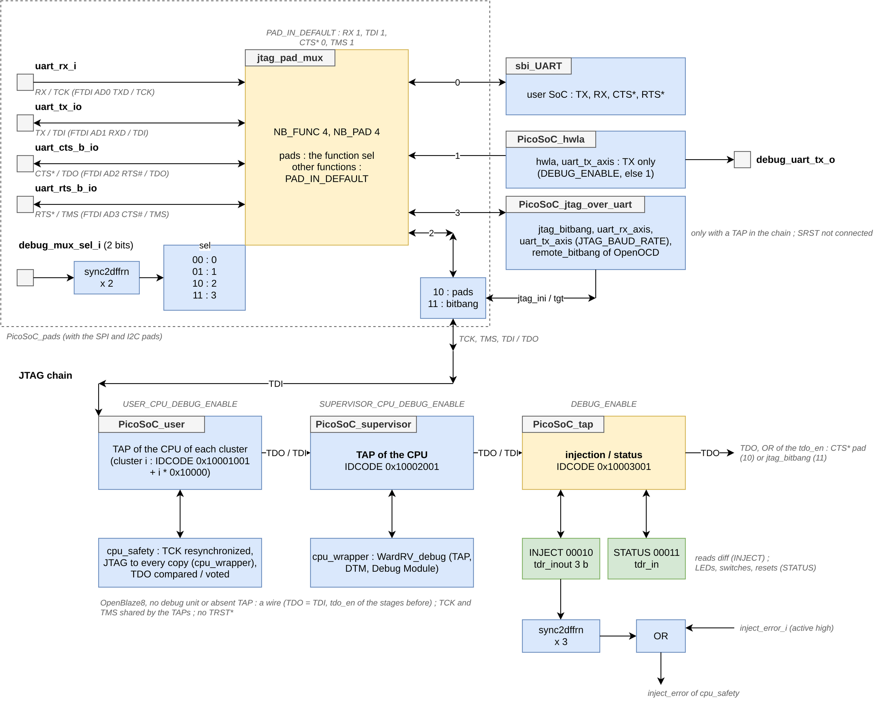
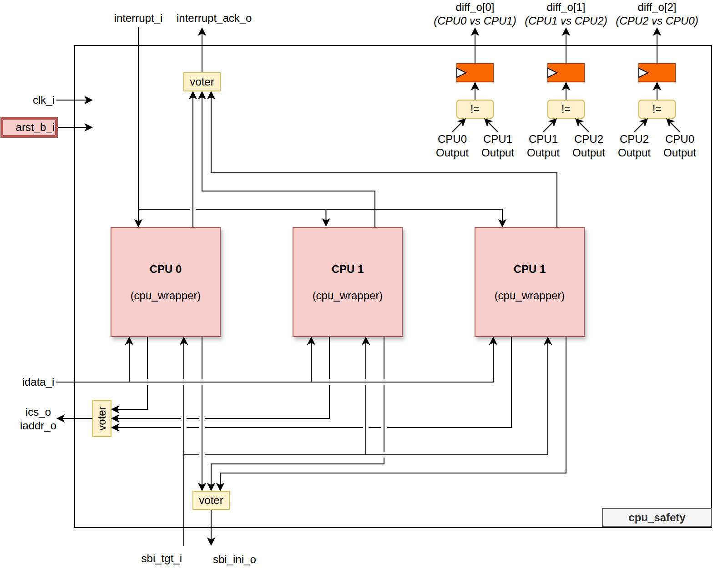
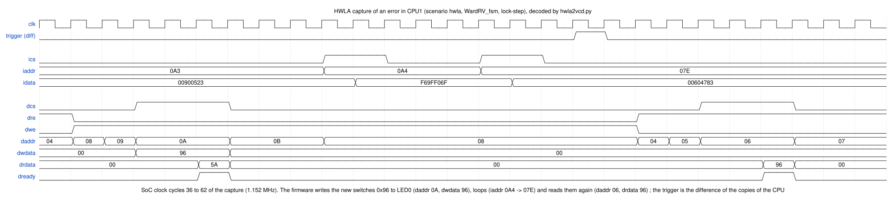
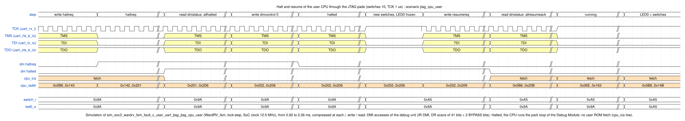
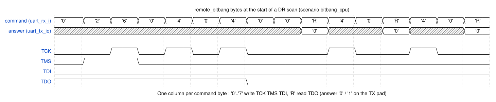

<!--
  README MODEL (common to every Asylum IP, keep the same headings)
  ----------------------------------------------------------------
  Regenerate from the sources, never from the previous README text alone:
    hdl/*.vhd (entities, generics, ports), <IP>.core (VLNV, targets, depends),
    mk/targets.txt, sim/, esw/, boards/, doc/.
  Sections, in this order (variant of a SoC: Memory Map instead of Registers):
    badges / title + one-line pitch / Overview / Features / Block Diagram /
    Getting Started / Hardware Interfaces / Configuration / Memory Map /
    Resources / Theory of Operation / Programmer's Guide /
    Design Verification / Dependencies and Related IPs / License
  Rules:
    - English, short and factual: every statement backed by the sources.
    - No VLNV line: the version badge shows it.
    - Badges: first line version, license; second line CI, lint, sim, syn.
    - Block diagram: doc/picosoc.drawio (owner's diagram, pages overview,
      cpu_safety-lock_step, cpu_safety-TMR), exported to doc/picosoc-<page>.png
      (make -C doc); the root README of asylum-project links doc/picosoc-overview.png.
    - A SoC README may name its CPUs.
    - Memory Map: link to the generated <X>_csr.md of each peripheral, never copy
      the register tables.
    - Tables: Configuration = Name|Type|Default|Description,
      Hardware Interfaces = Name|Direction|Type|Description, grouped by interface.
-->
[](https://github.com/deuskane/asylum-soc-picosoc/tags)
[](LICENSE)

[](https://github.com/deuskane/asylum-soc-picosoc/actions/workflows/ci.yml?query=branch%3Astudent)

> **Student branch of the ESIEE SEI-5201A labs.** The safety of PicoSoC is removed: `cpu_safety` implements `SAFETY = "none"` only, lock-step and TMR are holes to write (see [CPU safety](#cpu-safety)). The configurations are numbered in the order of the labs, `soc1` (WardRV_fsm, supervisor, no safety, fault injection), `soc2` / `soc3` (`soc1` with the lock-step / the TMR to write), see [Configuration](#configuration); only their targets are kept (see [Targets](#targets)), with the firmware [esw/demo/user_loop.c](esw/demo/user_loop.c) (LED0 = switches and one UART line per iteration: the loop number and a pseudo random number). The complete SoC, its safety, OpenBlaze8 (its path stays in the RTL, without target), the multi-core, Modbus, lint and synthesis targets are on the branch `main`.

# PicoSoC

**A small SoC in VHDL around OpenBlaze8 or WardRV CPUs: switches, LEDs, UART, SPI, I2C, PWM, GIC, timer, CRC, spinlock, mailbox and RAMs, with multi-core, a CPU safety wrapper (lock-step / TMR: holes to write on this branch), a supervisor and JTAG debug, programmed in C.**

Part of the [Asylum project](https://github.com/deuskane/asylum-project), a collection of small IP cores, written to be read and learned from.

## Table of Contents

1. [Overview](#overview)
2. [Features](#features)
3. [Block Diagram](#block-diagram)
4. [Getting Started](#getting-started)
5. [Hardware Interfaces](#hardware-interfaces)
6. [Configuration](#configuration)
7. [Memory Map](#memory-map)
8. [Resources](#resources)
9. [Theory of Operation](#theory-of-operation)
10. [Programmer's Guide](#programmers-guide)
11. [Design Verification](#design-verification)
12. [Dependencies and Related IPs](#dependencies-and-related-ips)
13. [License](#license)

## Overview

PicoSoC is the reference system of the Asylum project: it connects the Asylum IPs around a CPU and runs C firmware on them. The CPU is chosen at build time with `CPU_MODEL`: `OpenBlaze8` (8-bit, a PicoBlaze-3 clone) or `WardRV_fsm` (RV32I). Every peripheral sits on the SBI bus (the simple bus of Asylum: 8-bit address, 8-bit data).

The SoC has two parts:

- the **user SoC** (`PicoSoC_user`): 1 to `USER_NB_CPU` CPU clusters (CPU, program ROM, local interconnect, GIC and RAM) sharing the peripherals through a global interconnect;
- the **supervisor SoC** (`PicoSoC_supervisor`, optional): one CPU that watches the differences between the redundant user CPUs (lock-step or TMR) and resets the user SoC on an error.

The top level `PicoSoC_top` adds the board side: reset resynchronization, clock divider, input polarities, the pads (`PicoSoC_pads`: SPI, I2C, and the UART pads shared by the user UART, the UART of the logic analyzer, the JTAG pins of the JTAG chain and JTAG over the UART, selected by `debug_mux_sel_i`), with `DEBUG_ENABLE` a logic analyzer (HWLA) on the bus of the user CPU (its captures on a UART, or read through the JTAG chain with `HWLA_LINK = "jtag"`) and a JTAG TAP of fault injection and status. The JTAG chain also goes through the user and supervisor SoCs, where the WardRV CPUs can have their RISC-V debug unit (in `cpu_wrapper`). The firmware in [esw/](esw/) is compiled by FuseSoC generators into the ROMs at build time; the targets run it on GHDL testbenches or on a NanoXplore NG-MEDIUM board.

## Features

- CPU per build: `OpenBlaze8` or `WardRV_fsm` (`cpu_wrapper`), same SoC and same C drivers
- Multi-core user SoC: `USER_NB_CPU` clusters, each with its own ROM, GIC and local RAM; `mhartid` = cluster index (WardRV); spinlock, mailbox and shared RAM for the inter-CPU communication
- CPU safety (`cpu_safety`): `none`; on this branch `lock-step` (CPU1 runs `USER_LOCK_STEP_DEPTH` cycles after CPU0 and is compared with it) and `tmr` (3 CPUs, majority vote, sticky difference flags) are holes to write
- Fault injection: one instruction bit of each redundant CPU flipped from a pin (`inject_error_i`) or the JTAG TAP; a request, even of one cycle, is trapped until the compare flags the copy (without safety: until the power-on reset, the firmware derails)
- Supervisor SoC: resets the user SoC on a difference and counts the errors on `led_diff_o`; with TMR, a first error is only masked
- Peripherals: switches and 2 LED banks (`sbi_GPIO_irq`), UART with CTS/RTS, SPI master with pads, I2C master and slave with open-drain pads, PWM output, GIC, timer, CRC16 (Modbus polynomial), spinlock, mailbox, RAMs
- Interrupts: user button (`it_user_i`, resynchronized in the GIC), UART, timer, mailbox "data available", switch edges
- Firmware in C: full peripheral test with UART output, integration firmwares of the peripherals, supervisor (the identity, Modbus RTU and multi-core firmwares are on `main`)
- Debug (`DEBUG_ENABLE`): HWLA logic analyzer on the bus of the user CPU and the difference flags, triggered by the error injection (push buttons or TAP, every safety configuration, `soc1` too), captures sent on `debug_uart_tx_o` (`HWLA_LINK = "uart"`, the default: UART, `HWLA_BAUD_RATE`, 115200 baud by default) or read through a TAP of the JTAG chain (`HWLA_LINK = "jtag"`: `jtag_axis`, OpenOCD `picosoc_hwla_dump`); JTAG TAP of fault injection (ORed with `inject_error_i`) and status (LEDs, switches, resets, flags of the HWLA)
- UART pads shared by 4 functions (`jtag_pad_mux` of [asylum-debug-jtag](https://github.com/deuskane/asylum-debug-jtag)), selected by `debug_mux_sel_i`: user UART, UART of the HWLA, JTAG chain on the JTAG pinout of an FTDI cable (FT232R USB-UART cable with the OpenOCD `ft232r` driver, or FT232H / FT2232H MPSSE cable: one cable is the UART and the JTAG probe), JTAG over the UART (`jtag_bitbang`: OpenOCD `remote_bitbang` through any USB-UART cable, `JTAG_BAUD_RATE`)
- JTAG chain: RISC-V debug units (`WardRV_debug` in `cpu_wrapper`, Debug Specification 1.0, for OpenOCD + GDB) of the user CPUs (one TAP per cluster, `USER_CPU_DEBUG_ENABLE`) and of the supervisor CPU (`SUPERVISOR_CPU_DEBUG_ENABLE`), then the injection / status TAP; the JTAG pins reach every redundant copy of the CPU, whose TDO is compared or voted; an OpenBlaze8 (or a CPU without debug unit) is a wire in the chain (TDO = TDI)
- Host tools: OpenOCD configurations of the board in [tools/openocd](tools/openocd) (adapters FT232R, FT232H and `remote_bitbang`, JTAG chain discovered or given and riscv targets, discovery of the chain), capture of the HWLA in [tools/hwla](tools/hwla), serial terminal in [tools/uart](tools/uart)
- Self-checking UVVM testbenches driven by the firmware, with an SPI flash model, and NG-MEDIUM board targets

## Block Diagram


Supervisor SoC (top) and user SoC (bottom) with their address maps. The dashed box is the CPU cluster, replicated `USER_NB_CPU` times; ICN2 and the peripherals are shared. The `led0_o` GPIO of the supervisor is the reset of the user SoC, the three difference flags of the user CPUs are the supervisor GIC inputs. Source: [doc/picosoc.drawio](doc/picosoc.drawio), pages `overview`, `cpu_safety-lock_step` and `cpu_safety-TMR` (see [CPU safety](#cpu-safety)).

`PicoSoC_top` (not drawn on this page) takes its clock and resets from `PicoSoC_clkrst` (resynchronization of `arst_i`, division of `clk_i` by `FSYS/FSYS_INT`), inverts `it_user_i` / `inject_error_i` when they are active low (`active_high` of `PicoSoC_pkg`), puts IO buffers on the SPI and I2C signals (`PicoSoC_pads`) and, with `DEBUG_ENABLE`, instantiates the HWLA and its link (`PicoSoC_hwla`: its UART, or the TAP of `jtag_axis` in the JTAG chain with `HWLA_LINK = "jtag"`, see [Debug: HWLA](#debug-hwla)).



Page `jtag` of the same file: the UART pads and their multiplexer (`PicoSoC_pads`), and the JTAG chain of `PicoSoC_top`: user CPUs, supervisor CPU, HWLA (`HWLA_LINK = "jtag"`), injection / status TAP (see [UART pads and JTAG](#uart-pads-and-jtag)).

## Getting Started

The cores of the Asylum IPs are published in the FuseSoC library [asylum-cores](https://github.com/deuskane/asylum-cores) (with UVVM and the flash models used by the testbenches). The firmware is compiled at the setup of each target by the generators of [asylum-utils-generators](https://github.com/deuskane/asylum-utils-generators): `pbcc_gen` (SDCC with the PicoBlaze back-end and picoasm) for OpenBlaze8, `rvcc_gen` (`riscv64-unknown-elf-gcc`) for WardRV. GHDL, FuseSoC, UVVM, Yosys and both toolchains are in the [asylum-env](https://github.com/deuskane/asylum-ci) image used by the CI.

### Simulation

The branch keeps the version of `main` it comes from (VLNV `asylum:soc:PicoSoC:4.8.5`): in a clone of this branch, the core of the clone (`--cores-root .`, the Makefile) replaces the one of the library; give the version, else FuseSoC takes the latest PicoSoC of asylum-cores (`main`). WardRV is pinned to 1.5.0 (`=asylum:processor:WardRV:1.5.0` in `PicoSoC.core`: the labs keep the same CPU; `main` takes any later version):

```bash
pip install fusesoc
fusesoc library add https://github.com/deuskane/asylum-cores
git clone -b student https://github.com/deuskane/asylum-soc-picosoc && cd asylum-soc-picosoc
make sim_soc1_wardrv_fsm_fault_c_user_loop_sequence  # GHDL + RISC-V toolchain, log in log/
fusesoc --cores-root . run --target sim_soc1_wardrv_fsm_fault_c_user_loop_fault_none asylum:soc:PicoSoC:4.8.5
```

`make help`, `make nonreg_sim` (see [How to Run](#how-to-run)).

### Firmware

A target names its firmware with its `generate` entries (see [PicoSoC.core](PicoSoC.core)): for example `gen_rv32i_user_loop_9600` compiles [esw/demo/user_loop.c](esw/demo/user_loop.c) with `-DHAVE_UART -DCLOCK_FREQ=12500000 -DBAUD_RATE=9600` into the entity `ROM_user`, and `gen_rv32i_supervisor_c_tmr` compiles [esw/system/supervisor.c](esw/system/supervisor.c) with `-DSAFETY_TMR` into `ROM_supervisor`. To run another program, add a generator entry with its file and flags and a target that uses it. `CLOCK_FREQ` and `BAUD_RATE` of the firmware must match `FSYS_INT` and `USER_BAUD_RATE` of the target. The [integration firmwares](#integration-firmwares) `esw/test/test_<ip>.c` are short examples of each peripheral driven from C.

### Board

The `emu_ng_medium_*` targets build the SoC for the NanoXplore NG-MEDIUM kit (DK625V0) with NXmap and program it (`program: True`); pads in [boards/NanoXplore-DK625V0/pads.py](boards/NanoXplore-DK625V0/pads.py): 25 MHz clock, 4 user switches (S1 to S4, `USER_NB_SWITCH = 4`) and 2 switches for `debug_mux_sel_i` (S5, S6), push buttons on `arst_i`, `it_user_i` and `inject_error_i` (active low), 8 + 8 + 3 LEDs, UART, SPI flash (`USER_SPI_NB_IO = 2`), I2C (`i2c_scl_io`, `i2c_sda_io`, weak pull-ups of the pads) and `pwm_o` on spare pads of Bank0, the 4 UART pads and `debug_uart_tx_o` on spare pads of Bank0 (3.3V, test point TP2: pin 1 GND, pins 2 to 5 RX, TX, CTS*, RTS*, pin 7 `debug_uart_tx_o`; weak pull-ups on TDI and TMS; CTS* has the default pull-up of the pads, the NG-MEDIUM has no pull-down: see [UART pads and JTAG](#uart-pads-and-jtag)), for a 3.3V USB-UART or FTDI cable. Bank5 (TP5) is supplied at 2.5V by the HSMC supply and Bank12 at 2.5V: the bank voltages of `pads.py` follow the DK625 user guide. The `emu_ng_medium_*` targets set the three UARTs of the UART pads to 9600 baud (`USER_BAUD_RATE`, `HWLA_BAUD_RATE`, `JTAG_BAUD_RATE`): the terminal keeps its setting when `debug_mux_sel_i` changes. `emu_ng_medium_soc1_wardrv_fsm_fault` (the default `TARGET`, the reference build of the labs) and `_emu_ng_medium_soc2_wardrv_fsm_fault` / `_emu_ng_medium_soc3_wardrv_fsm_fault` set `DEBUG_ENABLE = false` (no HWLA, `debug_uart_tx_o` at `'1'`, no injection / status TAP) and have no TAP (the JTAG mode of the UART pads drives no pad). Their `_debug` variants (`emu_ng_medium_soc1_wardrv_fsm_fault_debug`, `_emu_ng_medium_soc2_wardrv_fsm_fault_debug`, `_emu_ng_medium_soc3_wardrv_fsm_fault_debug`) have the HWLA with its captures read through JTAG (`HWLA_LINK = "jtag"`), the injection / status TAP and the debugger of the user CPU: a JTAG chain of 3 TAPs for OpenOCD + GDB through the UART pads, `debug_mux_sel_i` `10` (FT232R or FTDI MPSSE cable) or `11` (any USB-UART cable, 9600 baud; see [OpenOCD and GDB on the board](#openocd-and-gdb-on-the-board)). The `_` targets fail until `cpu_safety` is written.

**Switches of the board:** S1 to S4 are the user switches (`switch_i`); S5 and S6 (left to right on the board) are `debug_mux_sel_i(1)` and `debug_mux_sel_i(0)` (pads `IOB10_D09N` / NA09 and `IOB10_D04N` / NA04 of [pads.py](boards/NanoXplore-DK625V0/pads.py), DK625 user guide), the function of the UART pads (see [UART pads and JTAG](#uart-pads-and-jtag)): read left to right, S5 S6 is the value of `debug_mux_sel_i`:

| `debug_mux_sel_i` | S5 | S6 | Function | Pads | Cable and host tool |
|-------------------|----|----|----------|------|---------------------|
| `00` | 0 | 0 | User UART (`sbi_UART`, `USER_BAUD_RATE`) | RX, TX, CTS*, RTS* | Any 3.3V USB-UART cable: a terminal at 9600 baud ([tools/uart/uart.sh](tools/uart/uart.sh): screen in an xterm) |
| `01` | 0 | 1 | UART of the HWLA (`HWLA_BAUD_RATE`), with `DEBUG_ENABLE` and `HWLA_LINK = "uart"` only | TX | Any USB-UART cable: [tools/hwla/hwla_capture.sh](tools/hwla/hwla_capture.sh) saves the captures, then `hwla2vcd.py` of asylum-debug-hwla (see [Debug: HWLA](#debug-hwla)) |
| `10` | 1 | 0 | JTAG pins of the JTAG chain | TCK, TDI, TDO, TMS | FT232R cable (`ft232r.cfg`) or FTDI MPSSE cable (`ft232h.cfg`): OpenOCD (see [OpenOCD and GDB on the board](#openocd-and-gdb-on-the-board)) |
| `11` | 1 | 1 | JTAG over the UART (`JTAG_BAUD_RATE`) | RX, TX | Any USB-UART cable: `socat` and OpenOCD (`remote_bitbang.cfg`) |

The board targets run [esw/demo/user_loop.c](esw/demo/user_loop.c): LED0 follows the switches, and in mode `00` a terminal at 9600 baud shows one line per iteration, `Loop <loop number> <pseudo random number>` (8 hexadecimal digits each, the xorwow sequence from a fixed seed: the same lines after every reset), for example `Loop 00000000 0EB70507`, `Loop 00000001 DBF10AA0`, `Loop 00000002 4B5FF98D`. The Basys1 pad file ([boards/Digilent-Basys1/pads.ucf](boards/Digilent-Basys1/pads.ucf)) has no pin for the UART, SPI, I2C and PWM, nor for `debug_mux_sel_i`. NXmap is not in the asylum-env image: these targets are not run by the CI.

```bash
make emu_ng_medium_soc1_wardrv_fsm_fault      # TOOL=nxmap (mk/defs.mk), the default TARGET
```

To use PicoSoC in another design, instantiate `PicoSoC_top` (library `asylum`, component in `asylum.PicoSoC_pkg`) and generate the two ROMs as the targets do (`ROM_user_pkg` is used by `PicoSoC_pkg`):

```vhdl
library asylum;
use     asylum.PicoSoC_pkg.all;

  ins_soc : PicoSoC_top
    generic map
    (FSYS                 => 25_000_000
    ,FSYS_INT             => 12_500_000
    ,CPU_MODEL            => "WardRV_fsm"
    ,USER_BAUD_RATE       => 9600
    ,USER_SAFETY          => "none"
    ,USER_FAULT_INJECTION => true
    ,SUPERVISOR           => true
    )
    port map
    (clk_i            => clk
    ,arst_i           => arst_b
    ,switch_i         => switch
    ,led0_o           => led0
    ,led1_o           => led1
    ,led_diff_o       => led_diff
    ,it_user_i        => button_b
    ,debug_mux_sel_i  => mux_sel          -- UART pads : 00 UART, 01 HWLA, 10 JTAG, 11 JTAG over the UART
    ,uart_rx_i        => uart_rx          -- RX   / TCK
    ,uart_tx_io       => uart_tx          -- TX   / TDI (inout)
    ,uart_cts_b_io    => uart_cts_b       -- CTS* / TDO (inout)
    ,uart_rts_b_io    => uart_rts_b       -- RTS* / TMS (inout)
    ,spi_sclk_io      => spi_sclk
    ,spi_cs_b_io      => spi_cs_b
    ,spi_io_io        => spi_io           -- (7 downto 0)
    ,i2c_scl_io       => i2c_scl          -- open drain : pull-up on the board
    ,i2c_sda_io       => i2c_sda
    ,pwm_o            => pwm
    ,inject_error_i   => inject_error_b
    ,debug_uart_tx_o  => debug_tx         -- HWLA captures, UART 115200 8N1
    );
```

## Hardware Interfaces

Top-level entity: **`PicoSoC_top`** ([hdl/PicoSoC_top.vhd](hdl/PicoSoC_top.vhd)), component in `asylum.PicoSoC_pkg`. It is the DUT of the testbenches and the toplevel of the `emu_*` targets.

### Clock and Reset

| Name | Direction | Type | Description |
|------|-----------|------|-------------|
| `clk_i` | in | std_logic | Board clock (`FSYS`), divided by `FSYS/FSYS_INT` for the SoC |
| `arst_i` | in | std_logic | Asynchronous reset, active level `RESET_POLARITY`, resynchronized inside |

### Switches, LEDs and Interrupt

| Name | Direction | Type | Description |
|------|-----------|------|-------------|
| `switch_i` | in | std_logic_vector(USER_NB_SWITCH-1 downto 0) | Switches (user GPIO `SWITCH`, resynchronized in the GPIO) |
| `led0_o` | out | std_logic_vector(USER_NB_LED0-1 downto 0) | User GPIO `LED0` |
| `led1_o` | out | std_logic_vector(USER_NB_LED1-1 downto 0) | User GPIO `LED1` |
| `led_diff_o` | out | std_logic_vector(2 downto 0) | Supervisor GPIO `LED_DIFF` (error counter of [esw/system/supervisor.c](esw/system/supervisor.c)); without supervisor, the difference flags |
| `it_user_i` | in | std_logic | User interrupt (user GIC source 0, resynchronized in the GIC), active level `USER_IT_POLARITY` |

### UART and JTAG

The 4 UART pads, shared by the user UART, the UART of the HWLA, the JTAG chain and JTAG over the UART (`debug_mux_sel_i`, see [UART pads and JTAG](#uart-pads-and-jtag)), in the order of the pins AD0 to AD3 of an FTDI MPSSE cable:

| Name | Direction | Type | Description |
|------|-----------|------|-------------|
| `debug_mux_sel_i` | in | std_logic_vector(1 downto 0) | Function of the UART pads: `00` user UART, `01` UART of the HWLA, `10` JTAG, `11` JTAG over the UART (asynchronous, synchronized inside) |
| `uart_rx_i` | in | std_logic | UART receive / JTAG TCK / receive of JTAG over the UART |
| `uart_tx_io` | inout | std_logic | UART transmit (output) / JTAG TDI (input) / transmit of JTAG over the UART (output) |
| `uart_cts_b_io` | inout | std_logic | UART Clear To Send, active low (input) / JTAG TDO (output while the TAPs shift, `'Z'` otherwise) |
| `uart_rts_b_io` | inout | std_logic | UART Request To Send, active low (output) / JTAG TMS (input) |

### SPI

| Name | Direction | Type | Description |
|------|-----------|------|-------------|
| `spi_sclk_io` | inout | std_logic | SPI clock (`obuf` with output enable) |
| `spi_cs_b_io` | inout | std_logic | Chip select, active low (`obuf`) |
| `spi_io_io` | inout | std_logic_vector(USER_SPI_NB_IO-1 downto 0) | Data lanes (`iobuf`): 0 = MOSI, 1 = MISO, 2 = WP#, 3 = HOLD# in single mode; the SPI inputs without pad read 0 |

### I2C

| Name | Direction | Type | Description |
|------|-----------|------|-------------|
| `i2c_scl_io` | inout | std_logic | I2C clock, open drain (`iobuf`): driven to 0 when the output enable of the I2C is set, `'Z'` otherwise; pull-up on the board |
| `i2c_sda_io` | inout | std_logic | I2C data, open drain, as `i2c_scl_io` |

### PWM

| Name | Direction | Type | Description |
|------|-----------|------|-------------|
| `pwm_o` | out | std_logic | PWM output, low while the PWM is disabled |

### Safety

| Name | Direction | Type | Description |
|------|-----------|------|-------------|
| `inject_error_i` | in | std_logic_vector(2 downto 0) | Bit `i` requests an error in CPU `i` of every cluster (`USER_FAULT_INJECTION`; resynchronized, trapped until the difference is flagged, see [CPU safety](#cpu-safety)), active level `USER_FAULT_POLARITY` |

### Debug

| Name | Direction | Type | Description |
|------|-----------|------|-------------|
| `debug_uart_tx_o` | out | std_logic | Captures of the HWLA (`DEBUG_ENABLE = true`, `HWLA_LINK = "uart"`): UART `HWLA_BAUD_RATE` baud (115200 by default), 8 data bits, no parity, 1 stop bit (see [Debug: HWLA](#debug-hwla)); `'1'` (idle) otherwise |

## Configuration

Generics of `PicoSoC_top`:

| Name | Type | Default | Description |
|------|------|---------|-------------|
| `FSYS` | positive | `50_000_000` | Frequency of `clk_i` (Hz) |
| `FSYS_INT` | positive | `50_000_000` | Frequency of the SoC (Hz): clock divider ratio `FSYS/FSYS_INT`, UART clock |
| `RESET_POLARITY` | string | `"low"` | Active level of `arst_i`: `"high"` / `"low"` |
| `DEBUG_ENABLE` | boolean | `False` | HWLA on the bus of the user CPU, captures on `debug_uart_tx_o` or through JTAG (`HWLA_LINK`, see [Debug: HWLA](#debug-hwla)); JTAG TAP of fault injection and status, last TAP of the JTAG chain |
| `USER_CPU_DEBUG_ENABLE` | boolean | `False` | RISC-V debug unit (`WardRV_debug`, in `cpu_wrapper`) of the user CPU of every cluster: one TAP per cluster, first TAPs of the JTAG chain; `CPU_MODEL = "WardRV_fsm"` only |
| `SUPERVISOR_CPU_DEBUG_ENABLE` | boolean | `False` | RISC-V debug unit of the supervisor CPU, TAP after the user CPU ones; `CPU_MODEL = "WardRV_fsm"` and `SUPERVISOR` only |
| `HWLA_BAUD_RATE` | integer | `115200` | Baud rate of the UART of the HWLA captures (`debug_uart_tx_o`, `DEBUG_ENABLE`): a bit every `FSYS_INT/HWLA_BAUD_RATE` SoC clock cycles |
| `HWLA_DEPTH` | positive | `64` | Samples of a capture of the HWLA, a power of 2 (`DEBUG_ENABLE`): the RAM of the HWLA is `HWLA_DEPTH` x (probes + timestamp) bits |
| `HWLA_PRE_TRIGGER` | natural | `32` | Samples of the HWLA before the trigger sample, 0 to `HWLA_DEPTH - 1` (`DEBUG_ENABLE`) |
| `HWLA_TIMESTAMP_WIDTH` | natural | `16` | Width of the timestamp of a sample of the HWLA, in SoC clock cycles (`DEBUG_ENABLE`; 0: no timestamp) |
| `HWLA_LINK` | string | `"uart"` | Link of the HWLA captures (`DEBUG_ENABLE`): `"uart"` (`debug_uart_tx_o` and the UART pads in mode `01`, `HWLA_BAUD_RATE`) or `"jtag"` (TX FIFO of `jtag_axis`, read through its TAP in the JTAG chain, IDCODE `0x10004001`; `debug_uart_tx_o` idle); any other value: assertion failure |
| `JTAG_BAUD_RATE` | integer | `115200` | Baud rate of JTAG over the UART pads (`debug_mux_sel_i` `11`, `jtag_bitbang`): a bit every `FSYS_INT/JTAG_BAUD_RATE` SoC clock cycles |
| `CPU_MODEL` | string | `"WardRV_fsm"` | `"OpenBlaze8"` or `"WardRV_fsm"`, for the user and supervisor CPUs; the ROMs of the target must be built for this CPU |
| `USER_NB_CPU` | natural | `1` | Number of CPU clusters of the user SoC |
| `USER_ICN_TARGET_SEL` | string | `"or"` | Response selection of the user interconnects: `"or"` / `"mux"` |
| `USER_ICN_MASTER_SEL` | string | `"fix"` | Arbitration of ICN2 between the clusters: `"fix"` / `"roundrobin"` |
| `USER_RAM1_DEPTH` | natural | `128` | Local RAM1 of each cluster (bytes, up to 128) |
| `USER_RAM2_DEPTH` | natural | `64` | Shared RAM2 (bytes, up to 64) |
| `USER_NB_SWITCH` | positive | `8` | Width of `switch_i` (4 on the NG-MEDIUM board) |
| `USER_NB_LED0` | positive | `8` | Width of `led0_o` (1 to 8) |
| `USER_NB_LED1` | positive | `8` | Width of `led1_o` (1 to 8) |
| `USER_BAUD_RATE` | integer | `115200` | UART baud rate (reset value of the baud counter) |
| `USER_UART_DEPTH_TX` / `_RX` | natural | `0` | UART FIFO depths |
| `USER_SPI_DEPTH_CMD` / `_TX` / `_RX` | natural | `0` | SPI FIFO depths |
| `USER_SPI_NB_IO` | natural | `8` | SPI data pads (up to 8) |
| `USER_SAFETY` | string | `"none"` | `"none"`; `"lock-step"` / `"tmr"`: holes of `cpu_safety`, assertion failure until they are written (see [CPU safety](#cpu-safety)) |
| `USER_LOCK_STEP_DEPTH` | natural | `2` | Delay of CPU1 behind CPU0 in lock-step (cycles) |
| `USER_FAULT_INJECTION` | boolean | `True` | Connect `inject_error_i` |
| `USER_FAULT_POLARITY` | string | `"low"` | Active level of `inject_error_i` |
| `USER_IT_POLARITY` | string | `"low"` | Active level of `it_user_i` |
| `USER_MAILBOX_FIFO0_DEPTH_TX` / `_RX`, `USER_MAILBOX_FIFO1_DEPTH_TX` / `_RX` | natural | `4` | Mailbox FIFO depths |
| `SUPERVISOR` | boolean | `True` | Instantiate the supervisor SoC |
| `SUPERVISOR_ICN_TARGET_SEL` / `_MASTER_SEL` | string | `"or"` / `"fix"` | Supervisor interconnect |
| `SUPERVISOR_RAM_DEPTH` | natural | `128` | Supervisor RAM (bytes, up to 128) |

The configurations of the targets of this branch are numbered in the order of the labs, WardRV_fsm, `_fault` = with fault injection:

| Configuration | Supervisor | `USER_SAFETY` | Branch `main` |
|---------------|------------|---------------|---------------|
| `soc1` | yes | `"none"` | no equivalent (`soc1` of `main` has no supervisor and no fault injection) |
| `soc2` | yes | `"lock-step"` (to write) | `soc3` |
| `soc3` | yes | `"tmr"` (to write) | `soc4` |

The defaults of `PicoSoC_top` are those of `soc1` (with `DEBUG_ENABLE = false`).

## Memory Map

PicoSoC has no register of its own: the software sees the registers of its peripherals at the base addresses of [hdl/PicoSoC_pkg.vhd](hdl/PicoSoC_pkg.vhd) (`PICOSOC_USER_*_BA`, `PICOSOC_SUPERVISOR_*_BA`), mirrored in [esw/include/addrmap_user.h](esw/include/addrmap_user.h) and [esw/include/addrmap_supervisor.h](esw/include/addrmap_supervisor.h). Address encoding `"binary"`: a target answers to its base address and its own address bits.

### User SoC

| Address | Target | Instance | Interconnect | Registers |
|---------|--------|----------|--------------|-----------|
| `0x00`-`0x01` | GIC (one per cluster) | `sbi_GIC` | ICN1 | [GIC_csr.md](https://github.com/deuskane/asylum-system-gic/blob/main/hdl/csr/GIC_csr.md) |
| `0x02`-`0x03` | Spinlock | `sbi_spinlock` | ICN2 | [spinlock_csr.md](https://github.com/deuskane/asylum-system-spinlock/blob/main/hdl/csr/spinlock_csr.md) |
| `0x04`-`0x07` | SWITCH | `sbi_GPIO_irq` (inputs) | ICN2 | [GPIO_irq_csr.md](https://github.com/deuskane/asylum-component-gpio/blob/main/hdl/csr/GPIO_irq_csr.md) |
| `0x08`-`0x0B` | LED0 | `sbi_GPIO_irq` (outputs) | ICN2 | [GPIO_irq_csr.md](https://github.com/deuskane/asylum-component-gpio/blob/main/hdl/csr/GPIO_irq_csr.md) |
| `0x0C`-`0x0F` | LED1 | `sbi_GPIO_irq` (outputs) | ICN2 | [GPIO_irq_csr.md](https://github.com/deuskane/asylum-component-gpio/blob/main/hdl/csr/GPIO_irq_csr.md) |
| `0x10`-`0x13` | CRC | `sbi_crc` (CRC16, polynomial `0xA001`, LSB first) | ICN2 | [crc_csr.md](https://github.com/deuskane/asylum-component-crc/blob/main/hdl/csr/crc_csr.md) |
| `0x14`-`0x17` | Mailbox | `sbi_mailbox` | ICN2 | [mailbox_csr.md](https://github.com/deuskane/asylum-system-mailbox/blob/main/hdl/csr/mailbox_csr.md) |
| `0x18`-`0x1B` | SPI | `sbi_spi` (software prescaler, WP# / HOLD# handled) | ICN2 | [SPI_csr.md](https://github.com/deuskane/asylum-communication-spi/blob/main/hdl/csr/SPI_csr.md) |
| `0x20`-`0x27` | UART | `sbi_uart` | ICN2 | [UART_csr.md](https://github.com/deuskane/asylum-communication-uart/blob/main/hdl/csr/UART_csr.md) |
| `0x28`-`0x2F` | Timer | `sbi_timer` | ICN2 | [timer_csr.md](https://github.com/deuskane/asylum-component-timer/blob/main/hdl/csr/timer_csr.md) |
| `0x30`-`0x33` | I2C | `sbi_I2C` (master and slave, FIFOs of depth 0, prescaler reset value `CLOCK_FREQ/400000-1`: SCL at 100 kHz) | ICN2 | [I2C_csr.md](https://github.com/deuskane/asylum-communication-i2c/blob/main/hdl/csr/I2C_csr.md) |
| `0x34`-`0x37` | PWM | `sbi_PWM` (default generics: prescaler reset value `0xC2`) | ICN2 | [PWM_csr.md](https://github.com/deuskane/asylum-component-pwm/blob/main/hdl/csr/PWM_csr.md) |
| `0x38`-`0x3F` | (unmapped) | default slave of ICN2: a write is ignored, a read returns 0 | ICN2 | - |
| `0x40`-`0x7F` | RAM2 (shared) | `sbi_ram`, `USER_RAM2_DEPTH` bytes | ICN2 | - |
| `0x80`-`0xFF` | RAM1 (one per cluster) | `sbi_ram`, `USER_RAM1_DEPTH` bytes | ICN1 | - |

Interrupt sources of the user GIC (the same vector on the GIC of every cluster):

| GIC source | Source | HDL constant | C mask |
|------------|--------|--------------|--------|
| 0 | `it_user_i` (resynchronized: `ITS_SYNC_ENABLE` bit 0) | `PICOSOC_USER_GIC_IT_USER` | `GIC_IT_USER_MSK` (`0x01`) |
| 1 | UART `it_o` | `PICOSOC_USER_GIC_UART` | `GIC_UART_MSK` (`0x02`) |
| 2 | Timer `it_o` | `PICOSOC_USER_GIC_TIMER` | `GIC_TIMER_MSK` (`0x04`) |
| 3 | Mailbox fifo0 not empty (level) | `PICOSOC_USER_GIC_MAILBOX0` | `GIC_MAILBOX0_MSK` (`0x08`) |
| 4 | Mailbox fifo1 not empty (level) | `PICOSOC_USER_GIC_MAILBOX1` | `GIC_MAILBOX1_MSK` (`0x10`) |
| 5 | SWITCH GPIO `it_o` (edge on a switch) | `PICOSOC_USER_GIC_SWITCH` | `GIC_SWITCH_MSK` (`0x20`) |

### Supervisor SoC

| Address | Target | Instance | Registers |
|---------|--------|----------|-----------|
| `0x10`-`0x13` | `RST` (GPIO `USER_ARST`): reset of the user SoC, active low | `sbi_GPIO_irq` | [GPIO_irq_csr.md](https://github.com/deuskane/asylum-component-gpio/blob/main/hdl/csr/GPIO_irq_csr.md) |
| `0x20`-`0x23` | `LED` (GPIO `LED_DIFF`): `led_diff_o` | `sbi_GPIO_irq` | [GPIO_irq_csr.md](https://github.com/deuskane/asylum-component-gpio/blob/main/hdl/csr/GPIO_irq_csr.md) |
| `0x40`-`0x41` | GIC, sources = difference flags (0 CPU0 vs CPU1, 1 CPU1 vs CPU2, 2 CPU2 vs CPU0) | `sbi_GIC` | [GIC_csr.md](https://github.com/deuskane/asylum-system-gic/blob/main/hdl/csr/GIC_csr.md) |
| `0x80`-`0xFF` | RAM | `sbi_ram`, `SUPERVISOR_RAM_DEPTH` bytes | - |

## Resources

This branch has no `lint_*` or `syn_*` target: the synthesis figures (Yosys, Artix-7 and sky130) of the configurations of `main` are in the README of `main`. The reference figures of the labs are those of the NG-MEDIUM board build `emu_ng_medium_soc1_wardrv_fsm_fault` (NXmap reports: LUT, DFF, Fmax), to compare with the same build of `soc2` / `soc3` once `cpu_safety` is written; NXmap is not in the asylum-env image, so they are not measured here.

## Theory of Operation

### Hierarchy

| File | Unit | Role |
|------|------|------|
| [hdl/PicoSoC_top.vhd](hdl/PicoSoC_top.vhd) | `PicoSoC_top` | Top level, wiring only: clock and resets (`PicoSoC_clkrst`), polarities of the inputs (`active_high`), user and supervisor SoCs, pads (`PicoSoC_pads`), JTAG chain (user SoC, supervisor SoC, HWLA (`HWLA_LINK = "jtag"`), injection / status TAP `PicoSoC_tap`), error injection (`PicoSoC_inject`), HWLA (`PicoSoC_hwla`, `DEBUG_ENABLE`), JTAG over the UART (`PicoSoC_jtag_over_uart`, when the chain has a TAP) |
| [hdl/PicoSoC_clkrst.vhd](hdl/PicoSoC_clkrst.vhd) | `PicoSoC_clkrst` | Clock and resets of the top: polarity of `arst_i` and its resynchronizers, clock divider, reset of the supervisor domain (debug units, board modules), of the supervisor SoC (and `ndmreset` of its debugger), of the user SoC (from the supervisor or `ndmreset` of its debugger, resynchronized) |
| [hdl/PicoSoC_pads.vhd](hdl/PicoSoC_pads.vhd) | `PicoSoC_pads` | Pads: UART pads shared by the user UART, the HWLA UART, the JTAG chain and JTAG over the UART (`jtag_pad_mux`, `debug_mux_sel_i` synchronizers and select; the JTAG chain driven by the pads or by `jtag_bitbang`), SPI pads (`obuf`, `iobuf`), I2C open-drain pads |
| [hdl/PicoSoC_hwla.vhd](hdl/PicoSoC_hwla.vhd) | `PicoSoC_hwla` | HWLA of the top: `hwla` on the probes (unconstrained `probe_i`: the width comes from the actual) and the trigger, its captures on the link `HWLA_LINK`: a UART 8N1 at `HWLA_BAUD_RATE` (`uart_core`, transmitter only; its JTAG stage a wire) or the TX FIFO of `jtag_axis` (its TAP a stage of the JTAG chain); its flags (`status_o`: arm, armed, triggered, sending) |
| [hdl/PicoSoC_jtag_over_uart.vhd](hdl/PicoSoC_jtag_over_uart.vhd) | `PicoSoC_jtag_over_uart` | JTAG over the UART pads (`debug_mux_sel_i` `11`): `uart_core` (receiver and transmitter, `JTAG_BAUD_RATE`, RX synchronizer inside) and `jtag_bitbang`; its JTAG pins drive the chain, the TDO of the chain comes back |
| [hdl/PicoSoC_tap.vhd](hdl/PicoSoC_tap.vhd) | `PicoSoC_tap` | Injection / status TAP of the top (`DEBUG_ENABLE`): `jtag_tap`, the instruction decoder, the INJECT (`jtag_tdr_inout`, read diff) and STATUS (`jtag_tdr_in`, unconstrained `status_i`) registers, the synchronizers of the injection; one stage of the JTAG chain (the top chains the stages) |
| [hdl/PicoSoC_inject.vhd](hdl/PicoSoC_inject.vhd) | `PicoSoC_inject` | Error injection of the top: the push buttons resynchronized, ORed with the INJECT requests of the TAP, one trap per copy of the CPU (set by a request, cleared by a rising edge of a difference flag of the copy or a 1 -> 0 of the TAP request), power-on reset |
| [hdl/PicoSoC_user.vhd](hdl/PicoSoC_user.vhd) | `PicoSoC_user` | User SoC: CPU clusters (`cpu_safety`, `ROM_user`, ICN1, GIC, RAM1), ICN2 and the shared peripherals |
| [hdl/PicoSoC_supervisor.vhd](hdl/PicoSoC_supervisor.vhd) | `PicoSoC_supervisor` | Supervisor SoC: CPU (TCK of its debug unit resynchronized), `ROM_supervisor`, ICN, 2 GPIO, GIC, RAM |
| [hdl/cpu_safety.vhd](hdl/cpu_safety.vhd) | `cpu_safety` | `SAFETY = "none"`: one CPU, fault injection; lock-step and TMR: holes to write (see [CPU safety](#cpu-safety)) |
| [hdl/cpu_wrapper.vhd](hdl/cpu_wrapper.vhd) | `cpu_wrapper` | `sbi_OpenBlaze8` or `sbi_WardRV_fsm` from `CPU_MODEL`; with `DEBUG_ENABLE` (WardRV_fsm) its debug unit `WardRV_debug`, else TDO = TDI |
| [hdl/PicoSoC_pkg.vhd](hdl/PicoSoC_pkg.vhd) | `PicoSoC_pkg` | Address maps, GIC source indexes, JTAG IDCODEs and instructions, debug records, `active_high` (polarity of an input), components |
| (generated) | `ROM_user`, `ROM_supervisor` | Program ROMs built from [esw/](esw/) by `pbcc_gen` / `rvcc_gen` |

### Clock and boot

In `PicoSoC_clkrst`, `arst_i` (after its polarity) goes through two `sync2dffrn` resynchronizers: the first one, on `clk_i`, resets the clock divider; the second one, on the divided clock, resets the supervisor SoC. The reset of the user SoC is this one without supervisor, or the `RST` GPIO of the supervisor: [esw/system/supervisor.c](esw/system/supervisor.c) sets up its GIC, then writes 1 to it. A third `sync2dffrn` on the divided clock resynchronizes it: 2 more cycles of reset with a running clock, so that the registers without reset of the user SoC (input stages of the GPIOs) are loaded before the reset release.

Every CPU starts at address 0 of its ROM: the firmware sets up the GPIO directions, the UART baud rate, the GIC masks and the CPU interrupt, then runs its main loop.

### Interconnect

Each cluster has a local interconnect ICN1 (one master): GIC at `0x00`, RAM1 at `0x80`, every other address forwarded to ICN2. ICN2 has `USER_NB_CPU` masters (arbitration `USER_ICN_MASTER_SEL`) and the shared targets; its internal default slave answers to an unmapped address. Code is not on the bus: each CPU fetches from its own ROM.

### Interrupts

The user GIC of each cluster collects the 6 sources of the [table above](#user-soc) and drives the interrupt of its CPU. `it_user_i` comes from a pad: the GIC resynchronizes it (`ITS_SYNC_ENABLE`). The mailbox sources are levels: a channel with data sets its `isr` bit again after a clear, so the firmware pops the channel before clearing the bit. The interrupt routine reads `isr`, serves the sources and clears them (write 1). The edges of the switches are recorded in the `isr` register of the SWITCH GPIO, whose `it_o` is source 5 ([esw/test/test_gpio.c](esw/test/test_gpio.c)); the interrupt outputs of LED0 and LED1 are not connected, the I2C and the PWM have no interrupt (the firmware polls the I2C status). The supervisor GIC receives the 3 difference flags.

### Multi-core

With `USER_NB_CPU > 1`, the clusters run the same ROM content and share ICN2. WardRV gives each one its index in `mhartid` (`cpu_hartid()` of `cpu.h`): `esw/demo/user_hello.c` of the branch `main` uses it, the spinlock for mutual exclusion (lock 0 for the shared data, lock 1 to elect the CPU that sets up the SoC) and RAM2 for the shared loop counter. Neither the spinlock nor the ICN arbitration is fair: the firmware backs off a random time after releasing the lock.

Safety and multi-core combine: the redundancy is inside each cluster (its `cpu_safety` holds the 2 or 3 copies of the cluster CPU, compared or voted together), the clusters are different harts. Every copy of a cluster gets the same `HARTID`, so the copies read the same `mhartid` and stay equal; the difference flags of all clusters are ORed for the supervisor.

### CPU safety

On this branch [hdl/cpu_safety.vhd](hdl/cpu_safety.vhd) implements `SAFETY = "none"` only (`gen_none`): one `cpu_wrapper`, its outputs are those of `cpu_safety`, `diff_o = "000"`, fault injection on the bit `SEU_BIT(0)`. `gen_lock_step` and `gen_tmr` are holes: a comment block says what to build (the copies, the delays, the compare or the vote, the difference flags, the fault injection per copy), the signals available and the reference to the students' `safety_pkg`, and an assertion of severity failure, `SAFETY = "lock-step" not implemented` / `SAFETY = "tmr" not implemented`, stops every target that selects them (`soc2`, `soc3`) until it is written. The generics and the ports are those of `main`. The rest of this section describes what to build (the implementation of `main`).


Lock-step: CPU0 drives the SoC. Its inputs (reset, instruction, bus response, interrupt, JTAG pins of the debug unit) go through `USER_LOCK_STEP_DEPTH` registers to CPU1; the outputs of CPU1 (`ics`, `iaddr`, interrupt acknowledge, bus request, TDO and `ndmreset` of the debug unit) are compared with the delayed outputs of CPU0. The bus requests are compared with the `"/="` of `sbi_pkg`: the address only when `cs = '1'`, the data only when `we = '1'`. A difference sets `diff_o(0)` until the reset.

On `main`, the inputs and the outputs of a copy are records (`cpu_in_t`, `cpu_out_t` with its `"/="` and its `vote`); the lock-step delay line is an array of these records, one generate instantiates the enabled copies, and the difference `i` compares the copy `i` with the copy `i+1 mod 3` (lock-step: CPU0 of the last stage of the delay line with CPU1).



TMR: 3 CPUs get the same inputs; `ics`, `iaddr`, the bus request, the interrupt acknowledge, TDO and `ndmreset` are majority-voted bit by bit. `diff_o` bits 0, 1, 2 latch the differences CPU0 / CPU1, CPU1 / CPU2 and CPU2 / CPU0.

Fault injection: `inject_error(i)` XORs one instruction bit of CPU `i` (bit 17 / 16 / 15 for OpenBlaze8, bit 7 / 8 / 9 for WardRV) of every cluster. The bits are chosen so that the program goes wrong even when nothing detects the error: for WardRV they are the low bits of the `rd` field, so the instruction writes the wrong register (an `rd` of `x0` becomes a real register), or a store or a branch gets another immediate (the low bits of the opcode, used before 4.8.3, give an unknown opcode that WardRV_fsm runs as a no-operation: the program often went on). The difference flags of all clusters are ORed into `PicoSoC_user.diff_o`.

`inject_error` comes from `PicoSoC_inject` (in `PicoSoC_top`), one trap per copy, so that a request is never lost (a request of one cycle may fall on a cycle where the CPU does not read its instruction):

- Request: `inject_error_i` after its polarity, resynchronized on the SoC clock (`sync2dffrn`), ORed with the INJECT register of the injection / status TAP (already synchronized in `PicoSoC_tap`).
- Set: a request sets the trap of its copy, even for one cycle; the trap flips the instruction bit until it is cleared.
- Clear by the detection: a rising edge (0 -> 1) of any registered (sticky) difference flag of the copy: CPU0 `diff(0)` or `diff(2)`, CPU1 `diff(0)` or `diff(1)`, CPU2 `diff(1)` or `diff(2)`. The same rule for lock-step (only `diff(0)` exists: it clears CPU0 and CPU1) and TMR. The edge, not the level: in TMR the supervisor masks a first error without a reset, its flags stay set, and they also involve the other copies; on the level they would keep every trap clear, on the edge they clear the traps once and a second error can be injected (`fault_tmr`). Without safety, no flag: only the TAP or the power-on reset clears a trap.
- Clear by the TAP: a 1 -> 0 of INJECT bit `i` (`picosoc_inject 0x1` then `picosoc_inject 0x0`).
- Priority: clear wins over set in the same cycle, the cycle of the edge only. A request that stays active (button held, INJECT bit at 1) sets the trap again on the next cycle: a held request keeps injecting, as a continuous error. A trap set after the edge (a request held past the detection, or made while the flags of its copy are already set) waits for the next edge: a 1 -> 0 of INJECT clears it, else it stays until the reset of the user SoC clears the flags and its error is detected again after the reset.
- Reset: the power-on reset of the supervisor domain (as the TAPs), not the reset of the user SoC: a trap set while the supervisor holds the user SoC in reset waits for the CPU to run.

Fault injection in `soc1` (`SAFETY = "none"`, scenario `fault_none`): a push of the button, even of one SoC clock cycle, sets the trap of CPU0, and nothing clears it (no difference flag): the bit 7 of every instruction stays flipped until the power-on reset (button S11 on the board) or a 1 -> 0 of the INJECT bit of the TAP (`_debug` bitstreams). The firmware derails: in simulation, [esw/demo/user_loop.c](esw/demo/user_loop.c) stops printing after the character in progress (no new line) and LED0 no longer follows the switches; with [esw/demo/user.c](esw/demo/user.c), LED0 freezes, its UART lines stop and an `it_user_i` interrupt then writes 0 to LED0 and LED1. The supervisor sees nothing: no difference flag, no reset of the user SoC, `led_diff_o` stays 0.

### Supervisor

[esw/system/supervisor.c](esw/system/supervisor.c) enables the 3 sources of its GIC, then releases the user SoC. On an interrupt:

- lock-step and `SAFETY = "none"` (default build; without safety no interrupt comes): it holds the user SoC in reset (`RST = 0`), clears its GIC, increments `LED` (`led_diff_o`) and releases the reset;
- TMR (`-DSAFETY_TMR`): on the first error (all sources still enabled) it only masks the sources that fired: the voter already hides the faulty CPU. On a second error (an unmasked pair differs) it resets the user SoC as above, unmasks every source and increments `LED`.

The user SoC restarts from its reset: the firmware runs its setup again.

### Debug: HWLA

With `DEBUG_ENABLE = true`, `PicoSoC_top` instantiates `PicoSoC_hwla` ([hdl/PicoSoC_hwla.vhd](hdl/PicoSoC_hwla.vhd)): `hwla`, the logic analyzer of [asylum-debug-hwla](https://github.com/deuskane/asylum-debug-hwla), and its link (a UART, or a TAP of the JTAG chain: `HWLA_LINK`), on the bus of the user CPU of cluster 0 (the CPU that drives the SoC, after the lock-step / TMR logic). With `DEBUG_ENABLE = false` nothing is added and `debug_uart_tx_o` stays at `'1'`.

- Probes: the data bus and the instruction bus of the CPU (`cpu_*` fields of `PicoSoC_user_debug_t`) and the difference flags (`diff`, MSB), 60 probes with OpenBlaze8, 74 with WardRV_fsm:

  | Probes | Signal | Name in `tools/hwla/*.args` |
  |--------|--------|-----------------------------|
  | 0, 1, 2, 3 | Data bus `cs`, `re`, `we`, `ready` | `dcs`, `dre`, `dwe`, `dready` |
  | 11:4 | Data bus address | `daddr` |
  | 19:12 | Data bus write data | `dwdata` |
  | 27:20 | Data bus read data | `drdata` |
  | 28 | Instruction fetch strobe `ics` (enable of the ROM: the instruction of the next cycle is the ROM word at the address) | `ics` |
  | 38:29 | Instruction address (address of the ROM word) | `iaddr` |
  | 56:39 (OpenBlaze8), 70:39 (WardRV_fsm) | Instruction (output of the ROM) | `idata` |
  | 59:57 (OpenBlaze8), 73:71 (WardRV_fsm) | Difference flags `diff` of the user SoC (bit 0 CPU0 vs CPU1, 1 CPU1 vs CPU2, 2 CPU2 vs CPU0; sticky until the reset of the user SoC; 000 with `USER_SAFETY = "none"`) | `diff` |

- Trigger: the error injection that reaches the CPUs, whatever its source (push buttons `inject_error_i` or INJECT of the injection / status TAP): the rising edge of the OR of the 3 traps of `PicoSoC_inject` (`USER_FAULT_INJECTION`) and of the pulses of the injection inside the CPUs (INJECT [7:4], [11:8], [15:12], the 4 bits of each copy), registered in `PicoSoC_top`; only the copies present (`USER_SAFETY`) count. The trap, not the request: a request of one cycle sets a trap, which flips the instruction bit from its next cycle, so the trigger sample is the first cycle of the error; the edge, not the level: one capture per injection, also while a trap stays set (`USER_SAFETY = "none"`: no difference flag clears it). The HWLA works in every safety configuration; the field `diff` of the capture shows whether and when the compare saw the error (lock-step, TMR: a few to about 60 clock cycles after the trigger in the simulations; none: never).
- Capture: `HWLA_DEPTH` stored samples (64 by default; 1024 on the NG-MEDIUM targets), `HWLA_PRE_TRIGGER` before the trigger sample (32 by default; 16 on the NG-MEDIUM targets: the capture is mostly after the error), a `HWLA_TIMESTAMP_WIDTH`-bit timestamp (16, cycles of the SoC clock), changes only: a sample is stored when a probe changes (and for the first sample, the trigger sample and the timestamp 0), so a capture of 64 samples covers about 70 (OpenBlaze8) to 130 (WardRV_fsm) clock cycles of the main loop of [esw/demo/user.c](esw/demo/user.c) (tens of instructions), 1024 samples about 1000 to 2000 cycles. `arm_i` is tied to 1: a new capture starts after each extraction, and waits for the next injection.
- Clock and reset: the SoC clock for both domains of the HWLA, and the reset of the supervisor SoC: a capture goes on while the supervisor resets the user SoC.
- Output: the bytes of the capture (`TDATA_WIDTH = 8`; with a 16-bit timestamp, a sample is 10 bytes (OpenBlaze8: 60 probes and the timestamp, 76 bits) or 12 bytes (WardRV_fsm: 74 probes, 90 bits), from the LSB; a capture is 640 or 768 bytes with the default generics, 10240 or 12288 bytes on the NG-MEDIUM targets) go to the link chosen by `HWLA_LINK`:
  - `"uart"` (default): `uart_core` of [asylum-communication-uart](https://github.com/deuskane/asylum-communication-uart), transmitter only (`RX_ENABLE = false`), without CSR: `HWLA_BAUD_RATE` baud, 115200 by default (a bit every `FSYS_INT/HWLA_BAUD_RATE` cycles, 108 cycles at 12.5 MHz: 115741 baud, + 0.5 %), 8 data bits, no parity, 1 stop bit, CTS ignored, on `debug_uart_tx_o` and on the TX pad in mode `01`; a capture of 12288 bytes (WardRV_fsm, NG-MEDIUM) takes about 12.8 s at 9600 baud (the baud rate of the NG-MEDIUM targets), 1.07 s at 115200 baud. The TAP stage of `PicoSoC_hwla` is a wire.
  - `"jtag"`: `jtag_axis` of [asylum-debug-jtag](https://github.com/deuskane/asylum-debug-jtag) (>= 1.3.0), TX only (`RX_ENABLE = false`), 8-bit words, `DEPTH_TX = 4`: the bytes go into its TX FIFO (`fifo_async`: written on the SoC clock, read on TCK) and the debugger reads them through its TAP, a stage of the JTAG chain between the supervisor CPU and the injection / status TAP (IDCODE `0x10004001`, see [UART pads and JTAG](#uart-pads-and-jtag)): instruction TX, one DR scan of 9 bits per byte, `{byte, valid}` (bit 0: valid, the byte is removed from the FIFO in Update-DR); instruction CONFIG (16 bits: TX enable, TX empty / full, RX enable, `DATA_WIDTH`). Back-pressure: the HWLA sends faster than any debugger reads; while the FIFO is full (`tready = 0`) the extraction of the HWLA waits with its byte held, so the capture stays in the RAM of the HWLA until it is read, nothing is lost and there is no overflow; the next capture starts after the last byte of this one is in the FIFO (a FIFO of a whole capture would only cost RAM). The TAP has no TRST* pin (its `trst_n` tied to 1): it is reset by the reset of the supervisor (power-on) and by 5 TCK with TMS = 1, like the other TAPs, and takes the TCK of the chain resynchronized on the SoC clock (the FIFO accepts any TCK). `debug_uart_tx_o` stays at `'1'` and the mode `01` of the UART pads sends nothing. A byte costs about 16 TCK (9 bits, a BYPASS bit per other TAP, the moves of TMS): with the FT232R at 1 MHz (`adapter speed 1000` of `ft232r.cfg`) about 60 kbyte/s on the wire, a capture of 12288 bytes in about 0.2 s, in practice more: the USB round trips of the scans of the bitbang driver dominate; through JTAG over the UART at 9600 baud, 3 bytes of 10 bits per scanned bit, about 20 captured bytes/s (a capture of 12288 bytes in about 10 minutes: prefer the UART link or the JTAG pins for the 1024-sample captures). These speeds are estimates, not measured on the board.
- Flags: `status_o` of `PicoSoC_hwla`, read in the register STATUS of the injection / status TAP (above its other fields, see the injection / status TAP in [UART pads and JTAG](#uart-pads-and-jtag)): `arm` (`arm_i` of `hwla`, tied to 1: the HWLA is armed from the reset and again after each extraction, so there is no "not armed" state to read), `armed` (capture started, trigger not yet seen), `triggered` (trigger seen, capture not yet extracted: post-trigger samples, then the extraction), `sending` (`m_axis_tvalid` of `hwla`: a byte of the capture offered to the link, held while the link is busy). The link itself has no other flag (no overflow); with `HWLA_LINK = "jtag"` the CONFIG of `jtag_axis` tells whether a capture is waiting (TX not empty).

To read a capture on the host, rebuild a VCD file from its bytes with [tools/hwla2vcd.py](https://github.com/deuskane/asylum-debug-hwla/blob/main/tools/hwla2vcd.py) of asylum-debug-hwla (>= 3.1.0: `--signal`, comments in the argument files) and the argument file of the CPU of [tools/hwla](tools/hwla). Both are in the build directory of every target, in `hwla/` of its work root: asylum-debug-hwla copies `hwla2vcd.py` there (fileset `tools` of its default target), PicoSoC copies its argument files next to it (`files_hdl`); for the bitstream of an NG-MEDIUM target, `build/asylum_soc_PicoSoC_<version>/<target>-nxmap/hwla/` (for example `build/asylum_soc_PicoSoC_4.8.5/emu_ng_medium_soc1_wardrv_fsm_fault_debug-nxmap/hwla/`). The argument files: [hwla_wardrv_fsm.args](tools/hwla/hwla_wardrv_fsm.args) or [hwla_openblaze8.args](tools/hwla/hwla_openblaze8.args), the generics of the HWLA of the NG-MEDIUM targets (`-n` 74 or 60 probes, `-d 1024 -p 16 -t 16 -w 8`) and the period of their SoC clock (`--period 80`, `FSYS_INT = 12.5 MHz`; another configuration: change these lines, or give the options after the file, which override them, as the hook of `_sim_soc2_wardrv_fsm_fault_c_user_openocd_hwla` does with `-d 64 -p 32`), then one `--signal=<name>=<msb>:<lsb>` per field of the probes (the names of the table above: only these signals and `trigger` are in the VCD file).

With `HWLA_LINK = "uart"` (no target of this branch: set it in a `_debug` target), the bytes of `debug_uart_tx_o` (or of the TX pad in mode `01`): saved by [tools/hwla/hwla_capture.sh](tools/hwla/hwla_capture.sh) `[-d device] [-b baud] [-o file] [-s bytes] [-n captures]` (the serial port set raw at `HWLA_BAUD_RATE`, the bytes appended to the file, the number of bytes and of complete captures shown as they arrive; 12288 bytes per capture by default: WardRV_fsm with the `HWLA_*` generics of the NG-MEDIUM targets; `-s 10240` for OpenBlaze8), then decoded, or read by `hwla2vcd.py` on the serial port directly:

```bash
H=build/asylum_soc_PicoSoC_4.8.5/<target>-nxmap/hwla
tools/hwla/hwla_capture.sh -d /dev/ttyUSB1 -n 1                    # S5 S6 = 01 : capture.bin
python3 $H/hwla2vcd.py capture.bin --args-file $H/hwla_wardrv_fsm.args -o capture.vcd
# or directly on the serial port
python3 $H/hwla2vcd.py --port /dev/ttyUSB1 --baudrate 9600 --captures 1 \
        --args-file $H/hwla_wardrv_fsm.args -o capture.vcd
gtkwave capture.vcd
```

With `HWLA_LINK = "jtag"` (the `_debug` targets: `make emu_ng_medium_soc1_wardrv_fsm_fault_debug`; the HWLA triggers on the error injection in every configuration: in `soc1` the field `diff` of the capture stays `000` (no compare), in `soc2` / `soc3` it shows the difference flags once the safety is written), OpenOCD with `picosoc.cfg` (see [OpenOCD and GDB on the board](#openocd-and-gdb-on-the-board): mode `10` with an FTDI cable or mode `11` through any USB-UART cable), then in its telnet console (port 4444) or with `monitor` in GDB:

```bash
tools/openocd/openocd.sh ft232r                    # S5 S6 = 10 ; the chain discovered, picosoc.hwla named
telnet localhost 4444
> picosoc_hwla_status                              # flags of the HWLA, CONFIG of its TAP : nothing to read
> picosoc_inject 0x1                               # an error in CPU0 (or the push button) : the HWLA triggers
> picosoc_inject 0x0
> picosoc_hwla_status                              # triggered, sending : a capture is waiting
> picosoc_hwla_dump capture.bin                    # one capture of 12288 bytes (WardRV_fsm, NG-MEDIUM) in capture.bin
H=build/asylum_soc_PicoSoC_4.8.5/emu_ng_medium_soc1_wardrv_fsm_fault_debug-nxmap/hwla
python3 $H/hwla2vcd.py capture.bin --args-file $H/hwla_wardrv_fsm.args -o capture.vcd
```

Several captures in one file (`hwla_capture.sh -n <captures>`, `picosoc_hwla_dump <file> <captures>`): `hwla2vcd.py` writes one VCD file per capture, or with `--merge` all of them in one VCD file (placed from their timestamps, a `capture` variable; asylum-debug-hwla 3.1.0).

`picosoc_hwla_dump <file> [captures [capture_bytes [timeout]]]` reads the bytes of the TX FIFO (`jtag_axis_pop`), waiting for the trigger, until `captures` x `capture_bytes` bytes are read (`capture_bytes` = `HWLA_DEPTH` x the bytes of a sample: 12288 by default, the WardRV_fsm bitstreams of the NG-MEDIUM targets (1024 samples of 12 bytes); 10240 with OpenBlaze8), and writes them raw to `<file>` (relative to the directory of OpenOCD): the same bytes as the UART, so `hwla2vcd.py` reads both the same way. It stops with a warning when no byte comes for `timeout` seconds (10). One capture per injection: the next one waits for the next injection. `picosoc_hwla_status [nb_switch [nb_led0 [nb_led1]]]` prints the flags of the HWLA (from STATUS, the widths of the bitstream as for `picosoc_status`) and the CONFIG of the TAP of `jtag_axis` with the state, for example `hwla_arm=0x1 hwla_armed=0x0 hwla_triggered=0x1 hwla_sending=0x1 tx_enable=1 tx_empty=0 tx_full=1 rx_enable=0 data_width=8 : a capture is waiting`; without the TAP of the HWLA (`HWLA_LINK = "uart"`) it prints the flags only. Both use the procedures of [tools/openocd/jtag_axis.tcl](tools/openocd/jtag_axis.tcl), a copy of [tools/openocd/jtag_axis.tcl](https://github.com/deuskane/asylum-debug-jtag/blob/main/tools/openocd/jtag_axis.tcl) of asylum-debug-jtag 1.3.0 (keep the two files identical), sourced by `picosoc.cfg` from its own directory. The file is raw bytes; it is a text of hexadecimal bytes (16 per line, `hwla2vcd.py --format hex`) when its name ends with `.hex`, or when the Tcl of the OpenOCD build has no command `binary` (some xPack builds: `picosoc_hwla_dump` then warns).

The `trigger` wire of the VCD file is high during the clock cycle of the trigger sample. Cost of the HWLA: see [Resources](#resources).

A capture of the scenario `hwla` on `main` (WardRV_fsm, lock-step, SoC clock 1.152 MHz), decoded by `hwla2vcd.py` from the bytes received on `debug_uart_tx_o`, around the trigger: an error is injected in CPU1 just after the firmware writes the new switches `0x96` to LED0 (`daddr` `0A`); the CPU fetches an instruction when `ics` is high, the ROM gives it the next cycle (`idata`); the difference of the two copies of the CPU triggers the capture (`trigger`, one cycle) while the main loop reads the switches again (`daddr` `06`):



### UART pads and JTAG

The 4 UART pads go through `jtag_pad_mux` (in `PicoSoC_pads`) of [asylum-debug-jtag](https://github.com/deuskane/asylum-debug-jtag): `debug_mux_sel_i` (synchronized on the SoC clock by two `sync2dffrn`) gives them to one function:

| `debug_mux_sel_i` | Function | Pads |
|-------------------|----------|------|
| `00` | user UART (`sbi_UART`) | RX, TX, CTS*, RTS* |
| `01` | UART of the HWLA (TX only): the captures, also on `debug_uart_tx_o`; `'1'` (idle) without `DEBUG_ENABLE` or with `HWLA_LINK = "jtag"`; no JTAG (nothing for OpenOCD) | TX |
| `10` | JTAG chain on the JTAG pins (no TRST*) | TCK, TDI, TDO, TMS |
| `11` | JTAG over the UART: the UART of `jtag_bitbang` (OpenOCD `remote_bitbang`), which drives the JTAG chain (see [JTAG over the UART](#jtag-over-the-uart)) | RX, TX |

The pinout is the one of an FTDI MPSSE cable (FT232H, channel A of an FT2232H): the same cable is the UART (virtual COM port, modes `00` and `11`) and the JTAG probe (OpenOCD `ftdi`, mode `10`) without rewiring. It is also the UART pinout of an FT232R cable (TXD, RXD, RTS#, CTS#): the OpenOCD `ft232r` driver drives these 4 pins in synchronous bitbang mode, so a plain FT232R USB-UART cable is the JTAG probe of mode `10` too.

| Pad | FTDI pin | UART mode (`00`) | JTAG mode (`10`) | JTAG over the UART (`11`) | NG-MEDIUM pad |
|-----|----------|------------------|------------------|---------------------------|---------------|
| `uart_rx_i` | AD0 (TXD / TCK) | RX, input | TCK, input | RX, input | `IOB0_D06N` (TP2 pin 2) |
| `uart_tx_io` | AD1 (RXD / TDI) | TX, output | TDI, input | TX, output | `IOB0_D07N` (TP2 pin 3), weak pull-up |
| `uart_cts_b_io` | AD2 (RTS# / TDO) | CTS*, input | TDO, output in Shift-IR / Shift-DR, `'Z'` otherwise | not used, `'Z'` | `IOB0_D05N` (TP2 pin 4), default pull-up (no pull-down on the NG-MEDIUM: CTS* inactive without a cable) |
| `uart_rts_b_io` | AD3 (CTS# / TMS) | RTS*, output | TMS, input | not used, `'Z'` | `IOB0_D09N` (TP2 pin 5), weak pull-up |

The functions that do not own the pads see `PAD_IN_DEFAULT`: RX idle (`'1'`), CTS* active (`'0'`: the user UART keeps sending into nothing and its firmware never waits, so the program goes on while the pads are given to JTAG), TDI `'1'`, TMS `'1'` (the TAPs stay in Test-Logic-Reset); TCK reads the RX default (`'1'`, no clock edge). The pad mapping is in the `PAD_*` constants and in one assignment block of `PicoSoC_pads`, which also gives the JTAG chain its pins: those of the pads in mode `10`, those of `jtag_bitbang` in mode `11`.

Switch the mode of the FPGA before starting the terminal or OpenOCD on the cable: in the wrong mode, two outputs drive the same wire (TX of the SoC and TDI of the probe, RTS* of the SoC and TMS of the probe). Series resistors (about 330 Ω) on these wires limit the current of such a contention. The multiplexer has no clock: change `debug_mux_sel_i` while the functions are idle; a change of mode while a probe is active (a scan cut in the middle, a byte half received) is not supported: stop the terminal or OpenOCD, change `debug_mux_sel_i`, start again.

**JTAG chain.** TDI → user SoC (the TAP of the CPU of each cluster, cluster 0 first) → supervisor SoC (the TAP of its CPU) → HWLA (the TAP of `jtag_axis`, `HWLA_LINK = "jtag"`) → injection / status TAP → TDO. The TAPs share TCK and TMS (they are always in the same state); TDO comes from the last stage, its enable is the OR of the enables of the stages. A CPU without debug unit (OpenBlaze8, or `*_CPU_DEBUG_ENABLE = false`) and an absent TAP are wires (TDO = TDI, TDO never driven), so the chain has 0 to `USER_NB_CPU` + 3 TAPs. Since a wire stage passes the TDO of the stages before it with the OR of their enables, the last real TAP drives the TDO pad whatever wires follow it (checked on `main` by the scenario `jtag_last`, with the TAP of the user CPU only, as on the NG-MEDIUM board). Without any TAP (`DEBUG_ENABLE` and both CPU debuggers off), nothing drives TDO: in mode `10` the pad stays `'Z'` and the probe reads the pull level of the pad (the default 30 kΩ pull-up of the NG-MEDIUM pads, which have no pull-down: ones); in mode `11`, `jtag_bitbang` answers `'1'` to every `'R'`, as a pull-up. Every TAP has a 5-bit IR; they are reset by the reset of the supervisor (power-on) and by 5 TCK with TMS = 1.

| Position from TDI | TAP | Present with | IDCODE | Instructions |
|-------------------|-----|--------------|--------|--------------|
| 1st to `USER_NB_CPU`-th | `WardRV_debug` of the user CPU of cluster `i` | `USER_CPU_DEBUG_ENABLE` | `0x10001001` + `i` x `0x10000` | IDCODE `00001`, DTMCS `10000`, DMI `10001`, BYPASS |
| next | `WardRV_debug` of the supervisor CPU | `SUPERVISOR_CPU_DEBUG_ENABLE` | `0x10002001` | same |
| next | `jtag_axis` of asylum-debug-jtag, HWLA captures (TX only, 8-bit words) | `DEBUG_ENABLE` and `HWLA_LINK = "jtag"` | `0x10004001` | IDCODE `00001`, CONFIG `00010`, TX `00011`, BYPASS (every other opcode, RX `00100` included) |
| last | `jtag_tap`, injection / status | `DEBUG_ENABLE` | `0x10003001` | IDCODE `00001`, INJECT `00010`, STATUS `00011`, BYPASS (every other opcode) |

The IDCODEs (`PICOSOC_JTAG_IDCODE_*` of `PicoSoC_pkg`) are version 1, manufacturer 0, part number `0x0001` + `0x10` x `i` for the user CPU of cluster `i`, 2 for the supervisor CPU, 3 for the injection / status TAP, 4 for the TAP of the HWLA captures (the same whatever the number of CPUs).

**Injection / status TAP** (`DEBUG_ENABLE`, `PicoSoC_tap` in [hdl/PicoSoC_tap.vhd](hdl/PicoSoC_tap.vhd)): a `jtag_tap` with its instruction decoder and two test data registers, in the TCK domain (the TCK resynchronized on the SoC clock by `PicoSoC_top`, see JTAG timing below):

| Instruction | TDR | Bits (from the LSB, first shifted out) |
|-------------|-----|----------------------------------------|
| INJECT `00010` | `jtag_tdr_inout`, 16 bits | written, nibble aligned: [2:0] error injection outside the CPUs, bit `i` in CPU `i` (as `inject_error_i`, active high: the instruction bit `SEU_BIT`; trapped, a 1 -> 0 clears the trap of CPU `i`); [3] reserved (0); [7:4], [11:8], [15:12] error injection inside the CPU copy 0, 1, 2, bit `4+4*i+k` = request `k` of copy `i` (for example bits 2:0 the copies of a TMR register, bit 3 the register file): a pulse of one SoC clock cycle on bit `k` of `inject_i` (4 bits) of the `cpu_wrapper` of copy `i` (`inject_cpu_i` of `cpu_safety`, 3 x 4 bits, every cluster) for each 0 -> 1 of the bit, so one error per write; unused by the reference CPUs: free for a hardened CPU, connected to its own injection. A write sets the 16 bits: writing the bits inside the CPUs also writes [2:0]. Read: `diff` of the user SoC in [2:0] (0 CPU0 vs CPU1, 1 CPU1 vs CPU2, 2 CPU2 vs CPU0, sticky until the reset of the user SoC), 0 in [15:3] |
| STATUS `00011` | `jtag_tdr_in`, `USER_NB_LED0 + USER_NB_LED1 + 3 + USER_NB_SWITCH + 2 + 4` bits (33 with the defaults) | `led0_o`, `led1_o`, `led_diff_o`, `switch_i`, the resets: user SoC, supervisor SoC (`1`: running), then the flags of the HWLA (`status_o` of `PicoSoC_hwla`): arm (`arm_i`, tied to 1), armed (capture started, trigger not yet seen), triggered (trigger seen, capture not yet extracted), sending (a byte of the capture offered to its link) |

The injection written by an Update-DR (falling edge of TCK) goes through a `sync2dffrn` per bit to the SoC clock. The 12 bits inside the CPUs then go through a register and give a pulse on the rising edge of each bit (`inject_cpu` of `PicoSoC_top` to `PicoSoC_user`, `cpu_safety` and `cpu_wrapper`, gated by `USER_FAULT_INJECTION` in `cpu_safety`; it is also a trigger of the HWLA). [2:0] is ORed with `inject_error_i` after its polarity (`USER_FAULT_POLARITY`) and resynchronized, in `PicoSoC_inject`: either sets the trap of the copy (see [CPU safety](#cpu-safety)). The written value stays until the next scan of INJECT, a Test-Logic-Reset or the power-on reset; a bit written back to 0 clears the trap of its copy (the way to stop an error without safety, where no difference flag clears it). The read values are quasi-static (LEDs, switches, sticky difference flags, resets) or single flags (HWLA): they are loaded in Capture-DR without synchronizer, a bit that changes during the capture may be read old or new.

**CPU debug units** (`USER_CPU_DEBUG_ENABLE`, `SUPERVISOR_CPU_DEBUG_ENABLE`, `CPU_MODEL = "WardRV_fsm"`): each `cpu_wrapper` with `DEBUG_ENABLE` instantiates `WardRV_debug` of [asylum-processor-WardRV](https://github.com/deuskane/asylum-processor-WardRV) (TAP, DTM, Debug Module with a program buffer of 2 words and 2 data registers, no system bus access, no TRST*) next to its `sbi_WardRV_fsm`: the halt requests and the debug memory stay inside `cpu_wrapper`, which only has the JTAG pins, the power-on reset of the debug unit and `ndmreset`. With lock-step or TMR, every copy of the CPU has its debug unit: `cpu_safety` receives a TCK already resynchronized on the SoC clock (by `PicoSoC_top`, see JTAG timing below) and gives the JTAG pins to every copy like their other inputs (to CPU1 through the lock-step delay line), and checks their TDO and `ndmreset` like their other outputs (compared with CPU0, which drives them, in lock-step; voted in TMR). So a halted, stepped or resumed CPU stays in lock-step: no difference flag. The supervisor CPU has no copy: `PicoSoC_supervisor` gives the JTAG pins to its debug unit. The debug units are reset by the reset of the supervisor (power-on), not by a reset of the user SoC; `ndmreset` of a debug unit resets the SoC of its CPU (the supervisor SoC holds the user SoC in reset).

**JTAG timing.** One `sync2dffrn` in `PicoSoC_top` resynchronizes TCK on the SoC clock for the whole chain, reset by the reset of the supervisor (power-on). It is after the pad multiplexer of `PicoSoC_pads`, so it serves both modes (the TCK pad in mode `10`, `tck_r` of `jtag_bitbang` in mode `11`): one place, the same path in both modes, and a glitch of the multiplexer when the mode changes is filtered too. Every TAP (the user CPU debug units in `cpu_safety`, the supervisor CPU debug unit, the injection / status TAP) gets this TCK: no TAP is clocked by the TCK pad, they all see the same TCK, 2 to 3 SoC clock cycles after the pad, and move on the same SoC clock edge. Only TCK is resynchronized: TMS and TDI go straight to the TAPs. This is not a protocol change (IEEE 1149.1 behaviour unchanged, the probes change TMS and TDI on the falling edge of TCK and sample TDO on the rising edge), but a limit on TCK:

| Parameter | Value |
|-----------|-------|
| TCK frequency | below about `FSYS_INT` / 8 (1.5 MHz at 12.5 MHz); TCK high and low each more than 3 SoC clock cycles |
| TMS, TDI hold after the rising edge of TCK | about 3 SoC clock cycles (the edge is seen up to 3 cycles later) |
| TDO valid after the falling edge of TCK | about 3 SoC clock cycles |

A probe faster than this limit can miss TCK pulses (the scans then fail). Along the chain, a TAP changes its TDO on the falling edge of the resynchronized TCK and the next TAP (its TDI) samples it on the rising edge of the same TCK, half a TCK period later (more than 3 SoC clock cycles): every TAP is on the same TCK, there is no skew between them. TMS and TDI, changed by the probe on the falling edge of the pad, are sampled on the rising edge of the resynchronized TCK, 2 to 3 SoC clock cycles after the rising edge of the pad: they must hold that long (the line above), which a TCK high time of more than 3 SoC clock cycles gives. The last TDO reaches the probe about 3 SoC clock cycles after the falling edge of the pad, before the next rising edge where the probe samples it.

Why a resynchronized TCK for every TAP: a TAP clocked by the TCK pad takes every glitch or ringing of the TCK wire as an edge, and an edge too close to a change of TMS may be taken with the old TMS. The synchronizer samples the pad once per SoC clock cycle, so a bounce on an edge shorter than a SoC clock period gives one edge, and TMS and TDI are sampled 2 to 3 cycles after the edge of the pad. Why one synchronizer: every TAP sees exactly the same edges (with one synchronizer per TAP, an edge in the metastable window could be seen one SoC clock cycle apart by two TAPs), there is one place to read, and `cpu_safety`, rewritten by the students, only receives a TCK already on the SoC clock. On the NG-MEDIUM board (`emu_ng_medium_soc3_wardrv_fsm_fault_debug` of `main`, FT232R in synchronous bitbang at 10 kHz, mode `10`), the injection / status TAP, then clocked by the pad like the supervisor CPU debug unit (only the user CPU debug units resynchronized TCK, in `cpu_safety`), lost its state: the 3 IDCODEs were read, then OpenOCD failed from time to time (`auto0.tap IR capture error` on this TAP only, `Unsupported DTM version 9`: the STATUS of this TAP read instead of `dtmcs`, `picosoc_status` all zeros) until a reset of the board, while JTAG over the UART (mode `11`, TCK made inside the FPGA on the SoC clock) always worked. The scenario `jtag_glitch` of `main` reads the IDCODEs of the chain with a bounce on every TCK edge of the scan: it passes with the resynchronized TCK and fails without the synchronizer of `PicoSoC_top`.

The testbench uses TCK = 1 µs; the co-simulation with OpenOCD runs at the limit (TCK = `FSYS_INT` / 8, see [Co-simulation with OpenOCD and GDB](#co-simulation-with-openocd-and-gdb)). JTAG over the UART (mode `11`) is always far below this limit: a TCK edge per command byte, at least 10 bit times.

On the host, OpenOCD and GDB use the files of [tools/openocd](tools/openocd): see [OpenOCD and GDB on the board](#openocd-and-gdb-on-the-board).

Halt and resume of the user CPU through the JTAG pads, from the simulation of the scenario `jtag_cpu_user` of `main` (WardRV_fsm, lock-step): the DMI write of `haltreq` sets the halt request of the Debug Module, the CPU enters debug mode (`halted`) and leaves the user ROM (`cpu_ics` low: it runs the park loop of the Debug Module, at the addresses `0x201` to `0x206`), LED0 no longer follows the switches; `resumereq` brings it back to the program:



#### JTAG over the UART

With the switches `11`, the UART pads carry a UART (`PicoSoC_jtag_over_uart`: `uart_core` of [asylum-communication-uart](https://github.com/deuskane/asylum-communication-uart), receiver and transmitter, RX resynchronized inside `uart_core`, 8 data bits, no parity, 1 stop bit, `JTAG_BAUD_RATE`, 115200 by default) to `jtag_bitbang` of [asylum-debug-jtag](https://github.com/deuskane/asylum-debug-jtag): a JTAG master driven by the byte stream of the OpenOCD `remote_bitbang` adapter. Its JTAG pins drive the same JTAG chain as the pads of mode `10` (the selection is in `PicoSoC_pads`), the TDO of the chain comes back to it. Any USB-UART cable is the probe: no JTAG adapter, no extra pin; the FTDI MPSSE cable of mode `10` works too, as a plain serial port (AD0 TXD to `uart_rx_i`, AD1 RXD from `uart_tx_io`).

| Byte | `jtag_bitbang` in PicoSoC |
|------|---------------------------|
| `'0'` to `'7'` | TCK, TMS, TDI = bits 2, 1, 0 of the byte |
| `'R'` | answer `'0'` / `'1'` on `uart_tx_io`: TDO of the chain, `'1'` when no TAP drives it |
| `'r'`, `'s'`, `'t'`, `'u'` | TRST, SRST: no effect. SRST (`srst_o` of `jtag_bitbang`) is not connected: a CPU is reset by `ndmreset` of its debug unit (Debug Module); TRST reaches the TAPs, which have no TRST* (ignored) |
| `'B'`, `'b'`, any other byte | LED of OpenOCD (not connected: no free LED), ignored |

- Clock and reset: `jtag_bitbang` and its UART run on the SoC clock with the reset of the supervisor (power-on): a reset of the user SoC (by the supervisor or `ndmreset`) keeps the link. They exist only when the JTAG chain has at least one TAP (`DEBUG_ENABLE`, `USER_CPU_DEBUG_ENABLE` or `SUPERVISOR_CPU_DEBUG_ENABLE`); without TAP, the code `11` drives the TX pad idle (`'1'`) and ignores RX.
- TCK: in mode `11`, TCK is the register `tck_r` of `jtag_bitbang`, clocked by the SoC clock, with a TCK edge per command byte. Every TAP resynchronizes it on the SoC clock as the TCK of the pads (see JTAG timing in [UART pads and JTAG](#uart-pads-and-jtag)): nothing changes for them. Neither the TCK pad nor `tck_r` clocks a register: each is the input of the synchronizers (false path, as every `sync2dffrn` input), and the TAPs are clocked by the outputs of the synchronizers (registers of the SoC clock): no clock to declare for TCK. OpenOCD changes TMS and TDI a byte before the rising edge of TCK and reads TDO a byte after its falling edge.
- Speed: a scanned bit read by OpenOCD costs 3 bytes (TCK low with TMS and TDI, `'R'`, TCK high), a TMS move 2 bytes. At 115200 baud (11520 bytes/s), TCK is about 3.8 kHz during the scans (about 320 Hz at 9600 baud, the baud rate of the NG-MEDIUM targets): the IDCODE of a TAP (about 110 bytes) takes about 10 ms, a DMI access of a CPU debug unit (two DR scans of 41 bits and the BYPASS bits of the other TAPs, about 310 bytes) about 27 ms. The speed scales with `JTAG_BAUD_RATE` (the testbench uses 921600 baud); `adapter speed` of OpenOCD has no effect.

On the host, [tools/openocd/remote_bitbang_setup.sh](tools/openocd/remote_bitbang_setup.sh) (`socat`) links the TCP port 9824 of the OpenOCD adapter `remote_bitbang` ([tools/openocd/remote_bitbang.cfg](tools/openocd/remote_bitbang.cfg), the adapter of the co-simulation) to the serial port: see [OpenOCD and GDB on the board](#openocd-and-gdb-on-the-board).

The same halt and resume through JTAG over the UART, from the simulation of the scenario `bitbang_cpu` of `main` (921600 baud): each step is a DMI access, two DR scans of 43 bits (the target and the BYPASS bits of the 2 other TAPs), 3 command bytes per bit:


The first bytes of such a scan, one column per byte (TCK low then high around each `'R'`, the answer comes back on `uart_tx_io` while the next commands arrive):



#### OpenOCD and GDB on the board

OpenOCD takes an adapter file (the cable), then a chain file (the TAPs), both in [tools/openocd](tools/openocd); any adapter goes with any chain file:

```bash
openocd -f tools/openocd/<adapter>.cfg -f tools/openocd/<chain>.cfg
```

[tools/openocd/openocd.sh](tools/openocd/openocd.sh) checks the host, then runs this command: `tools/openocd/openocd.sh <adapter> [picosoc|discover] [OpenOCD options]` (adapter `ft232r`, `ft232h` or `remote_bitbang`; chain `picosoc` by default).

- OpenOCD >= 0.11 (`OPENOCD=<path>` for another binary than `openocd`).
- `ft232r`, `ft232h`: the cable on USB (`lsusb`, VID:PID `0403:6001` / `0403:6014`); without access to its USB device, OpenOCD runs with `sudo` (the udev rules `contrib/60-openocd.rules` of OpenOCD avoid it); `ft232r`: a warning when a terminal still holds a `/dev/ttyUSB*`.
- `remote_bitbang`: `remote_bitbang_setup.sh` listens on the TCP port 9824.
- The ports 3333, 4444 and 6666 are free (no other OpenOCD running).

| Adapter file | Cable | OpenOCD driver | `debug_mux_sel_i` | TCK |
|--------------|-------|----------------|-------------------|-----|
| [ft232r.cfg](tools/openocd/ft232r.cfg) | USB-UART cable with an FT232R (TXD, RXD, RTS#, CTS#, 3.3V; for example DSD TECH SH-U09G), `vid_pid 0x0403 0x6001` | `ft232r`, synchronous bitbang (the `ftdi` driver needs an MPSSE chip, the FT232R has none) | `10` | `adapter speed 1000` (kHz: 1 MHz checked on the NG-MEDIUM board with an SH-U09G, TCK resynchronized on the SoC clock; the bitbang clock of the FT232R is not the one asked: keep a margin below `FSYS_INT / 8`, 1.56 MHz with the NG-MEDIUM generics) |
| [ft232h.cfg](tools/openocd/ft232h.cfg) | FTDI MPSSE cable: FT232H, `vid_pid 0x0403 0x6014` (FT2232H: `0x0403 0x6010`, channel A) | `ftdi`, `layout_init 0x0008 0x000b` | `10` | `adapter speed 500` (kHz) |
| [remote_bitbang.cfg](tools/openocd/remote_bitbang.cfg) | Any USB-UART cable, through `socat` (TCP port 9824 to the serial port) | `remote_bitbang` (also the adapter of the co-simulations) | `11` | A TCK edge per byte: the baud rate of the serial port (`JTAG_BAUD_RATE`, 9600 on the NG-MEDIUM targets); `adapter speed` has no effect |

In mode `10`, TCK stays below `FSYS_INT` / 8 (1.5 MHz on the NG-MEDIUM targets, see JTAG timing in [UART pads and JTAG](#uart-pads-and-jtag)). Both cables keep the wiring of the UART modes (NG-MEDIUM: TP2 pins 2 to 5):

| Cable pin (FT232R / FT232H) | Pad | TP2 pin | Mode `10` |
|-----------------------------|-----|---------|-----------|
| TXD / AD0 | `uart_rx_i` | 2 | TCK, input of the FPGA |
| RXD / AD1 | `uart_tx_io` | 3 | TDI, input of the FPGA |
| RTS# / AD2 | `uart_cts_b_io` | 4 | TDO, output of the FPGA |
| CTS# / AD3 | `uart_rts_b_io` | 5 | TMS, input of the FPGA |

With `ft232r`, RXD and CTS# are outputs of the cable and RTS# an input (`ft232r jtag_nums TXD CTS RXD RTS`, in the order TCK, TMS, TDI, TDO); `ft232r restore_serial 0x0015` gives the cable back to the serial driver when OpenOCD quits (else unplug and plug the cable).

| Chain file | Role |
|------------|------|
| [picosoc.cfg](tools/openocd/picosoc.cfg) | The JTAG chain (the list `picosoc_chain`: chip, TAP and IDCODE of each TAP, from TDO), a riscv target for each CPU TAP (GDB ports 3333, 3334 ... in the order of the chain), the commands `picosoc_inject <errors>` (INJECT of the injection / status TAP, raw 16 bits: [2:0] outside the CPUs, [7:4], [11:8], [15:12] inside the CPU copy 0, 1, 2), `picosoc_inject_cpu <copy> <mask>` (one injection inside the CPU copy, mask of 4 bits; writes `mask << (4 + 4 * copy)`, then 0, [2:0] at 0), `picosoc_status` (its STATUS), `picosoc_hwla_status` and `picosoc_hwla_dump` (the HWLA, see [Debug: HWLA](#debug-hwla); with the procedures of `jtag_axis.tcl`, a copy of the one of asylum-debug-jtag), then `init`. Any PicoSoC bitstream, no argument: see the two modes below |
| [picosoc_cmds.tcl](tools/openocd/picosoc_cmds.tcl) | Short commands of the telnet session, sourced by `picosoc.cfg` (`picosoc_help`): `status` (state and pc of every CPU), `select <cpu>`, `stop` / `run` (one CPU or `stop_all` / `run_all`), `stepi`, `halt_cause`, `pc`, `regs`, `read_reg` / `write_reg`, `read_mem` / `write_mem` (32 bits) and `read_byte` / `write_byte` (8 bits: the peripheral registers), `bp_add` / `bp_del`. A CPU is given by its name (`user.cpu0`, `supervisor.cpu`), a short name (`user`, `user1`, `sup`) or its index in `status`. Without System Bus Access, memory is accessed by the CPU itself (program buffer), only while it is halted: `read_mem` / `write_mem` halt a running CPU for the access, then resume it. Checked by the co-simulation `sim_soc3x2_wardrv_fsm_c_user_openocd_generic` |
| [discover.cfg](tools/openocd/discover.cfg) | Declares no TAP and no target: `picosoc_discover` probes and prints the chain, then the file prints the line `set picosoc_chain {...}` (the chain to give to `picosoc.cfg`) and quits (`shutdown`) |
| [discover.tcl](tools/openocd/discover.tcl) | Sourced by `picosoc.cfg` and `discover.cfg` (one copy of the discovery): `picosoc_discover` runs `jtag init` in the configuration stage: the adapter starts and OpenOCD probes the chain after Test-Logic-Reset (autoprobe: TAPs `auto0.tap`, `auto1.tap` ... from TDO, IR length from the Capture-IR value); it reads the IDCODEs from `scan_chain` (`jtag cget <tap> -idcode` needs the exec stage), prints the number of TAPs and the IDCODE and PicoSoC name of each TAP (`picosoc_tap`, table below), and returns the chain as a `picosoc_chain` list |

| `picosoc.cfg` mode | TAPs | riscv targets | Checks |
|--------------------|------|---------------|--------|
| `picosoc_chain` not set (default) | Discovered: `picosoc_discover` prints the chain; the TAPs keep the names of the OpenOCD autoprobe (`auto<k>.tap`) | One per CPU TAP, named from its IDCODE (`supervisor.cpu`, `user.cpu<i>`); a TAP of unknown IDCODE stays in the chain without target (`Warn : TAP auto<k>.tap (IDCODE ...) : not a PicoSoC TAP, no target`) | None: the chain is the one found |
| `picosoc_chain` set before the file (`-c "set picosoc_chain {...}"`, the line printed by `discover.cfg`) | Declared: `<chip>.<tap>`, 5-bit IR, `-expected-id` | One per TAP named `cpu*`, named `<chip>.<tap>` | `init` checks each IDCODE against its `-expected-id` |

Names given by `picosoc_tap` of `discover.tcl` (the IDCODEs of [UART pads and JTAG](#uart-pads-and-jtag)):

| IDCODE | TAP | In `picosoc_chain` (riscv target) |
|--------|-----|-----------------------------------|
| `0x10001001` + `i` x `0x10000` | `WardRV_debug` of the user CPU of cluster `i` | `user cpu<i>` (`user.cpu<i>`) |
| `0x10002001` | `WardRV_debug` of the supervisor CPU | `supervisor cpu` (`supervisor.cpu`) |
| `0x10003001` | Injection / status TAP | `picosoc inject` (no target) |
| `0x10004001` | `jtag_axis` of the HWLA captures (`HWLA_LINK = "jtag"`) | `picosoc hwla` (no target; `picosoc_hwla_status`, `picosoc_hwla_dump`) |
| Any other value | Not a PicoSoC TAP: no target (given in `picosoc_chain`, `picosoc.cfg` declares it with a 5-bit IR) | `unknown tap<k>` |

Steps (an FT232R cable in mode `10`; with the FTDI MPSSE cable use `ft232h.cfg`):

1. Build and program a bitstream with TAPs: `make emu_ng_medium_soc1_wardrv_fsm_fault_debug` (chain of 3 TAPs, from TDO: injection / status, HWLA, user CPU; the same chain in the `_debug` targets of `soc2` / `soc3`); the other `emu_ng_medium_*` targets have no TAP.
2. Stop the terminal on the cable, then set S5 S6 to `10` (S5 1, S6 0; see [Board](#board)).
3. Start OpenOCD with the adapter file and `picosoc.cfg`, no argument: it discovers the chain, prints it, creates the riscv targets and starts a GDB server per CPU.
4. Connect GDB to the GDB port of the CPU (3333 for the first CPU of the chain, from TDO).
5. Quit GDB and OpenOCD, set S5 S6 back to `00` for the user UART.

After a reset of the board (button S11, which also resets the TAPs and the CPU debug units), the TAPs are back in Test-Logic-Reset while OpenOCD still believes them in Run-Test/Idle: its next scans are shifted and read garbage. Restart OpenOCD (the CPUs are examined again), or at least run `jtag arp_init` (telnet port 4444, or `monitor jtag arp_init` in GDB): Test-Logic-Reset through TMS, then the IDCODEs of the chain checked again.

```bash
make emu_ng_medium_soc1_wardrv_fsm_fault_debug                      # TOOL=nxmap
tools/openocd/openocd.sh ft232r                                     # S5 S6 = 10
gdb-multiarch -ex "set architecture riscv:rv32" -ex "mem 0x80000040 0x80000100 rw" -ex "target extended-remote localhost:3333"
```

For the chain of `emu_ng_medium_soc1_wardrv_fsm_fault_debug`, `picosoc.cfg` prints (lines of the co-simulation `sim_soc1_wardrv_fsm_fault_c_user_openocd_generic`, the same command on `remote_bitbang.cfg`):

```
PicoSoC JTAG chain : 3 TAP(s), from TDO
TAP 0 : IDCODE 0x10003001 : picosoc.inject
TAP 1 : IDCODE 0x10004001 : picosoc.hwla
TAP 2 : IDCODE 0x10001001 : user.cpu0
Info : Examined RISC-V core; found 1 harts
Info : starting gdb server for user.cpu0 on 3333
```

The chain can also be given, its IDCODEs then checked by `init` (`-expected-id`): `discover.cfg` prints the chain and its `picosoc_chain` line (lines of `sim_soc1_wardrv_fsm_fault_c_user_openocd_discover`), then quits; give that line before `picosoc.cfg`:

```bash
openocd -f tools/openocd/ft232r.cfg -f tools/openocd/discover.cfg
openocd -f tools/openocd/ft232r.cfg -c "set picosoc_chain {picosoc inject 0x10003001 picosoc hwla 0x10004001 user cpu0 0x10001001}" -f tools/openocd/picosoc.cfg
```

JTAG over the UART (mode `11`, any USB-UART cable): [tools/openocd/remote_bitbang_setup.sh](tools/openocd/remote_bitbang_setup.sh) links the TCP port 9824 of `remote_bitbang.cfg` to the serial port, at the baud rate of the bitstream (`JTAG_BAUD_RATE`); the rest is the same:

```bash
tools/openocd/remote_bitbang_setup.sh /dev/ttyUSB0 9600   # S5 S6 = 11 ; Ctrl-C to stop
tools/openocd/openocd.sh remote_bitbang                                     # in another terminal
```

- The script sets the serial port with `stty` (raw, 8N1, no flow control) and runs `socat` without termios option: some `socat` versions fail with `Inappropriate ioctl for device` on the options `raw,echo=0,b9600` of a serial port.
- The link stays for the next OpenOCD session (`fork`).
- Without read / write access to the serial port, the script runs `stty` and `socat` with `sudo`. To avoid it, add the user to the group of the port: `sudo usermod -aG dialout $USER`, then log out and in.

With the injection / status TAP in the chain (`DEBUG_ENABLE`), GDB drives it through OpenOCD:

```bash
(gdb) monitor picosoc_inject 0x1          # inject an error in CPU0 (INJECT, trapped until diff ; soc1 : no diff), prints the difference flags
(gdb) monitor picosoc_inject 0x0          # end of the injection : the 1 -> 0 clears the trap (soc1 : the CPU state stays corrupted, reset it)
(gdb) monitor picosoc_inject_cpu 1 0x8    # request 3 inside the CPU copy 1 (INJECT [11:8] = 1000, then 0) : for a hardened CPU
(gdb) monitor picosoc_status              # STATUS : led0, led1, led_diff, switch, user / supervisor SoC running
```

`picosoc_status [nb_switch [nb_led0 [nb_led1]]]` reads the register STATUS (IR `0x03`) of the injection / status TAP and prints its fields, for example `led0=0x9 led1=0x0 led_diff=0x2 switch=0x9 user_running=0x1 supervisor_running=0x1 hwla_arm=0x1 hwla_armed=0x1 hwla_triggered=0x0 hwla_sending=0x0`:

| Field | Bits (from the LSB) | Signal |
|-------|---------------------|--------|
| `led0` | `USER_NB_LED0` | `led0_o` (the firmware `user.c` copies the switches) |
| `led1` | `USER_NB_LED1` | `led1_o` (count of `it_user_i` in `user.c`) |
| `led_diff` | 3 | `led_diff_o`: LEDs of the supervisor (its count of the resets of the user SoC) |
| `switch` | `USER_NB_SWITCH` | `switch_i` |
| `user_running` | 1 | reset of the user SoC released (`1`: running) |
| `supervisor_running` | 1 | reset of the supervisor SoC released (`1`: running) |
| `hwla_arm`, `hwla_armed`, `hwla_triggered`, `hwla_sending` | 1 each | flags of the HWLA (see [Debug: HWLA](#debug-hwla)): arm (tied to 1), armed, triggered, sending; 0 with a bitstream before 4.8.0 (its STATUS is 4 bits shorter: these bits are the zeros shifted in by the scan) |

The widths are the generics of the bitstream: the default arguments (4 switches, 8 + 8 LEDs) are those of the NG-MEDIUM targets.

- GDB reads the memory of the RAM of the firmware only (`mem`, the data RAM of the `rvcc_gen` link script): without it, GDB reads the code around pc through the data bus of the hart, where the user ROM is not, so these reads reach the peripherals (a spinlock taken, a FIFO popped; in a co-simulation, a read that never ended left the abstract command busy).
- Several riscv targets in one chain work with OpenOCD 0.12: the co-simulations `sim_soc3x2_wardrv_fsm_c_user_openocd_chain` and `_generic` of `main` examine, halt and resume the 3 CPUs of a chain of 4 TAPs.
- A discovered chain keeps the TAP names of the autoprobe (`auto<k>.tap`): OpenOCD 0.12 can neither rename nor remove a TAP, and a `jtag newtap` after the probe adds a TAP after them (checked in a co-simulation of the chain of 1 TAP: `user.cpu0` declared after `jtag init` is a second TAP at `init`, `UNEXPECTED: 0xffffffff`, `IR capture error`, the target is not examined). The targets carry the PicoSoC names, and `picosoc_inject` uses the TAP of IDCODE `0x10003001`.
- `picosoc_inject` and `picosoc_status` are defined even when the chain has no injection / status TAP: they then fail in OpenOCD. `picosoc_status` is checked on its decoding only (OpenOCD 0.12); the register STATUS itself by the scenario `jtag_status` of `tb_PicoSoC` on `main`.
- A bitstream without TAP: nothing drives TDO. TDO at one (mode `10`: the default pull-up of the NG-MEDIUM pad; mode `11`: `jtag_bitbang` answers `'1'`) gives `JTAG scan chain interrogation failed: all ones` and the discovery prints `0 TAP(s)` and a line `No TAP : ...` (checked with a co-simulation without TAP, TDO pulled up); `picosoc.cfg` then creates no target. TDO at zero (an adapter or a board that pulls TDO down) is read by the OpenOCD autoprobe as a chain of TAPs without IDCODE, `unknown` with `0x00000000` (seen with the OpenOCD `dummy` adapter, whose TDO is 0): `picosoc.cfg` warns for each one and creates no target.

Install on the host:

- OpenOCD >= 0.11 (the `ft232r` driver and the RISC-V target), for example xPack OpenOCD 0.12 on CentOS 8; the co-simulations use OpenOCD 0.12 of the asylum-env image.
- A RISC-V GDB: `gdb-multiarch` (asylum-env image) or `riscv-none-elf-gdb`.
- `socat` for JTAG over the UART (`remote_bitbang_setup.sh`).
- Access to the cables without `sudo` (USB device for OpenOCD, serial port for screen, socat and the HWLA captures), once: [tools/udev/install.sh](tools/udev/install.sh) installs [tools/udev/60-picosoc.rules](tools/udev/60-picosoc.rules) in `/etc/udev/rules.d` (FTDI FT232R `0403:6001`, FT2232H `0403:6010`, FT232H `0403:6014`: group `dialout`, mode `0660`, kept when the cable is plugged again or re-enumerated, e.g. after OpenOCD or by the USB passthrough of a virtual machine) and adds the user to the group `dialout`; log out and in once (`tools/udev/install.sh --uninstall` removes the rules).

## Programmer's Guide

### Firmware structure

[esw/](esw/) has one folder per group of firmwares: [system/](esw/system/) (supervisor), [demo/](esw/demo/) (the firmware of the board and of the lab targets), [test/](esw/test/) (integration firmwares); [include/](esw/include/) holds the drivers and the address maps (`-Iesw/include` of every generator).

| File | Description |
|------|-------------|
| [esw/system/supervisor.c](esw/system/supervisor.c) | Supervisor (see [Supervisor](#supervisor)) |
| [esw/demo/user.c](esw/demo/user.c) | Kept for the OpenOCD co-simulations (their testbench follows LED0 = switches without UART). Peripheral test: LED0 = switches, LED1 counts the `it_user_i` interrupts, UART echo in the interrupt routine; one UART line per loop with the loop counter, the switches, an SPI byte (loopback or flash, `HAVE_SPI` / `HAVE_SPI_MEMORY`), a spinlock test and a mailbox test that also checks the mailbox sources of the GIC (prints `KO` and stops on a mismatch; on hart 0 only: with several clusters, the others share the mailbox and its GIC sources and skip it) |
| [esw/demo/user_loop.c](esw/demo/user_loop.c) | LED0 = switches and one UART line per iteration, `Loop <loop number> <pseudo random number>`, both in 8 hexadecimal digits; the numbers come from the xorwow generator of Marsaglia (5 x 32-bit xorshift state and a Weyl counter `d += 362437`: shifts, xor and additions, no multiply on RV32I), fixed seed (`Loop 00000000 0EB70507`, `Loop 00000001 DBF10AA0` ...): the same lines after every reset, a wrong or missing line shows an error (WardRV). The firmware of the lab targets (sims and boards) |
| [esw/test/test_&lt;ip&gt;.c](esw/test/) | Integration firmwares, see below |

### Integration firmwares

One small firmware per peripheral of the user SoC, the reference example of its use from C: registers through the driver of [esw/include/](esw/include/) at the base address of `addrmap_user.h`, the path to the pins (seen by the testbench) and the interrupt through the user GIC. Each step is one `test_check(step, condition)` of [esw/include/test.h](esw/include/test.h); the firmware prints `PASS` on the UART, or `FAIL <step>` and stops. Each one has its scenario `test_<ip>` in `tb_PicoSoC` (see [Scenarios](#scenarios-tests_list)).

| Firmware | What it checks |
|----------|----------------|
| [esw/test/test_gpio.c](esw/test/test_gpio.c) | GPIO: reset directions and values, LED0 / LED1 registers read back and seen on the pins, switches set by the testbench read back, their rising / falling edges recorded in the `isr` of SWITCH and taken by interrupt (SWITCH -> GIC source 5 -> CPU), direction register (an input reads its pin) |
| [esw/test/test_uart.c](esw/test/test_uart.c) | UART: reset values (disabled, baud rate of the generics), setup read back, TX (every line), RX polled on the "RX FIFO not empty" source, RX by interrupt (UART source -> GIC source 1 -> CPU) |
| [esw/test/test_spi.c](esw/test/test_spi.c) | SPI with the flash model of the testbench: reset values, prescaler and configuration read back, flash status register (write enable latch set / cleared), read of 4 bytes, page program of 2 bytes polled on the write-in-progress bit, read back |
| [esw/test/test_timer.c](esw/test/test_timer.c) | Timer: reset values, 32-bit initial value read back, periodic interrupt (autostart, GIC source 2) counted on LED0, period of 2000 SoC cycles measured by the testbench, no interrupt after the timer is stopped |
| [esw/test/test_crc.c](esw/test/test_crc.c) | CRC: reset value, seed read back, CRC16 of `123456789` (`0x4B37`), of a Modbus request (`C5 CD`) and of the request with its CRC (0) |
| [esw/test/test_spinlock.c](esw/test/test_spinlock.c) | Spinlock from one CPU: test-and-set on read, 2 independent locks, release by a write of 0, a write never takes a lock (several CPUs: `esw/demo/user_hello.c` of `main`) |
| [esw/test/test_gic.c](esw/test/test_gic.c) | GIC: reset values, mask read back, `it_user_i` pulse recorded while masked (no interrupt), taken when unmasked, taken at once when unmasked before |
| [esw/test/test_ram.c](esw/test/test_ram.c) | RAM2 (64 bytes) and the lower half of RAM1 (WardRV keeps its stack in the upper half): address in the data then its complement (aliasing, every data bit), the unmapped addresses `0x38`-`0x3F` answered by the default slave of ICN2 (write ignored, read 0) |
| [esw/test/test_i2c.c](esw/test/test_i2c.c) | I2C with the UVVM I2C BFM of the testbench: reset values (disabled, prescaler for 100 kHz), prescaler and configuration read back; master: write of 2 bytes to the BFM slave and read back, every byte acknowledged, NACK on an address without slave; slave (polling of the status, no interrupt): 2 bytes written by the BFM master read and checked, then sent back to it |
| [esw/test/test_pwm.c](esw/test/test_pwm.c) | PWM: reset values, prescaler / period / duty read back; steps on LED0, acknowledged by the testbench on the switches: `pwm_o` low while disabled, period and high phase measured by the testbench for 2 duties, low again once disabled |

The interconnects and the clock divider have no firmware of their own: every integration firmware reaches its peripheral through ICN1 and ICN2 at its base address (a decoding error fails it), `test_ram` checks the RAM ranges and the default slave (the mailbox test with 2 masters on ICN2 is on `main`), and the timer period and the UART bit time measured by the testbench are counted in cycles of the divided clock (`FSYS_INT`).

The firmwares are portable C (the drivers support both CPUs; this branch builds them for WardRV_fsm only), with one restriction: `test_ram` is built for WardRV only, as pbcc (SDCC 3.0.1, OpenBlaze8) miscompiles the variable port address of `PORT_WR(base, i, ...)` in a loop (it uses the high byte of `base + i`). Two other pbcc limits shape the code of the integration firmwares: a function that ends with an infinite loop breaks the register saves of the next function (the stop loops of `test.h` are in macros), a register saved inside a branch is restored on every path, and a register is saved at its first use, also inside a polling loop of `main`, where it would be saved at each iteration (`test_i2c.c` has no local variable and tests a status bit before its first loop).

### Drivers

The drivers in [esw/include/](esw/include/) are macros on `PORT_WR(base, offset, data)` / `PORT_RD(base, offset)` (8-bit accesses, [cpu/picoblaze.h](esw/include/cpu/picoblaze.h) or [cpu/riscv.h](esw/include/cpu/riscv.h) from `cpu.h`) and on the register offsets of the regtool headers of each peripheral (`<X>_csr.h`, on the include path of the generators): `gpio.h`, `uart.h` (`putchar`, `puthex`, `getchar`, empty without `HAVE_UART`), `spi.h` (flash commands), `i2c.h` (master commands, slave data), `pwm.h`, `gic.h`, `timer.h`, `crc.h`, `spinlock.h`, `mailbox.h`. `cpu.h` also gives `ISR_FCT` (the interrupt routine `isr`), `interrupt_setup`, `interrupt_enable` / `interrupt_disable`, `cpu_nop` and `cpu_hartid` (`mhartid` on WardRV, 0 on OpenBlaze8). The base addresses are those of `addrmap_user.h` / `addrmap_supervisor.h`.

### Example: switches to LEDs, interrupt counter

```c
#include <stdint.h>
#include "addrmap_user.h"

// Interruption routine : count the it_user_i interruptions on LED1
ISR_FCT
{
  if (gic_isr(GIC) & GIC_IT_USER_MSK)
    {
      gpio_wr(LED1, gpio_rd(LED1)+1);
      gic_clr(GIC, GIC_IT_USER_MSK);     // acknowledge (rw1c)
    }
}

void main()
{
  gpio_setup(SWITCH, INPUT);
  gpio_setup(LED0  , OUTPUT);
  gpio_setup(LED1  , OUTPUT);
  gpio_wr   (LED1  , 0);

  gic_clr      (GIC, GIC_IT_USER_MSK);   // old events : the ISR also records the masked sources
  gic_it_enable(GIC, GIC_IT_USER_MSK);
  interrupt_setup(isr);
  interrupt_enable();

  while (1)
    gpio_wr(LED0, gpio_rd(SWITCH));      // LED0 = switches
}
```

Clear the old events of a GIC source before unmasking it: the `isr` register also records the masked sources.

## Design Verification

### Testbenches

| File | DUT | Description |
|------|-----|-------------|
| [sim/picosoc/tb_PicoSoC.vhd](sim/picosoc/tb_PicoSoC.vhd) | `PicoSoC_top` | Self-checking UVVM testbench driven by the firmware of the target: drives the switches, `debug_mux_sel_i`, `it_user_i` and `inject_error_i`, checks LED0, LED1, `led_diff_o`, `pwm_o`, the UART lines (UART VIP; the lines of `user_loop.c` with a receiver of `tb_PicoSoC_sequence_pkg` that returns on a silent line); the I2C bus has pull-ups and the UVVM I2C BFM; the UART pads have pull-ups and a model of the FTDI cable. Generics: the DUT configuration, `TESTS_LIST`, `FIRMWARE` (program of the user ROM: `user_loop` or an integration firmware `test_<ip>`; it selects the scenarios that apply), `TB_WATCHDOG` (timeout of each wait, in `clk_i` cycles) and `SPI_MODEL` (`m25p40` / `s25fl512s` flash model preloaded with [sim/mem/memory.mem](sim/mem/memory.mem)). Scenarios in `tb_PicoSoC_<name>_pkg`, names, applicability and dispatch in [tb_PicoSoC_tests_pkg](sim/picosoc/tb_PicoSoC_tests_pkg.vhd), helpers in [tb_PicoSoC_bfm_pkg](sim/picosoc/tb_PicoSoC_bfm_pkg.vhd). With an integration firmware, a UART console logs every line and stops on `FAIL <step>` |
| [sim/openocd/tb_PicoSoC_openocd.vhd](sim/openocd/tb_PicoSoC_openocd.vhd) | `PicoSoC_top` | OpenOCD + GDB co-simulation (see [Co-simulation with OpenOCD and GDB](#co-simulation-with-openocd-and-gdb)) |

The scenarios of the JTAG chain, of JTAG over the UART, of the pad multiplexer, of the HWLA captures (`hwla`), of the trap of the error injection, of the multi-core and of Modbus, and the mutant campaigns that validated the testbenches, are on `main`.

### Scenarios (`TESTS_LIST`)

The scenarios are chosen at run time with the generic `TESTS_LIST`: names separated by `,` without space. The sequencer first checks every name (an unknown name, or a scenario that does not apply to the firmware and the configuration, is a `TB_ERROR` before any scenario runs), then for each scenario puts the inputs to their inactive level, drives a reset pulse, logs `TEST <i>/<N> : <name>` and runs it. The empty list only compiles and elaborates the testbench. Checks are counted as the `=> OK` lines of the log; for an integration scenario, `(+ n)` is the number of `test_check` steps of its firmware, summed up by its `PASS` line.

| Name | Checks | Applies to | Description |
|------|--------|------------|-------------|
| `sequence` | 10 | `user_loop` | Switches `0x5A`, then 3 lines; `0xA5`, then 3 more: the 6 lines are the reference lines of the loops 0 to 5 (`Loop <n> <xorwow>`, the xorwow sequence computed by the testbench from the seed of the firmware, [tb_PicoSoC_sequence_pkg](sim/picosoc/tb_PicoSoC_sequence_pkg.vhd), with a UART line receiver that returns on a silent line); LED0 = the switches after each run of lines; `led_diff_o` stable at 0 |
| `fault_none` | 6 | `user_loop`, supervisor, `SAFETY = "none"`, fault injection | 2 reference lines; a request of one SoC clock cycle on `inject_error_i(0)` just after a line (a short push of the button): the trap keeps the error, the firmware derails: its next lines leave the sequence or it stops printing (no start bit within `TB_WATCHDOG`; observed: it stops); the supervisor does not react (`led_diff_o` stable at 0: no difference flag, no reset of the user SoC) |
| `fault_lock_step` | 19 | `user_loop`, supervisor, lock-step, fault injection | 2 reference lines, then errors in CPU0, CPU1, CPU0 (requests of one SoC clock cycle): after each one `led_diff_o` counts the errors and the firmware prints the sequence again from the loop 0 (the end of a line, a line cut by the reset may precede it), then the loops 1 to 3 |
| `fault_tmr` | 20 | `user_loop`, supervisor (`-DSAFETY_TMR`), TMR, fault injection | Requests of one SoC clock cycle. Error in CPU0: voted out, the lines go on in sequence, `led_diff_o` = 0; CPU1: second error, reset (`led_diff_o` = 1), the sequence restarts from the loop 0; CPU2: first error after the reset, voted out, the lines go on; CPU0: second error, reset (`led_diff_o` = 2), restart |
| `test_gpio` | 5 (+ 16 in the firmware) | `test_gpio` | LED0 = `0xA5` and LED1 = `0x5A` on the pins, switches `0x3C` (rising edges) copied into LED0, then `0x00` (falling edges); `PASS` |
| `test_uart` | 3 (+ 11) | `test_uart` | On each prompt `>`, a byte sent on `uart_rx_i`: `0x5A` read by polling, `0xA5` by the interrupt routine; `PASS` |
| `test_spi` | 1 (+ 16) | `test_spi` (`SPI_MODEL = m25p40`) | `PASS`: the firmware checks the answers of the flash model |
| `test_timer` | 9 (+ 10) | `test_timer` | LED0 counts the timer interrupts: 3 periods of 2000 SoC cycles (± 10); `PASS`; no interrupt once stopped |
| `test_crc` | 1 (+ 10) | `test_crc` | `PASS`: the firmware checks the CRC values |
| `test_spinlock` | 1 (+ 9) | `test_spinlock` | `PASS`: the firmware checks the lock values |
| `test_gic` | 5 (+ 9) | `test_gic` | One `it_user_i` pulse on each request of the firmware (LED0 = 1, 2, 3); `PASS`; LED1 = 2 interrupts |
| `test_ram` | 1 (+ 6) | `test_ram` | `PASS`: the firmware checks the RAM bytes and the unmapped addresses |
| `test_i2c` | 25 (+ 14) | `test_i2c` | Master write / read with the BFM slave, NACK, SCL period; BFM master write / read of the slave of the SoC; `PASS` |
| `test_pwm` | 21 (+ 9) | `test_pwm` | `pwm_o` low while disabled, period and high phase of 2 duties measured, low once disabled; `PASS` |

### Co-simulation with OpenOCD and GDB

OpenOCD 0.12 (adapter `remote_bitbang`) and GDB (`gdb-multiarch`) drive `tb_PicoSoC_openocd` through the OpenOCD co-simulation kit `asylum:verification:openocd` of [asylum-verification-uvvm](https://github.com/deuskane/asylum-verification-uvvm): its TCP server `rbb_server.c` (VHPIDIRECT), its testbench entities `rbb_jtag` (JTAG pins, `DEBUG_MUX_SEL` `10`, TCK = `FSYS_INT` / 8) / `rbb_axis` (JTAG over the UART, `11`, 921600 baud) and its hooks `rbb/cosim.sh` (build `librbb.so`, start OpenOCD and GDB, fail without the line `SCENARIO PASS`). The OpenOCD files of [tools/openocd](tools/openocd) are the ones of the board; the core copies them with the scenarios of [sim/openocd](sim/openocd) into `openocd/` of the work root. The testbench writes its JTAG chain (`PICOSOC_CHAIN`) and `USER_SAFETY` (`PICOSOC_SAFETY`) in `cosim.cfg`, exported to OpenOCD and GDB.

| Target | Chain (from TDO) | Scenario | Checks |
|--------|------------------|----------|--------|
| `sim_soc1_wardrv_fsm_fault_c_user_openocd_jtag` | injection / status, user CPU, given by [gdb.cfg](sim/openocd/gdb.cfg) | GDB [picosoc.py](sim/openocd/picosoc.py): the IDCODEs found, the user hart halted (pc in the user ROM, `dcsr.cause`, sp in the stack), resumed (`dmstatus`); no INJECT step with `SAFETY = "none"` (no copy to differ from) | 4 `=> OK`, 8 GDB `ok` |
| `_sim_soc1_wardrv_fsm_fault_c_user_openocd_bitbang` | the same, JTAG over the UART | the same; by hand only (about 20 to 35 minutes) | the same |
| `sim_soc1_wardrv_fsm_fault_c_user_openocd_discover` | injection / status, HWLA, user CPU (as `emu_ng_medium_soc1_wardrv_fsm_fault_debug`) | [discover.cfg](tools/openocd/discover.cfg) of the board, checked by [discover_check.cfg](sim/openocd/discover_check.cfg): number of TAPs, IDCODEs, `picosoc_chain` line | 4 `=> OK`, 5 OpenOCD `OK` |
| `sim_soc1_wardrv_fsm_fault_c_user_openocd_generic` | the same | [picosoc.cfg](tools/openocd/picosoc.cfg) without `picosoc_chain` (chain discovered, [generic.cfg](sim/openocd/generic.cfg)), GDB `picosoc.py` | 4 `=> OK`, 9 GDB `ok` |
| `_sim_soc2_wardrv_fsm_fault_c_user_openocd_hwla` | injection / status, HWLA, user CPU; `soc2` | [hwla_check.cfg](sim/openocd/hwla_check.cfg): chain discovered, `picosoc_hwla_status` before / after the error / after the dump, `picosoc_inject` (an error in CPU1, the supervisor resets the user SoC), `picosoc_hwla_dump` of one capture, decoded by `hwla2vcd.py` ([hwla_vcd.sh](sim/openocd/hwla_vcd.sh)) | 4 `=> OK`, 8 OpenOCD `OK` |

Before OpenOCD, the testbench checks that the firmware runs (LED0 = switches, `led_diff_o` = 0); after OpenOCD quits, LED0 follows new switches and `led_diff_o` is 0 in `soc1` (no injection), not 0 in `soc2` (the resets counted by the supervisor).

### Targets

A target is a firmware build: its generators compile the user and supervisor programs into the ROMs. The `soc1` targets (`sim_*`) are the CI jobs and the nonreg of the branch: the integration tests are the nonreg of the SoC when the CPU is modified. The targets with a leading `_` are out of the CI and of `make nonreg_*`, run by hand: the `soc2` / `soc3` ones fail on the assertion of `cpu_safety` until the lock-step / the TMR is written, then they check it.

| Target | Toplevel | Description |
|--------|----------|-------------|
| `sim_soc1_wardrv_fsm_fault_c_user_loop` | `tb_PicoSoC` | `soc1`, firmware `user_loop.c`: build and elaboration (`TESTS_LIST` empty) |
| `sim_soc1_wardrv_fsm_fault_c_user_loop_<test>` | `tb_PicoSoC` | One target per scenario: `sequence`, `fault_none` |
| `sim_soc1_wardrv_fsm_fault_c_test_<ip>` | `tb_PicoSoC` | Integration firmware `esw/test/test_<ip>.c` in `soc1`: scenario `test_<ip>`, for `<ip>` in `gpio`, `uart`, `spi`, `timer`, `crc`, `spinlock`, `gic`, `ram`, `i2c`, `pwm` (`sim_soc1_wardrv_fsm_c_test_<ip>` of `main`, without supervisor) |
| `sim_soc1_wardrv_fsm_fault_c_user_openocd_jtag`, `_discover`, `_generic`, `_sim_soc1_wardrv_fsm_fault_c_user_openocd_bitbang` | `tb_PicoSoC_openocd` | OpenOCD co-simulations in `soc1`, firmware `user.c` (see above) |
| `_sim_soc2_wardrv_fsm_fault_c_user_loop` | `tb_PicoSoC` | `soc2` (lock-step), `user_loop.c`: `sequence`, `fault_lock_step` |
| `_sim_soc3_wardrv_fsm_fault_c_user_loop` | `tb_PicoSoC` | `soc3` (TMR, IT and fault inputs active low), `user_loop.c`: `sequence`, `fault_tmr` |
| `_sim_soc2_wardrv_fsm_fault_c_user_openocd_hwla` | `tb_PicoSoC_openocd` | `soc2`, HWLA captures over JTAG with OpenOCD (see above) |
| `emu_ng_medium_soc1_wardrv_fsm_fault` | `PicoSoC_top` | NG-MEDIUM board, `soc1`, no debug: the reference build of the labs, default `TARGET` of [mk/defs.mk](mk/defs.mk) |
| `emu_ng_medium_soc1_wardrv_fsm_fault_debug` | `PicoSoC_top` | The same with `DEBUG_ENABLE` (HWLA, `HWLA_LINK = "jtag"`, injection / status TAP) and the debugger of the user CPU: OpenOCD + GDB on the board |
| `_emu_ng_medium_soc2_wardrv_fsm_fault`, `_emu_ng_medium_soc3_wardrv_fsm_fault` and their `_debug` | `PicoSoC_top` | NG-MEDIUM board, `soc2` / `soc3` (supervisor `-DSAFETY_TMR` for `soc3`) |

The NG-MEDIUM targets need NXmap, which is not in the asylum-env image: they are not run by the CI. Every `sim_*` target is a job of the [GitHub CI](https://github.com/deuskane/asylum-soc-picosoc/actions/workflows/ci.yml), run in the [asylum-env](https://github.com/deuskane/asylum-ci) image.

### How to Run

From a clone of this branch (in the asylum-env image, or with GHDL, FuseSoC and the RISC-V toolchain installed; the co-simulations also need `gcc`, `openocd` and `gdb-multiarch`):

```bash
make help                                             # variables, rules and targets
make sim_soc1_wardrv_fsm_fault_c_user_loop_fault_none # one scenario, log in log/
make sim_soc1_wardrv_fsm_fault_c_test_gpio            # one integration test
make sim_soc1_wardrv_fsm_fault_c_user_openocd_generic # OpenOCD + GDB co-simulation
make nonreg_sim                                       # every sim_* target (soc1)
make _sim_soc2_wardrv_fsm_fault_c_user_loop           # lock-step written : its scenarios
make _sim_soc3_wardrv_fsm_fault_c_user_loop           # TMR written : its scenarios
```

To run a list of scenarios, build the target once, then run the list without recompiling (same `--build-root` and `--no-export` as the Makefile; any generic of the target can be overridden after the VLNV):

```bash
make sim_soc1_wardrv_fsm_fault_c_user_loop            # build and elaboration (TESTS_LIST empty)
fusesoc --cores-root . run --build-root build --no-export --run --target sim_soc1_wardrv_fsm_fault_c_user_loop asylum:soc:PicoSoC:4.8.5 --TESTS_LIST=sequence,fault_none
```

To add a scenario: a package `tb_PicoSoC_<name>_pkg` with a procedure `run`, its name in `C_TESTS`, its applicability in `test_applies` and its case in `run_test` of [tb_PicoSoC_tests_pkg](sim/picosoc/tb_PicoSoC_tests_pkg.vhd), the file in the `files_sim` fileset, the name in the `TESTS_LIST` of a target, then `make mk/targets.txt` and `make ci_generate`.

Outside the CI, GHDL writes a waveform `dut.fst`.

## Dependencies and Related IPs

| Core | Repository | Purpose |
|------|------------|---------|
| `asylum:utils:pkg` | [asylum-utils-pkg](https://github.com/deuskane/asylum-utils-pkg) | `sbi_pkg` (SBI records, `"/="` of the lock-step compare, `vote` of the TMR vote, >= 1.11.0), `logic_pkg`, `math_pkg`; the testbenches need >= 1.10.0 (`string_pkg` lists of `TESTS_LIST`) |
| `asylum:target:techmap` | [asylum-target-techmap](https://github.com/deuskane/asylum-target-techmap) | `sync2dffrn` (resets, `debug_mux_sel_i` of the pad multiplexer, injection of the JTAG TDR), `obuf`, `iobuf` |
| `asylum:component:clock_divider` | [asylum-component-clock_divider](https://github.com/deuskane/asylum-component-clock_divider) | SoC clock (`PicoSoC_clkrst`) |
| `asylum:component:GPIO` | [asylum-component-gpio](https://github.com/deuskane/asylum-component-gpio) | `sbi_GPIO_irq`: switches, LEDs, supervisor GPIOs |
| `asylum:communication:uart` | [asylum-communication-uart](https://github.com/deuskane/asylum-communication-uart) | `sbi_uart`; `uart_core` (>= 3.1.0): HWLA output (`PicoSoC_hwla`, transmitter only), JTAG over the UART (`PicoSoC_jtag_over_uart`, receiver and transmitter) |
| `asylum:debug:HWLA` | [asylum-debug-hwla](https://github.com/deuskane/asylum-debug-hwla) | `hwla` (`DEBUG_ENABLE`); `tools/hwla2vcd.py` reads its captures, copied to `hwla/` of the work root of every target (>= 3.1.0: `--signal` and comments of the argument files of [tools/hwla](tools/hwla), copied next to it) |
| `asylum:debug:jtag` | [asylum-debug-jtag](https://github.com/deuskane/asylum-debug-jtag) | `jtag_pad_mux` (UART pads), `jtag_tap`, `jtag_tdr_inout`, `jtag_tdr_in` (injection / status TAP), `jtag_bitbang` (JTAG over the UART, >= 1.1.0), `jtag_axis` (HWLA captures over JTAG, >= 1.3.0, with `fifo_async` of asylum-component-fifo >= 1.3.0), `jtag_pkg`; `tools/openocd/jtag_axis.tcl` (OpenOCD procedures of `jtag_axis`: a copy of it is in [tools/openocd](tools/openocd), sourced by `picosoc.cfg`) |
| `asylum:communication:SPI` | [asylum-communication-spi](https://github.com/deuskane/asylum-communication-spi) | `sbi_spi`; `fmf:memory:flash_nor` (flash models of the testbench) |
| `asylum:system:GIC` | [asylum-system-gic](https://github.com/deuskane/asylum-system-gic) | `sbi_GIC` (>= 2.0.0) |
| `asylum:component:timer` | [asylum-component-timer](https://github.com/deuskane/asylum-component-timer) | `sbi_timer` |
| `asylum:component:crc` | [asylum-component-crc](https://github.com/deuskane/asylum-component-crc) | `sbi_crc` |
| `asylum:system:spinlock` | [asylum-system-spinlock](https://github.com/deuskane/asylum-system-spinlock) | `sbi_spinlock` |
| `asylum:communication:I2C` | [asylum-communication-i2c](https://github.com/deuskane/asylum-communication-i2c) | `sbi_I2C` |
| `asylum:component:PWM` | [asylum-component-pwm](https://github.com/deuskane/asylum-component-pwm) | `sbi_PWM` |
| `asylum:system:mailbox` | [asylum-system-mailbox](https://github.com/deuskane/asylum-system-mailbox) | `sbi_mailbox` (>= 1.1.0) |
| `asylum:infrastructure:icn` | [asylum-infrastructure_icn](https://github.com/deuskane/asylum-infrastructure_icn) | `sbi_icn` |
| `asylum:component:ram` | [asylum-component-ram](https://github.com/deuskane/asylum-component-ram) | `sbi_ram` |
| `asylum:component:fifo` | [asylum-component-fifo](https://github.com/deuskane/asylum-component-fifo) | FIFOs of the peripherals |
| `asylum:processor:OpenBlaze8` | [asylum-processor-OpenBlaze8](https://github.com/deuskane/asylum-processor-OpenBlaze8) | `sbi_OpenBlaze8` |
| `asylum:processor:WardRV` | [asylum-processor-WardRV](https://github.com/deuskane/asylum-processor-WardRV) | `sbi_WardRV_fsm`, `WardRV_debug` (debug units in `cpu_wrapper`, >= 1.2.0: TAP of asylum-debug-jtag); the GDB helpers `gdb_lib.py` of the co-simulation (>= 1.5.0) |
| `asylum:utils:generators` | [asylum-utils-generators](https://github.com/deuskane/asylum-utils-generators) | `rvcc_gen` (firmware to ROM; `pbcc_gen` for OpenBlaze8 on `main`), regtool of the peripherals |
| `bitvis:verification:uvvm` | [UVVM](https://github.com/UVVM/UVVM) | Verification library, UART and I2C VIPs |
| `asylum:verification:uvvm` | [asylum-verification-uvvm](https://github.com/deuskane/asylum-verification-uvvm) | The library `asylum_uvvm` of the co-simulation kit (>= 1.3.0) |
| `asylum:verification:openocd` | [asylum-verification-uvvm](https://github.com/deuskane/asylum-verification-uvvm) | OpenOCD co-simulation kit (>= 1.0.0): `rbb_server.c`, `rbb_jtag`, `rbb_axis`, hooks `rbb/cosim.sh` of `tb_PicoSoC_openocd` |

All the IPs: [asylum-project](https://github.com/deuskane/asylum-project).

## License

Apache License 2.0, see [LICENSE](LICENSE).

Exception: the SPI flash models (`fmf:memory:flash_nor`, from the [Free Model Foundry](https://www.freemodelfoundry.com), GPL-2.0) are a dependency of the simulation targets only, they are not in this repository and not part of the SoC.
